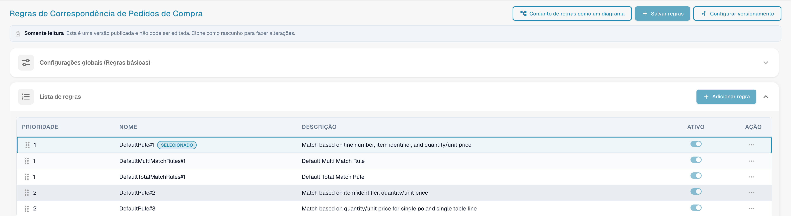
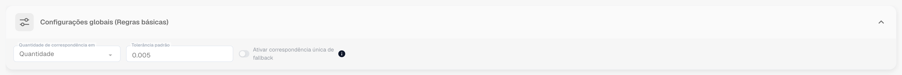
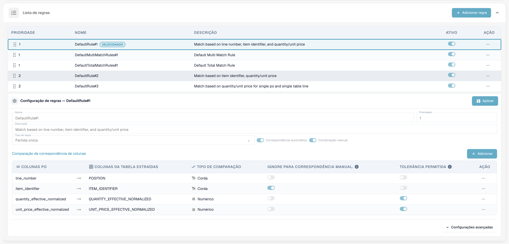
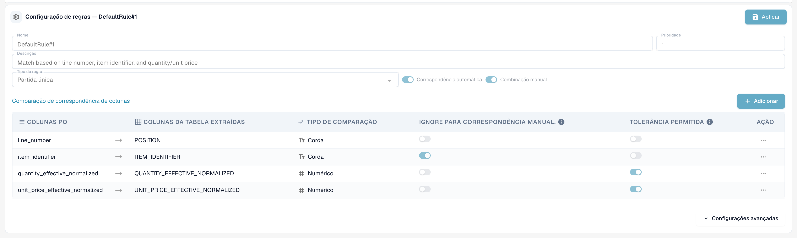
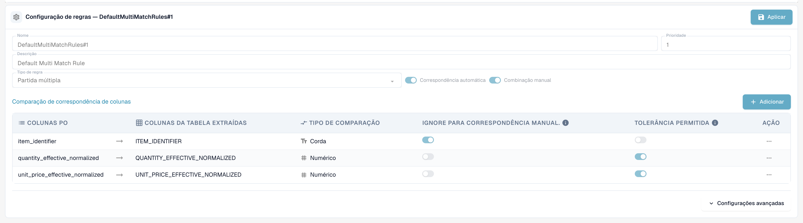
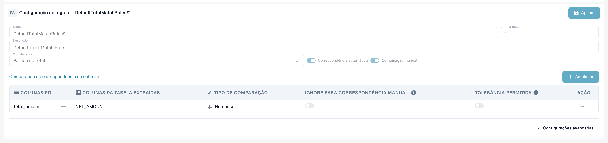
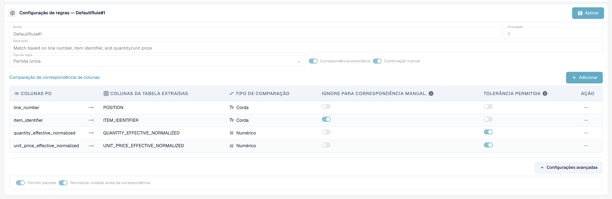
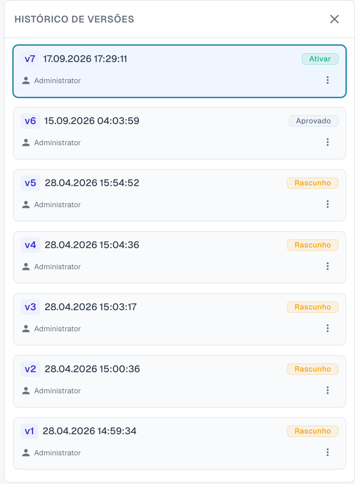

# Regras de Correspondência de Pedido de Compra

## Introdução: Pedidos de Compra e Gestão de Regras de PO

A Correspondência de Pedido de Compra (PO) é um processo crítico para garantir a consistência entre os Pedidos de Compra (POs) e as faturas ou recibos de mercadorias correspondentes. Um conjunto robusto de regras é essencial para alcançar uma alta taxa de correspondência automática, prevenir fraudes e garantir pagamentos corretos.

Esta página de configuração é usada para definir e gerenciar as regras que determinam _como_ os itens das linhas do PO são correspondidos ao documento de entrada correspondente (Fatura, Confirmação de Pedido).


**Pré-requisito:** as regras de correspondência são usadas apenas quando **PO corresponde ao lado do servidor** está ativado para o tipo de documento (Configurações → Tipos de documentos → Mais configurações → Ordem de compra). Com o interruptor desligado, o DocBits faz a correspondência com seu mecanismo interno (quantidade, preço unitário, número do item, número do pedido de compra) e ignora o conjunto de regras.


***

## Como Acessar

1. Navegue até **Configurações** → **Configurações globais** → **Tipos de documentos**, selecione o tipo de documento e clique em **Mais configurações**.
2. No cartão **Ordem de compra**, ative **PO corresponde ao lado do servidor**.
3. Clique em **Configurar regras de correspondência de pedidos de compra** ao lado do interruptor.

<figure><figcaption>
O cartão Ordem de compra. <strong>Configurar regras de correspondência de pedidos de compra</strong> fica ao lado de <strong>PO corresponde ao lado do servidor</strong>.
</figcaption></figure>

## A página em resumo

<figure><figcaption>
A página de Regras de Correspondência de Pedido de Compra.
</figcaption></figure>

A página tem três botões no topo:

* **Conjunto de regras como um diagrama** abre um fluxograma do conjunto de regras ativo. Veja Conjunto de regras como um diagrama.
* **Salvar regras** salva suas alterações no rascunho que você está editando.
* **Configurar versionamento** abre o histórico de versões. Veja Versões e rascunhos.

Abaixo dos botões, um aviso **Somente leitura** aparece quando você visualiza uma versão publicada: *Esta é uma versão publicada e não pode ser editada. Clone como rascunho para fazer alterações.* Abaixo dele vêm o cartão **Configurações globais (Regras básicas)** e a **Lista de regras**. Selecione uma regra na lista para configurá-la na área **Configuração de regras** abaixo da lista.

***

## Configurações globais (Regras básicas)

Estas configurações estabelecem a estrutura que se aplica a todas as regras de correspondência:

<figure><figcaption>
O cartão Configurações globais (Regras básicas), aberto.
</figcaption></figure>

* **Configuração:** Quantidade de correspondência em
  * **Objetivo:** Define qual quantidade da linha do pedido de compra é comparada com a linha do documento — por exemplo, a quantidade pedida ou a **quantidade em aberto na fatura** (pedido menos já faturado), que é a escolha usual para faturas.
  * **Valores Válidos:** Quantidade ou outros campos de quantidade disponíveis no sistema, dependendo da estrutura dos dados (por exemplo, um campo alternativo de quantidade normalizada).
  * **Dependência:** Determina a base para todas as regras de correspondência que incluem quantidade em seus critérios de comparação.
* **Configuração:** Tolerância padrão
  * **Objetivo:** Define o quanto um valor numérico no documento pode se desviar do valor do pedido de compra e ainda ser considerado uma correspondência. Compensa diferenças de arredondamento. Aplica-se a **todas as colunas numéricas** com "Tolerância permitida" ativada — quantidade e preço unitário.
  * **Valor Válido:** Um número decimal. Se é interpretado como um **valor absoluto** (0.005 = uma variação de até 0.005 na quantidade ou preço comparado) ou como uma **percentagem** (0.5 = 0,5 % do valor comparado) é definido pelo **tipo de tolerância** do conjunto de regras (`value` ou `percent`; novos conjuntos de regras usam `value`). Tolerâncias por item (veja [Configurações de Tolerância](purchase-order-tolerance-settings-additional-purchase-order-tolerance.md)) substituem a tolerância padrão para aquele item.
  * **Dependência:** Aplica-se a regras que usam campos numéricos para correspondência e têm a opção "Tolerância permitida" ativada.
* **Configuração:** Ativar correspondência única de fallback
  * **Objetivo:** Quando ativada, a última linha do pedido de compra ainda não correspondida é correspondida automaticamente, mesmo que o número do comprovante de embalagem seja diferente. A correspondência é sinalizada como incompatibilidade para a sua revisão.
  * **Valores Válidos:** Ligado ou desligado. O padrão é desligado.

***

## Lista de regras

A Lista de regras exibe todas as regras de correspondência disponíveis e gerencia sua ordem de execução.

<figure><figcaption>
A Lista de regras. A regra escolhida é marcada como <strong>Selecionado</strong>. Uma regra pode ser desligada com seu interruptor <strong>Ativo</strong>.
</figcaption></figure>

#### Estrutura e Execução

* **Prioridade:** Este campo numérico (ex.: 1, 2, 3) dita a sequência de execução das regras. Regras com número de prioridade menor são tentadas primeiro. Isso permite que os administradores estruturem uma hierarquia, normalmente começando pelas regras mais específicas e rigorosas (ex.: correspondência por número de linha e número da peça) e recuando para regras mais amplas ou menos restritivas.
* **Nome & Descrição:** Fornece identificação clara e contexto para a regra, explicando os critérios principais usados (ex.: "Regra Padrão Nº 1: Correspondência baseada em Número da Linha, ID do Item e Quantidade").
* **Ativo:** Um simples interruptor que permite ativar ou desativar instantaneamente a regra sem precisar excluir sua configuração.

**Fluxo de Execução:** O sistema realiza a correspondência em sequência cascata. Se uma regra (ex.: Prioridade 1) corresponder com sucesso a um item da linha, o processo para aquele item é interrompido. Se nenhuma correspondência for encontrada, o sistema passa para a próxima regra na sequência de prioridade (ex.: Prioridade 2). Cada execução é registrada no documento; o **Histórico de correspondência** na tela de Correspondência de Pedido de Compra mostra qual regra foi tentada, qual correspondeu e quais foram puladas e por quê.

***

## Configuração de regras (Configurações Detalhadas)

Esta área detalhada de configuração define a lógica e os critérios específicos para uma regra individual.

<figure><figcaption>
A área Configuração de regras para uma regra de partida única. <strong>Aplicar</strong> mantém suas alterações no rascunho.
</figcaption></figure>

#### Parâmetros Base

* **Tipo de regra:** Especifica a cardinalidade da correspondência.

| Tipo de regra | O que faz | Uso típico |
| ------------- | --------- | ---------- |
| **Partida única** | Uma linha do pedido de compra para uma linha do documento. Todas as colunas configuradas devem concordar (dentro da tolerância onde permitida). | O caso padrão. |
| **Partida múltipla** | Várias linhas do pedido de compra para uma linha do documento, ou várias linhas do documento para uma linha do pedido de compra. As quantidades são **somadas**, o preço unitário é comparado como uma **média**, as outras colunas devem concordar. | Entregas parciais, uma linha de fatura que cobre várias linhas do pedido. |
| **Partida no total** | Compara um **valor** — geralmente o valor líquido da linha do documento contra o **total** do pedido de compra — e corresponde ao pedido de compra inteiro de uma só vez. | Fornecedores que faturam um valor global, faturas de serviço, faturas de uma linha. |

<figure><figcaption>
Uma regra de partida múltipla compara o identificador do item, a quantidade somada e o preço unitário médio.
</figcaption></figure>

<figure><figcaption>
Uma regra de partida no total compara um valor, aqui o valor líquido com o total do pedido de compra.
</figcaption></figure>

* **Correspondência automática:** Se ativada, o sistema tentará aplicar esta regra de forma totalmente automática. É necessária alta confiança nos critérios para o processamento automático.
* **Combinação manual:** Se ativada, esta regra pode ser apresentada ou aplicada por um usuário durante a etapa de reconciliação manual, oferecendo um conjunto predefinido de critérios de comparação para resolver exceções.
* **Cair pra trás:** Uma regra marcada como fallback é executada em uma fase posterior, apenas para os pares de linhas que ainda não foram correspondidos depois que todas as regras regulares foram executadas. Use-a para a regra "mais flexível", que deve capturar o que as regras rigorosas deixaram passar.

#### Condições de ativação

Uma regra pode conter **condições de ativação** — expressões que devem ser verdadeiras antes que a regra seja executada. Se uma condição for falsa, a regra é **ignorada para este documento** (o histórico de correspondência a mostra como "não executada" com o motivo). As expressões usam as contagens das linhas que estão sendo correspondidas:

| Expressão | Significado |
| --------- | ----------- |
| `[[count(po_lines)]]` | número de linhas do pedido de compra disponíveis para correspondência |
| `[[count(table_lines)]]` | número de itens de linha no documento que estão mapeados para correspondência |

Compare-as com `==`, `!=`, `>`, `>=`, `<`, `<=` e combine várias condições com `&` (e). Exemplos:

* `([[count(po_lines)]] > 1) & ([[count(table_lines)]] > 1)` — somente para documentos com várias linhas em ambos os lados (típico para uma regra de partida múltipla).
* `([[count(po_lines)]] == 1) & ([[count(table_lines)]] == 1)` — somente para documentos de uma linha contra um pedido de uma linha.
* `([[count(po_lines)]] >= 1) & ([[count(table_lines)]] >= 1)` — sempre que houver algo para corresponder.


As condições de ativação são o motivo mais comum pelo qual uma regra "não faz nada". Uma regra de partida no total com a condição `[[count(table_lines)]] > 1` nunca é executada para uma fatura de uma linha — e uma [regra de transformação](../../transformation-rules.md) que reduz a fatura a uma única linha de total produz exatamente esse tipo de documento. Verifique as contagens no histórico de correspondência antes de alterar a própria regra.


#### Comparação de Colunas (Critérios de Correspondência)

Esta é a definição central da lógica da regra, especificando quais campos devem coincidir entre os documentos.

1. Definindo as Colunas a Comparar:
   * **Colunas do PO:** O campo extraído dos dados do Pedido de Compra (ex.: número da linha).
   * **Colunas da Tabela Extraída:** O campo correspondente extraído ou analisado do documento de entrada (Fatura/Confirmação de Pedido) (ex.: `POSITION`).
2. **Tipo de Comparação:** Define a natureza da correspondência exigida (ex.: Tt para comparação de Texto/String, exigindo correspondência exata caractere por caractere; # para comparação Numérica).
3. **Tolerância permitida:** Para campos numéricos (quantidade, preço), ativar esta opção instrui o sistema a aplicar a Tolerância padrão global definida anteriormente. Se _não_ estiver ativada para um campo numérico, os valores devem corresponder exatamente.
4. **Ignore para correspondência manual:** Se marcado, este critério é relaxado durante a intervenção manual. Isso é útil para campos como descrições ou referências internas que podem variar ligeiramente, permitindo que o usuário ignore pequenas discrepâncias não críticas.

**Quais colunas podem ser comparadas**

| Coluna | Lado do documento | Lado do pedido de compra | Nota |
| ------ | ----------------- | ------------------------ | ---- |
| Número da linha | `POSITION` | `line_number` | Texto, exato. Útil somente quando o fornecedor imprime os números das linhas do pedido no documento. |
| Identificador do item | `ITEM_IDENTIFIER` | `item_identifier` | Texto, exato. Número do item ou número do item do fornecedor, também por meio do [Mapa de Números de Itens do Fornecedor](supplier-item-number-map-admin-documentation.md). |
| Quantidade normalizada efetiva | `QUANTITY_EFFECTIVE_NORMALIZED` | `quantity_effective_normalized` | Numérico. A quantidade selecionada em **Quantidade de correspondência em**, convertida para a mesma unidade em ambos os lados (conversão de código de unidade, quantidades "por"). |
| Preço unitário normalizado efetivo | `UNIT_PRICE_EFFECTIVE_NORMALIZED` | `unit_price_effective_normalized` | Numérico. O preço por unidade individual após descontos e após **Preço unitário por** — e, se [Calcular preço unitário do pedido de compra](calculate-po-unit-price.md) estiver ativado, o preço calculado a partir do valor e da quantidade da linha do pedido. |
| Valor líquido | `NET_AMOUNT` | `total_amount` | Numérico. Usado por regras de partida no total. |

**Exemplo: Regra Rigorosa de Correspondência de PO (`DefaultRule#1`)**

Uma regra rigorosa típica combina verificações obrigatórias de identidade com verificações de valor:

* **Identidade Obrigatória:** Número da Linha e Identificador do Item devem corresponder exatamente (Comparação de Texto, sem tolerância).
* **Verificações de Valor:** Quantidade Normalizada Efetiva e Preço Unitário Normalizado Efetivo devem corresponder (Comparação Numérica, Tolerância Permitida). Somente se todos os quatro critérios forem atendidos (com tolerância para os valores) é executada uma correspondência automática.

***

#### Configurações avançadas

Clique em **Configurações avançadas** sob a tabela de colunas para abrir mais duas opções da regra.

<figure><figcaption>
Configurações avançadas de uma regra.
</figcaption></figure>

* **Permitir pacotes:** Permite que a regra corresponda linhas em que a quantidade e o preço unitário diferem por um tamanho de pacote. Os tamanhos de pacote padrão são 10, 20, 100 e 1000. O DocBits ajusta então a quantidade e o preço unitário do documento pelo tamanho do pacote antes de compará-los. Esta é a etapa **Package criteria** de cada estágio no diagrama de regras.
* **Normalizar unidade antes da correspondência:** Converte a unidade de medida de ambos os lados para a mesma unidade antes de a quantidade ser comparada. Está ativada por padrão.

***

## Conjunto de regras como um diagrama

**Conjunto de regras como um diagrama** abre um painel ao lado das regras. Ele mostra as regras da versão ativa como um fluxograma, para que você veja em que ordem o DocBits as tenta e onde a correspondência termina.

<figure><figcaption>
O conjunto de regras como um diagrama.
</figcaption></figure>

O DocBits percorre cinco estágios, de cima para baixo. Cada estágio tem até três passagens: **Exact match for all rules**, **Tolerance-based match** e **Package criteria**. A primeira passagem que encontra uma correspondência encerra o processo (seta verde). Se uma passagem não encontra correspondência, o DocBits continua com a próxima (seta vermelha).

| Estágio | O que faz |
| ------- | --------- |
| 1. Single match validation | Aplica as regras de partida única na ordem de prioridade. |
| 2. Multi match validation | É executado após a partida única, para várias linhas em um dos lados. |
| 3. Total match validation | É executado somente quando nada foi correspondido. Compara o total do pedido de compra com a soma das linhas da tabela. |
| 4. Single mismatch validation | Aplica novamente as regras de partida única, ignorando o preço unitário. |
| 5. Fallback logic | Emparelha a última linha do pedido de compra com a última linha da tabela quando resta exatamente uma linha em cada lado. |

Sob o gráfico, o painel lista as regras de cada estágio por prioridade, com as colunas que cada regra compara. Uma nota no topo informa de onde vêm as tolerâncias: do conjunto de regras ou, quando `CUSTOM_RANGE_FOR_PO_TOLERANCE` está ativado, das [configurações do tipo de documento](purchase-order-tolerance-settings-additional-purchase-order-tolerance.md).

<figure><figcaption>
Sob o gráfico: as regras de cada estágio com as colunas que elas comparam, a tolerância e as opções Correspondência automática, Combinação manual e Cair pra trás.
</figcaption></figure>

***

## O conjunto de regras padrão

Toda organização começa com o mesmo conjunto de regras padrão. Ele é uma boa referência quando você constrói o seu próprio:

| Regra | Tipo / prioridade | Colunas comparadas | Condição de ativação |
| ----- | ----------------- | ------------------ | -------------------- |
| `DefaultRule#1` | partida única, prioridade 1 | número da linha, identificador do item, quantidade (tol.), preço unitário (tol.) | sempre |
| `DefaultMultiMatchRules#1` | partida múltipla, prioridade 1, fallback | identificador do item, quantidade (tol.), preço unitário (tol.) | `count(po_lines) > 1` e `count(table_lines) > 1` |
| `DefaultTotalMatchRules#1` | partida no total, prioridade 1 | valor líquido ↔ total do pedido de compra (sem tolerância) | `count(po_lines) >= 1` e `count(table_lines) > 1` |
| `DefaultRule#2` | partida única, prioridade 2, fallback | identificador do item, quantidade (tol.), preço unitário (tol.) | sempre |
| `DefaultRule#3` | partida única, prioridade 2, fallback | quantidade (tol.), preço unitário (tol.) | `count(po_lines) == 1` e `count(table_lines) == 1` |

Lendo de cima para baixo: primeiro a regra rigorosa (o número da linha e o item devem estar impressos no documento), depois os fallbacks sem o número da linha e, por fim, um último recurso para documentos de uma linha que compara apenas quantidade e preço.

***

## Impacto no Processo de Correspondência de PO

O conjunto de regras definido governa diretamente a eficiência e a integridade do fluxo de trabalho de correspondência de PO:

* **Priorização e Fallbacks:** A Prioridade definida garante que o sistema tente primeiro o método de correspondência mais confiável. Se as regras rigorosas e de alta prioridade falharem, o sistema recua para regras mais amplas, com o objetivo de minimizar o número de exceções encaminhadas aos usuários.
* **Controle da Qualidade da Correspondência:** Regras mais rigorosas (exigindo correspondências mais exatas e menos tolerância) resultam em menos correspondências automáticas, porém altamente confiáveis. Regras mais flexíveis aumentam a taxa de correspondência automática, mas elevam o risco de falsos positivos.
* **Tratamento de Exceções (Correspondência Manual):** Ao ativar regras para a Correspondência Manual, o sistema oferece opções estruturadas aos usuários. Se uma transação falhar nos critérios de correspondência automática, ela se torna uma exceção. O usuário pode então tentar resolver a exceção aplicando uma regra manual predefinida, que pode ter critérios relaxados (ex.: ignorar uma pequena discrepância de texto conforme a configuração "Ignore para correspondência manual").

## O que mais influencia o resultado

* **Quando a correspondência é executada:** durante o processamento do documento, quando um usuário clica em **Correspondência automática de PO**, e **a cada salvamento** em que o número do pedido de compra mudou ou nunca foi consultado antes (por exemplo, quando os dados mestres o preencheram após o processamento). Um salvamento nunca sobrescreve uma correspondência que já existe.
* [**Regras de transformação**](../../transformation-rules.md) são executadas antes da correspondência e podem alterar os itens de linha — e com eles as contagens de linhas que as condições de ativação observam. Uma regra de tabela que reconstrói as linhas mantém uma correspondência existente enquanto as linhas permanecerem as mesmas; se substituir linhas correspondidas, a correspondência é descartada e o nome da regra é mostrado como motivo.
* [**Calcular preço unitário do pedido de compra**](calculate-po-unit-price.md) altera qual preço unitário as regras comparam no lado do pedido de compra.
* [**Configurações de tolerância**](purchase-order-tolerance-settings-additional-purchase-order-tolerance.md) e [**status desativados**](purchase-order-disable-statuses.md) decidem quão rigorosa é a comparação e quais linhas do pedido de compra são oferecidas.

## Solução de Problemas

| Sintoma | O que verificar |
| ------- | --------------- |
| "Sem correspondência" embora todos os valores concordem | Abra o histórico de correspondência: qual regra foi executada, em qual coluna ela falhou (o desvio é mostrado por coluna), a regra foi ignorada por uma condição de ativação? |
| Preço unitário subestimado exatamente pela taxa de imposto | O total do pedido de compra inclui imposto; ative [Calcular preço unitário do pedido de compra](calculate-po-unit-price.md) (valor líquido primeiro) ou compare o valor líquido da linha. |
| Uma regra de partida no total nunca é executada | A condição de ativação dela exige mais de uma linha no documento. Defina `[[count(table_lines)]] >= 1` ou não reduza as linhas com uma regra de transformação. |
| O conjunto de regras não tem efeito algum | **PO corresponde ao lado do servidor** está desligado para o tipo de documento, ou o conjunto de regras alterado ainda é um rascunho — ative a versão. |

***

## Versões e rascunhos

As regras de correspondência são versionadas. Você só pode editar um **rascunho**, e uma versão publicada só pode ser visualizada. Clique em **Configurar versionamento** para abrir o **Histórico de versões**.

<figure><figcaption>
O Histórico de versões com todas as versões do conjunto de regras.
</figcaption></figure>

Cada versão mostra seu número, a data e a hora e seu status, por exemplo **Rascunho** ou **Aprovado**. O menu de uma versão oferece as ações disponíveis para ela. Para alterar o conjunto de regras padrão, clone-o primeiro: abra **Configurar versionamento** e escolha **Clonar como rascunho** nas opções do cartão da versão. Edite o rascunho, clique em **Aplicar** em cada regra alterada e em **Salvar regras**. As regras alteradas entram em vigor quando a versão é ativada.
