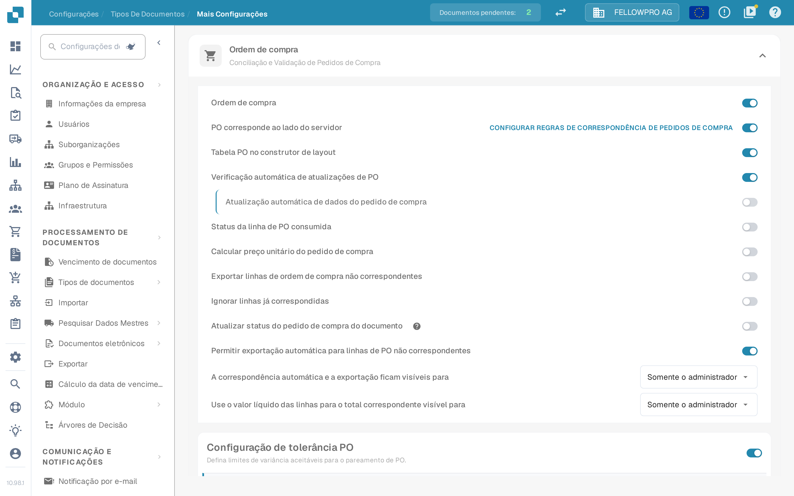

# Ordem de compra

## Visão Geral

Esta configuração ativa a seção [**Correspondência de Ordem de Compra**](../../../../../../end-user-and-partner-section/end-user-section/purchase-order-matching/), que se torna acessível após a validação do documento.

<mark style="color:red;">**Nota**</mark>: Para o tipo de documento **Fatura**, os seguintes requisitos adicionais devem ser atendidos:

* A configuração de **Ordem de Compra** deve estar habilitada (conforme descrito nesta página)
* A fatura deve ser do tipo **Fatura de Compra**
* Uma **Tabela Extraída** deve estar presente

## Etapas de Ativação 

1. Vá para **Configurações** -> **Configurações globais** -> **Tipos de documentos**
2.  Localize o cartão do tipo de documento e abra as respetivas definições com a engrenagem (**Mais configurações**).
3.  Abra a secção **Ordem de compra** e ative **Ordem de compra**.

<figure><figcaption>
A secção <strong>Ordem de compra</strong> nas definições avançadas. O primeiro interruptor ativa a conciliação de ordens de compra para o tipo de documento; os seguintes afinam-na.
</figcaption></figure>

## **Funcionalidade**

Uma vez ativada, a seção [**Correspondência de Ordem de Compra**](../../../../../../end-user-and-partner-section/end-user-section/purchase-order-matching/) torna-se disponível após a validação do documento.

### Que quantidade é comparada

A quantidade da ordem de compra comparada pela conciliação depende de **PO corresponde ao lado do servidor**:

* **PO corresponde ao lado do servidor desativado** – junto ao interruptor **Ordem de compra** aparece uma lista com **Quantidade**, **Quantidade Recebida** e **Quantidade de entrega aberta recebida**. O DocBits compara a quantidade escolhida com o seu próprio motor de conciliação.
* **PO corresponde ao lado do servidor ativado** – a conciliação segue as regras do tipo de documento e a quantidade faz parte dessas regras. A ligação **Configurar regras de correspondência de pedidos de compra**, à direita da linha, abre as regras.


A captura foi feita com **PO corresponde ao lado do servidor** ativado, por isso a lista de quantidade não aparece nesse ecrã: define-se nas regras de conciliação.

