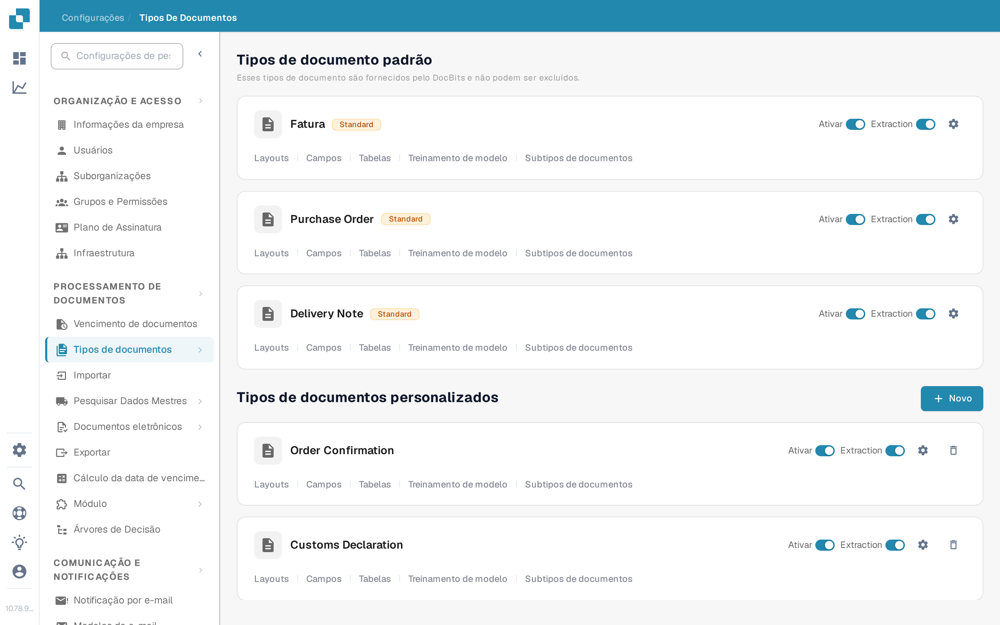
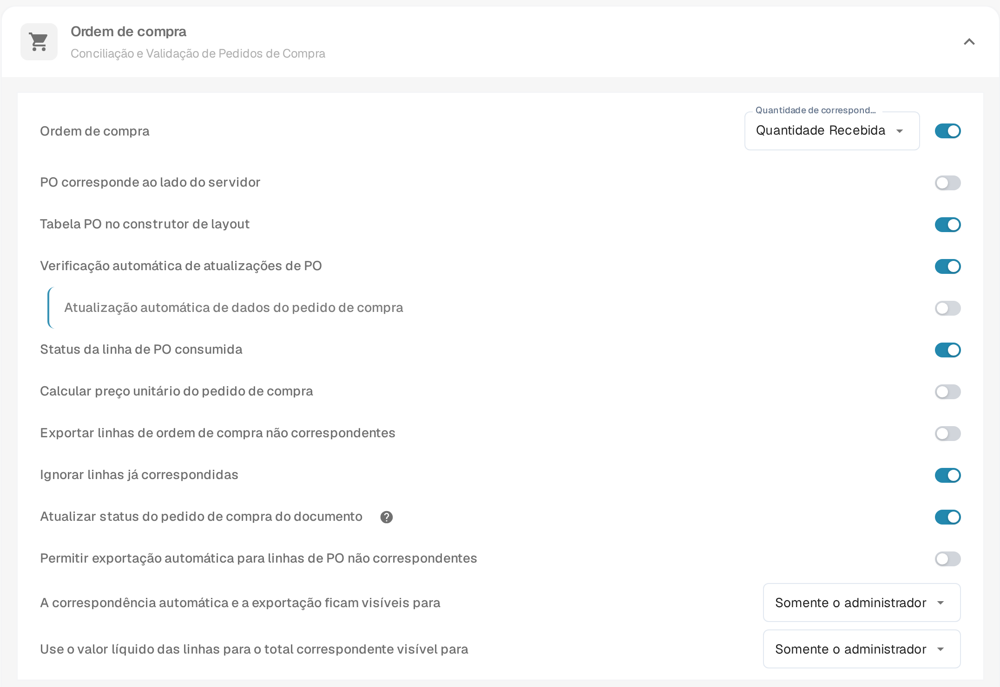
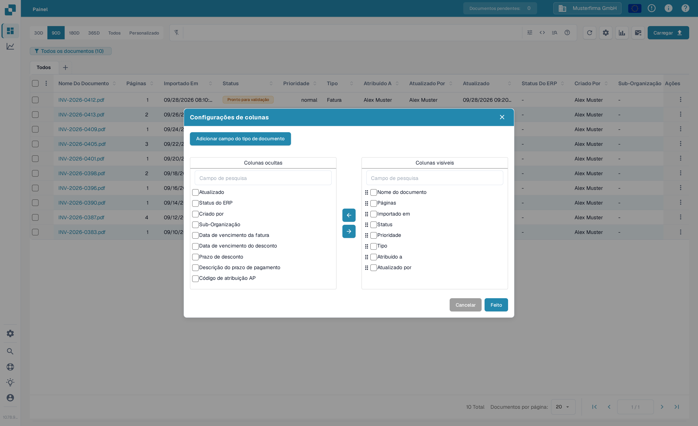
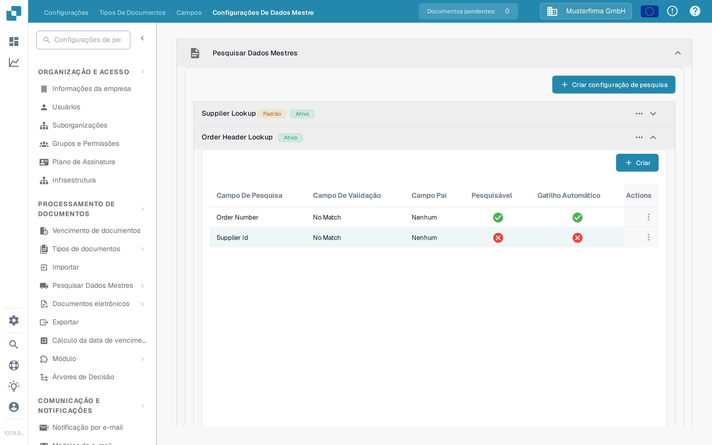

# Atualizar o Status do Pedido de Compra do Documento

Essa configuração é para tipos de documento que usam pedidos de compra. Ela controla se um documento pode receber atualizações de status a partir do pedido de compra vinculado. O interruptor é configurado por tipo de documento. Para ver um status de PO no painel, o campo relevante também precisa estar disponível e visível como coluna.

Antes de alterar a configuração, escolha a organização e o tipo de documento corretos. Você precisa de acesso de administrador para editar as configurações do tipo de documento. Um pedido de compra precisa estar vinculado a um documento antes que uma mudança de status possa ser verificada.

## Ativar a configuração

1. Abra **Configurações → Processamento de Documentos → Tipos de Documentos**.
2. Encontre o tipo de documento usado para os documentos vinculados a POs, por exemplo **Fatura**, e selecione a engrenagem no cartão dele para abrir **Mais Configurações**.
3. Expanda **Ordem de compra**. Encontre **Atualizar status do pedido de compra do documento** e ative-o. O ícone de ajuda próximo explica a opção na aplicação. Alterar esse interruptor não altera as outras configurações de PO na mesma seção.

<figure><figcaption>Abra as configurações do tipo de documento que você usa.</figcaption></figure>

<figure><figcaption>O interruptor de atualização de status nas configurações de Ordem de compra.</figcaption></figure>

## Mostrar um status de PO no painel

1. Volte ao painel e selecione a engrenagem acima da tabela de documentos.
2. Abra **Configurações de colunas** no menu de configurações avançadas.
3. Selecione **Adicionar campo do tipo de documento**, escolha o tipo de documento e pesquise o campo de status da PO. Se esse campo estiver disponível, selecione-o, escolha **Adicionar às colunas visíveis** e depois **Concluído**.

O diálogo de colunas contém **Colunas ocultas** e **Colunas visíveis**. Use as setas para mover uma coluna selecionada entre elas. Veja [Modificar as Colunas do Documento](../../../../../../end-user-and-partner-section/end-user-section/dashboard/change-document-columns.md) para o guia completo de colunas. Se o campo de status da PO não existir para o tipo selecionado, peça a um administrador para verificar o campo e a configuração de lookup; apenas o interruptor de exibição não cria um campo ausente.

<figure><figcaption>Escolha quais colunas aparecem no painel.</figcaption></figure>

## Verificar o lookup do pedido de compra

Em **Configurações → Processamento de Documentos → Tipos de Documentos → Campos → Configurações De Dados Mestre**, expanda **Pesquisar Dados Mestres** e depois **Order Header Lookup**. Verifique se o mapeamento necessário do campo de PO existe e se o lookup relevante tem **Gatilho Automático** quando um lookup automático for necessário. A imagem abaixo mostra a lista de configuração; os círculos riscados significam que o Gatilho Automático está desligado para essas linhas de exemplo. Ela não demonstra um status de PO atualizado.

<figure><figcaption>Verifique as linhas reais de lookup do tipo de documento.</figcaption></figure>

Para obter ajuda na configuração de um lookup, veja [Configuração de Dados Fuzzy com Dados Mestres](../../../../../setup/document-types/fuzzy-data-configuration-with-master-data.md).

## Verificar com um documento conhecido

Use um documento já vinculado a um pedido de compra de teste. Altere o status desse pedido de compra pelo seu processo normal, atualize o painel e verifique o documento e o campo de status da PO visível. Se o status não for atualizado, verifique o vínculo de PO do documento, a configuração de lookup e se o campo relevante foi adicionado ao painel. Não conclua que a atualização foi bem-sucedida apenas pelo interruptor.

## Achados de tradução da aplicação

Os termos acima são as etiquetas reais da interface em português, verificados com o executável em sandbox. Alguns termos da aplicação permanecem inconsistentes ou não traduzidos em PT e são reportados aqui, sem correção na documentação:

- Nomes de tipo de documento sem tradução nos cartões: `Purchase Order`, `Order Confirmation`, `Customs Declaration`, `Freight Letter`; cabeçalho de coluna `Extraction`.
- Nomes de lookup sem tradução: `Supplier Lookup`, `Order Header Lookup`, `Order Line Lookup`; valores de status `No Match`; coluna de ações `Actions`.
- Nomenclatura inconsistente na mesma seção: o menu mostra **Tipos De Documentos** e **Ordem de compra**, mas o cartão do tipo e o painel mostram **Fatura** (italiano para "fatura/factura").
