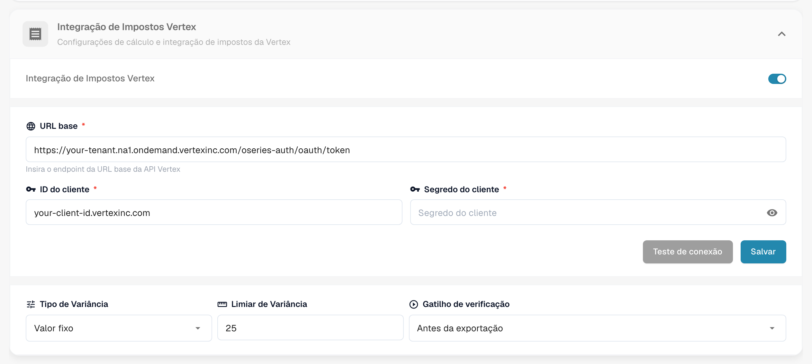
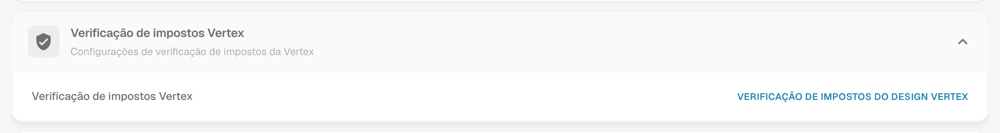
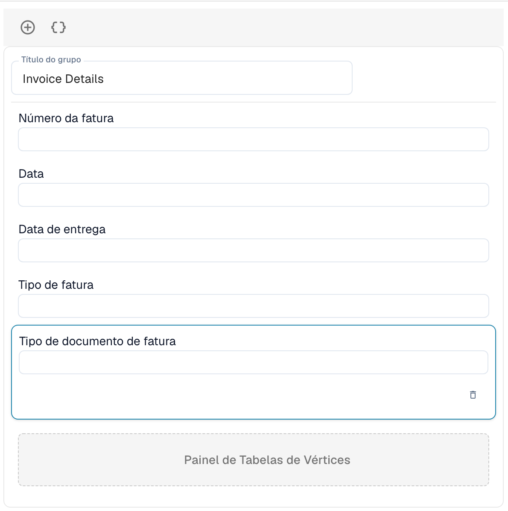

# Verificação de impostos Vertex

A Verificação de impostos Vertex compara o imposto que um fornecedor cobrou em uma fatura com o imposto que a Vertex calcula para as mesmas linhas. O DocBits solicita o cálculo à Vertex, mostra os dois valores ao usuário e interrompe o documento quando o imposto do fornecedor é alto demais.

## Como funciona

1. O documento chega ao ponto de disparo. Você o escolhe nas configurações do módulo: **Antes da exportação** (padrão) ou **Antes da aprovação**.
2. O DocBits envia as linhas da fatura à Vertex e recebe o imposto calculado.
3. O DocBits grava o resultado de volta no documento: o **Valor do Imposto Vertex** e a **Taxa de imposto Vertex** por linha, e os totais do cabeçalho **Imposto sobre o fornecedor** (o imposto cobrado na fatura), **Imposto Vertex**, o subtotal e a **Variância**.
4. O DocBits compara o imposto do fornecedor com o imposto Vertex:

| Situação | Resultado |
| -------- | --------- |
| O imposto do fornecedor é maior que o imposto Vertex em **mais do que o limiar de variância** | O documento é rejeitado. Seu status passa a ser **Imposto Vertex Rejeitado**. |
| O imposto do fornecedor é maior, mas **dentro do limiar** | O documento é aceito. |
| O imposto do fornecedor é igual ao imposto Vertex | O documento é aceito. |
| O imposto do fornecedor é **menor** que o imposto Vertex | O documento é aceito e o valor faltante é provisionado. |

A mensagem de resultado cita os valores, por exemplo: *Rejected: vendor tax $380.00 exceeds Vertex calculated tax $140.00 by $240.00 (171.4%), above configured threshold of $25.00.*

Os usuários abrem o resultado pelo ícone da Vertex na linha do documento no painel. A tela **Verificação de impostos Vertex** mostra um banner (**Verificação falhou** com a mensagem, ou **Verificação concluída com sucesso**), os campos do layout que você desenhou e as tabelas Vertex com o imposto por linha.


A verificação só é executada para tipos de documento que têm uma configuração de exportação do tipo **Vértice**. Sem ela, o documento continua sem verificação.


## Configurar a integração

Abra **Configurações** → **Módulo** → **Ordem e Finanças** e vá ao cartão **Integração de Impostos Vertex**. A página também contém as configurações de correspondência de PO e de contabilização automática.

<figure><figcaption>
O cartão Integração de Impostos Vertex. Nesta captura de tela, os valores de tenant e de cliente foram substituídos por valores de exemplo.
</figcaption></figure>

1. Ative **Integração de Impostos Vertex**. O recurso exige a assinatura de impostos da Vertex.
2. Informe a **URL base** do seu endpoint de token da Vertex, seu **ID do cliente** e seu **Segredo do cliente**.
3. Clique em **Teste de conexão** e depois em **Salvar**.
4. Defina a tolerância e o disparo:
   * **Tipo de Variância:** **Valor fixo** ou **Percentagem**.
   * **Limiar de Variância:** O desvio que ainda é aceito. O padrão é um valor fixo de 25. No modo percentual, informe o valor como decimal, por exemplo 0.05 para 5 %.
   * **Gatilho de verificação:** **Antes da exportação** ou **Antes da aprovação**. Com **Antes da aprovação**, a verificação é executada enquanto o documento é processado, antes de ele seguir para a aprovação. Se a própria verificação falhar, o documento recebe o status **Erro de exportação**.

Em seguida, adicione uma configuração de exportação do tipo **Vértice** para o tipo de documento (**Configurações** → **Exportar**). Ela usa um arquivo de mapeamento TOML.

## Desenhar o formulário de verificação

Os campos que os usuários veem na tela de verificação são desenhados por tipo de documento.

1. Abra **Configurações** → **Configurações globais** → **Tipos de documentos**, selecione o tipo de documento e clique em **Mais configurações**.
2. Abra o cartão **Verificação de impostos Vertex** e clique em **Verificação de impostos do Design Vertex**.

<figure><figcaption>
O cartão Verificação de impostos Vertex.
</figcaption></figure>

O Construtor de layout abre com o tipo de layout **Verificação de impostos Vertex**. Arraste grupos e campos para o formulário, por exemplo **Detalhes da fatura** com número da fatura, data e data de entrega. O **Painel de Tabelas de Vértices** mostra a comparação de impostos e os itens de linha com o imposto Vertex por linha. Ele faz parte do layout.

<figure><figcaption>
Um layout de Verificação de impostos Vertex com o grupo Detalhes da fatura e o Painel de Tabelas de Vértices.
</figcaption></figure>

Para saber como o Construtor de layout funciona, veja o [Layout Manager](../layout-manager/README.md).
