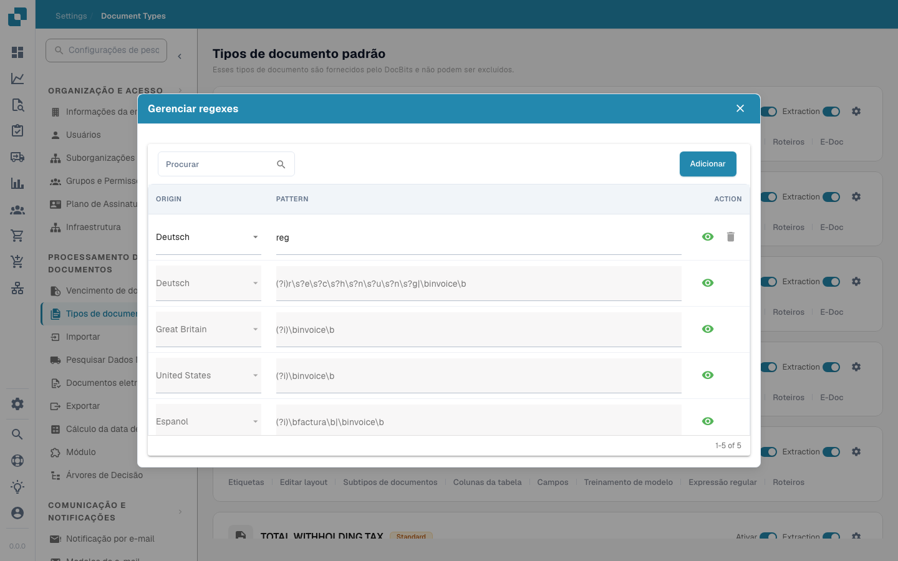

# Expressão Regular

<figure><figcaption></figcaption></figure>

No DocBits, as configurações de Regex permitem que os administradores definam padrões personalizados que o sistema usa para encontrar e extrair dados de documentos. Este recurso é especialmente útil em situações em que os dados precisam ser extraídos de texto não estruturado ou quando os dados seguem um formato previsível que pode ser capturado usando padrões de regex.

#### Principais Recursos e Opções

1. **Gerenciando Regexes**:

* **Adicionar**: Permite que você crie um novo padrão de regex para um tipo de documento específico.
* **Salvar Alterações**: Salva modificações nas configurações de regex existentes.
* **Padrão**: Aqui, você pode definir o padrão de regex que corresponde ao formato de dados específico necessário.
* **Origem**: É a Origem do Documento - Por exemplo, você pode definir um Regex diferente na Alemanha


