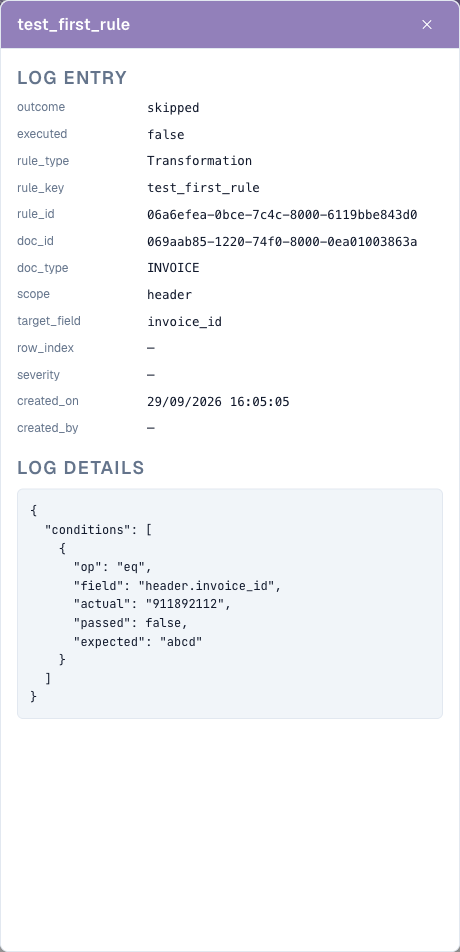

# Condições da Regra (Applies when)

## Visão geral

Toda regra nos recursos de regras do DocBits tem uma seção **Applies when**. Ela decide **para quais documentos (e, nas regras de tabela, para quais linhas) a regra faz alguma coisa**. A tarefa real da regra — gerar um erro de validação, alterar um valor, escolher um layout — só acontece quando a condição é verdadeira.

O mesmo construtor de condições é usado nos três recursos de regras:

| Recurso | Rótulo no construtor | Quando a condição é verdadeira… | Quando é falsa… | Quando fica vazia… |
| --- | --- | --- | --- | --- |
| [Regras de Validação Personalizadas](custom-validation-rules.md) | Etapa 2 **Applies when** | a verificação da etapa 3 é executada | a regra é ignorada — sem erro, sem aviso | a verificação é executada em todos os documentos |
| [Regras de Transformação](transformation-rules.md) | Etapa 2 **When it runs** → **Only when…** | o pipeline altera o valor | o valor permanece como está | escolha **Always**: a regra é executada em todos os documentos |
| [Regras de Seleção de Layout](layout-manager/layout-selection-rules.md) | Etapa 2 **Applies when** | o documento recebe o layout desta regra (a primeira correspondência vence) | o DocBits tenta a próxima regra | a regra corresponde a todos os documentos nessa prioridade |

Aprenda uma vez aqui e use em qualquer lugar.


Uma condição apenas decide **se** uma regra se aplica. Ela nunca altera dados e nunca exibe uma mensagem por si só. "O ID fiscal do fornecedor deve estar preenchido" é a **verificação** de uma regra de validação; "somente para faturas alemãs" é a sua **condição**.


## Lendo uma condição

Uma condição se lê como uma frase. O construtor abaixo diz:

> **Se TODAS** as condições a seguir forem verdadeiras: o Document Origin **is** Deutsch, o Total Amount é **greater than** 250 e (**ANY** of: a Currency **is** EUR, a Currency **is empty**).

<figure><figcaption>
Duas condições combinadas com ALL, mais um grupo aninhado combinado com ANY
</figcaption></figure>

Com essa condição, a regra se aplica a:

| Documento | Origem | Valor total | Moeda | Aplica-se? | Por quê |
| --- | --- | --- | --- | --- | --- |
| A | DE | 469.18 | EUR | **sim** | as três partes são verdadeiras |
| B | DE | 469.18 | *(vazia)* | **sim** | o grupo ANY é verdadeiro porque a moeda está vazia |
| C | DE | 120.00 | EUR | não | 120 não é maior que 250 |
| D | DE | 469.18 | USD | não | nenhuma das linhas do grupo ANY é verdadeira |
| E | AT | 469.18 | EUR | não | a origem não é DE |

## Os blocos de construção

### Linhas de condição

Cada linha tem quatro partes:

| Parte | O que é |
| --- | --- |
| **Field** | O valor que é verificado: um atributo do documento, um campo do cabeçalho, uma coluna de tabela ou um caminho JSON. Veja [Campos que você pode usar](#campos-que-voce-pode-usar). |
| **Operator** | Como o valor é comparado — *is*, *contains*, *greater than*, *is empty* … Veja [Operadores](#operadores). |
| **Value** | Com o que o campo é comparado. Oculto para *is empty* / *is not empty*. Para campos com uma lista fixa de valores (origem, status, moeda…), o valor é escolhido em uma lista suspensa. |
| **Aa** | Ignorar maiúsculas/minúsculas. Disponível somente para comparações de texto. Quando ativado, `gmbh` corresponde a `GmbH`. |

Clique em **✕** para remover uma linha.

### ALL e ANY

O seletor no início de um grupo decide como suas linhas são combinadas:

* **All** of the following are true — todas as linhas devem ser verdadeiras (AND).
* **ANY** of the following are true — pelo menos uma linha deve ser verdadeira (OR).

### Grupos aninhados

Clique em **+ Add nested group** para colocar um grupo dentro de um grupo. Um grupo aninhado conta como uma linha do grupo pai, de modo que você pode misturar AND e OR:

* *ALL of*: a origem é DE, **ANY of** (a moeda é EUR, a moeda está vazia)
* *ANY of*: o fornecedor é 10040, **ALL of** (o fornecedor é 20723, o valor total é maior que 1000)

Os grupos podem ser aninhados em quantos níveis você precisar. Mantenha a legibilidade: dois níveis bastam para quase toda regra de negócio.

### Uma condição vazia

Se você não adicionar nenhuma linha, a regra não tem condição e **sempre se aplica** (para regras de layout: corresponde a todos os documentos nessa prioridade). Essa é a escolha certa para regras que devem ser executadas em todo lugar, como "remover os espaços do número da fatura" ou "a quantidade deve ser positiva".

## Campos que você pode usar

Abra a lista suspensa de campos para ver todos os campos, agrupados por sua origem. Digite para filtrar a lista.

<figure><figcaption>
O seletor de campos: primeiro os atributos do documento, depois os campos do cabeçalho do tipo de documento
</figcaption></figure>

### Atributos do documento (`doc.`)

Informações que o DocBits conhece sobre o próprio documento, independentes dos campos extraídos:

| Campo no seletor | Chave | Valores de exemplo | Uso típico |
| --- | --- | --- | --- |
| **Document Origin** | `doc.doc_origin` | `DE`, `AT`, `US` (exibidos como Deutsch, Austria, United States) | regras e layouts específicos de cada país |
| **Extraction Method** | `doc.extraction_method` | `ELECTRONIC_DOCUMENT`, `FELLOW_KV2`, `MANUAL` | tratar faturas eletrônicas (XRechnung, ZUGFeRD) de forma diferente de PDFs digitalizados |
| **Document Status** | `doc.status` | Ready for validation, Pending Approval, Pending second approval … | layouts por etapa do workflow, regras que só valem antes da aprovação |
| **Sub Document Type** | `doc.sub_doc_type` | seus subtipos, p. ex. nota de crédito | regras para um único subtipo |

### Campos do cabeçalho (`header.`)

Todos os campos do tipo de documento, por exemplo **Invoice Number** (`header.invoice_id`), **Supplier ID** (`header.supplier_id`), **Total Amount** (`header.total_amount`), **Currency** (`header.currency`), **Supplier Tax ID** (`header.supplier_tax_id`), **Purchase Order** (`header.purchase_order`). O seletor mostra o rótulo e, entre parênteses, a chave técnica. O valor usado é o valor atual do campo — incluindo as correções feitas por um usuário.

### Colunas de tabela (`row.`)

Colunas da linha atual da tabela, por exemplo `row.QUANTITY` ou `row.ITEM_NUMBER`. Elas aparecem no seletor como **Table columns** somente em regras que são executadas **uma vez por linha**:

* regras de validação com o nível **Table line**
* regras de transformação com o escopo **Table column**

Nessas regras, a condição é verificada **para cada linha separadamente**. Uma linha que não corresponde é ignorada; as demais linhas continuam sendo processadas.

<figure><figcaption>
Uma condição por linha: somente as linhas que têm um número de item são verificadas
</figcaption></figure>

As regras que são executadas uma vez por documento (regras de cabeçalho, regras de tabela inteira, regras de layout) não podem usar campos `row.` — não há uma única linha que elas possam consultar.

### Caminho JSON personalizado (Advanced)

Na parte inferior do seletor, **Advanced → Custom JSON path…** transforma o campo em uma caixa de texto livre marcada com `$path`. Ele lê um valor em qualquer ponto dos dados extraídos do documento, mesmo que não seja um campo do tipo de documento.

<figure><figcaption>
Uma condição com caminho JSON sobre o canal de importação do documento
</figcaption></figure>

* O caminho começa com `$` e usa `.name` para chaves e `[0]` para posições de lista, por exemplo `$.metadata.import_channel` ou `$.shipping.addresses[0].country`.
* Ele deve terminar em um único valor. Um caminho que termina em uma lista ou em um objeto conta como vazio.
* As linhas com caminho JSON oferecem os operadores *is*, *is not*, *matches*, *is empty* e *is not empty*.

Use caminhos JSON com moderação. Eles dependem da estrutura interna dos dados extraídos; um campo do tipo de documento é mais fácil de entender e de manter.

### Onde cada tipo de campo pode ser usado

| | Validação: campo de cabeçalho | Validação: linha de tabela | Validação: tabela inteira | Transformação: cabeçalho / roteamento / linhas de tabela | Transformação: coluna de tabela | Seleção de layout |
| --- | --- | --- | --- | --- | --- | --- |
| Atributos do documento `doc.` | ✓ | ✓ | ✓ | ✓ | ✓ | ✓ |
| Campos de cabeçalho `header.` | ✓ | ✓ | ✓ | ✓ | ✓ | ✓ |
| Colunas de tabela `row.` | – | ✓ | – | – | ✓ | – |
| Caminho JSON `$` | ✓ | ✓ | ✓ | ✓ | ✓ | ✓ |

## Operadores

<figure><figcaption>
Os operadores oferecidos para um campo de texto
</figcaption></figure>

| Operador | Verdadeiro quando… | Valor | Exemplo |
| --- | --- | --- | --- |
| **is** | o campo é igual ao valor | um valor | Supplier ID **is** `20723` |
| **is not** | o campo não é igual ao valor | um valor | Currency **is not** `EUR` |
| **is one of** | o campo é igual a qualquer valor de uma lista | valores separados por vírgulas | Supplier ID **is one of** `10040, 10041, 20723` |
| **contains** | o valor aparece em qualquer parte do campo | texto | Supplier Name **contains** `GmbH` |
| **starts with** | o campo começa com o valor | texto | Invoice Number **starts with** `GS-` |
| **ends with** | o campo termina com o valor | texto | Purchase Order **ends with** `-IT` |
| **matches** | uma expressão regular encontra uma correspondência no campo | expressão regular | Invoice Number **matches** `^INV-\d{6}$` |
| **is empty** | o campo não tem valor (ausente ou apenas espaços) | – | Purchase Order **is empty** |
| **is not empty** | o campo tem um valor | – | Purchase Order **is not empty** |
| **greater than** / **less than** | o campo é um número acima / abaixo do valor | número | Total Amount **greater than** `10000` |
| **greater or equal** / **less or equal** | o mesmo, incluindo o próprio valor | número | Total Amount **less or equal** `250` |

### Quais operadores um campo oferece

A lista se adapta ao tipo do campo:

| Tipo de campo | Operadores |
| --- | --- |
| Texto | todos os operadores |
| Número e valor monetário (Total Amount, Quantity …) | is, is not, greater than, less than, greater or equal, less or equal, is empty, is not empty |
| Campos com lista fixa (Document Origin, Status, Currency …) | is, is not, is one of, is empty, is not empty |
| Data (Invoice Date, Due Date …) | is, is not, is empty, is not empty |
| Sim/Não | is, is not, is empty, is not empty |
| Caminho JSON personalizado | is, is not, matches, is empty, is not empty |


**As datas não podem ser comparadas com *before* ou *after* em uma condição.** "Data de vencimento posterior à data da fatura" ou "data da fatura com mais de 90 dias" pertencem à **verificação** de uma regra de validação (**Compare fields**), não ao *Applies when*.


## Como os valores são comparados

Conhecer estas regras evita a maioria das surpresas:

1. **Os números são comparados como números.** Se ambos os lados parecem números, `250`, `250.00` e `250,00` são iguais. Valores formatados conforme a localidade, como `1.234,56`, são compreendidos.
2. **Todo o resto é comparado como texto, após a remoção dos espaços no início e no fim.** `" EUR "` é `EUR`.
3. **Maiúsculas e minúsculas importam**, a menos que **Aa** (ignorar maiúsculas/minúsculas) esteja ativado.
4. **O vazio é especial.** Um campo ausente ou em branco:
   * é verdadeiro para **is empty** e **is not**,
   * é falso para **is**, **is one of**, **contains**, **starts with**, **ends with**, **matches** e todas as comparações numéricas.


Por causa da regra 4, *Currency **is not** EUR* também é verdadeiro para documentos **sem** moeda. Se não for isso que você quer, adicione uma segunda linha *Currency **is not empty***.



Por causa da regra 1, os valores que parecem números são comparados numericamente mesmo quando são códigos: `007` **is** `7` é verdadeiro. Para códigos em que os zeros à esquerda importam, use **matches** com um padrão como `^007$`.


## Exemplos

**Somente documentos alemães** — `Document Origin` **is** `Deutsch`.

**Somente faturas eletrônicas** — `Extraction Method` **is** `ELECTRONIC_DOCUMENT`. Use **is not** para excluí-las, por exemplo em uma regra que corrige erros de OCR.

**Um grupo de fornecedores** — `Supplier ID` **is one of** `10040, 10041, 20723`.


Para campos cujo valor é escolhido em uma lista suspensa (origem, status, moeda), **is one of** permite escolher apenas uma entrada. Para aceitar várias, crie um grupo **ANY** com uma linha **is** por valor.


**Faturas de alto valor de um fornecedor** — **All of**: `Supplier ID` **is** `20723`, `Total Amount` **greater than** `10000`.

**Faturas sem pedido de compra** — `Purchase Order` **is empty**. Uma condição típica para uma regra de "centro de custo obrigatório".

**Tudo, exceto notas de crédito** — `Invoice Type` **is not** `credit_note` (use os valores que a sua organização armazena no campo).

**Faturas que chegaram por e-mail** — Caminho JSON personalizado `$.metadata.import_channel` **is** `EMAIL`.

**Somente linhas de artigos** (regras de linha de tabela / coluna de tabela) — `row.ITEM_NUMBER` **is not empty**. Linhas de frete ou de desconto sem número de item são ignoradas.

**Segunda etapa de aprovação** (regras de layout na tela de Approval) — `Document Status` **is** `Pending second approval`.

**EUR ou moeda ausente** — **All of**: `Document Origin` **is** `Deutsch`, **ANY of** (`Currency` **is** `EUR`, `Currency` **is empty**). Esta é a condição mostrada no início desta página.

## Testar e depurar uma condição

Cada recurso permite testar uma condição antes de depender dela:

* **Regras de validação** — **Test rule** executa a regra em um documento real. "*Rule skipped — scope not matched*" significa que a condição foi falsa para esse documento. Veja [Test rule](custom-validation-rules.md#test-rule).
* **Regras de transformação** — o **Live preview** tem **Condition values**: digite um valor para cada campo da condição e veja "*Conditions match — rule runs*" ou "*Conditions do not match — rule is skipped*".
* **Regras de seleção de layout** — o painel **Live preview · /resolve** mostra qual regra correspondeu para um documento de exemplo.

### Ler o rastreamento da condição nos logs

Ative **Log execution** em uma regra. Cada avaliação passa então a ser gravada em **Document Types → (tipo de documento) → Logs**. Abra uma entrada: em **Log details**, cada linha de condição é listada com o valor que a regra esperava, o valor que o documento realmente tinha e se a linha passou.

<figure><figcaption>
A entrada de log explica por que a regra foi ignorada: a regra esperava <code>abcd</code>, o documento tinha <code>911892112</code>
</figcaption></figure>

Os logs podem ser pesquisados por **Rule key**, **Rule ID** ou **Document**, e filtrados por tipo de regra, resultado e data. Desative **Log execution** novamente quando terminar — ele grava uma entrada por avaliação, e as regras são executadas a cada salvamento.

## Erros comuns

| Sintoma | Causa | Solução |
| --- | --- | --- |
| A regra nunca se aplica | O valor difere em maiúsculas/minúsculas ou na grafia (`Gmbh` vs `GmbH`) | Ative **Aa** ou copie o valor exatamente do documento |
| A regra se aplica a documentos sem o campo | **is not** é verdadeiro para campos vazios | Adicione *campo* **is not empty** |
| *greater than* nunca corresponde | O campo não é um número, ou é uma data | Use um campo numérico; compare datas em uma verificação de validação |
| A regra se aplica a documentos demais | As linhas foram combinadas com **ANY** em vez de **All** | Verifique o seletor de cada grupo |
| As colunas de tabela não aparecem no seletor | A regra é executada uma vez por documento | Use o nível **Table line** (validação) ou o escopo **Table column** (transformação) |
| A condição funcionou na pré-visualização, mas não no documento | A pré-visualização usou valores que você digitou | Teste com **Test rule** em um documento real ou verifique o rastreamento no log |
