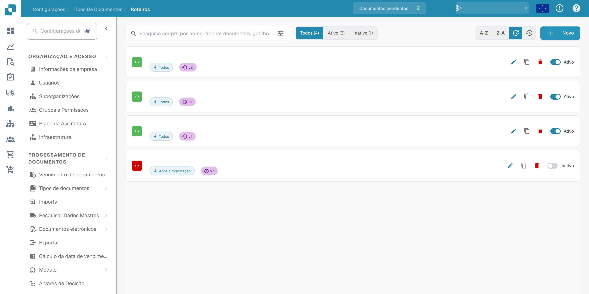
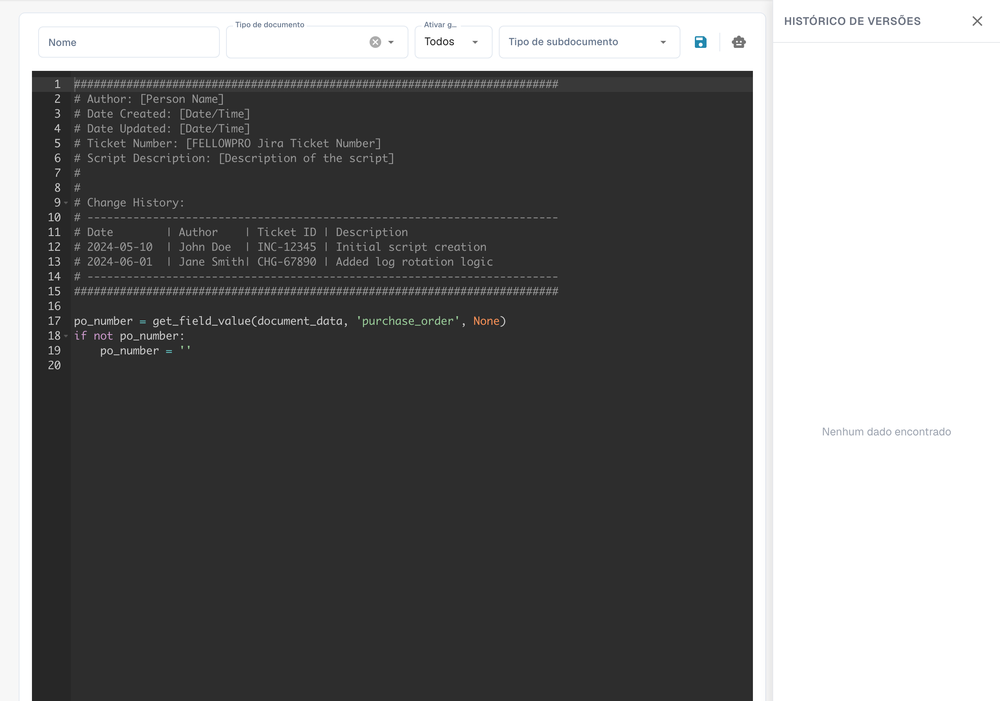

# Criando e Editando Scripts


Scripts de documentos do DocBits: automatizar lógica personalizada no fluxo de trabalho dos documentos


## Para criar um novo script no DocBits, siga estas instruções detalhadas:

**Escolha a linguagem de script:**

Selecione um tipo de script e uma linguagem realmente disponíveis no editor e no ambiente de execução da sua instalação do DocBits. Os tipos disponíveis e os contextos de execução dependem da versão instalada.

**Abra o ambiente de desenvolvimento de script:**

Faça login no DocBits e navegue até o ambiente de desenvolvimento de script. Ele fica na área de administração.

<figure><figcaption><p>Lista de scripts com nomes, datas e dados da organização ocultos.</p></figcaption></figure>

**Crie um novo script:**

Clique no botão "+ Novo" para abrir um novo editor de script.

<figure><figcaption><p>Editor de um novo script com o modelo inicial fornecido; é distinto do exemplo autónomo de Python apresentado abaixo.</p></figcaption></figure>

**Escreva o código:**

Use o editor para escrever o código para o seu script. Comece com a sintaxe básica da linguagem de script escolhida.

Por exemplo, se você estiver usando Python, seu script pode ser assim:

## 1. Exemplo de script em Python


## Função para limpar nomes de pacientes

Este exemplo autónomo de Python ilustra a sintaxe. Não é um ponto de execução do ciclo de vida do DocBits verificado; adapte-o ao contexto de script documentado antes de o utilizar.

```python
def clean_patient_name(name):
    cleaned_name = name.strip().title()
    return cleaned_name

if __name__ == "__main__":
    patient_name = " john doe "
    cleaned_name = clean_patient_name(patient_name)
    print("Cleaned patient name:", cleaned_name)
```

## 2. Exemplo de script


**Teste o script:**

Verifique se há erros no código e teste-o em um ambiente de teste. Certifique-se de que o script produza os resultados esperados e funcione corretamente.


**Salve o script:**

Salve o script no DocBits e dê a ele um nome significativo que descreva o objetivo do script.


**Mapeamento do script para tipos de documento:**

Uma etapa importante é mapear o script para os tipos de documento apropriados. Isso determina quando e como o script é aplicado. Isso geralmente pode ser feito por meio de uma interface de configuração no DocBits, onde você pode atribuir o script a um tipo de documento específico e especificar sob quais condições ele deve ser aplicado.


**Revisão e publicação:**

Depois de criar, testar e mapear o script, verifique-o novamente em busca de erros e inconsistências. Se tudo estiver OK, você poderá publicar o script no ambiente de produção do DocBits.


Por meio dessas etapas, você pode criar, testar e implementar com sucesso um novo script no DocBits para automatizar processos e melhorar a eficiência da documentação médica.
