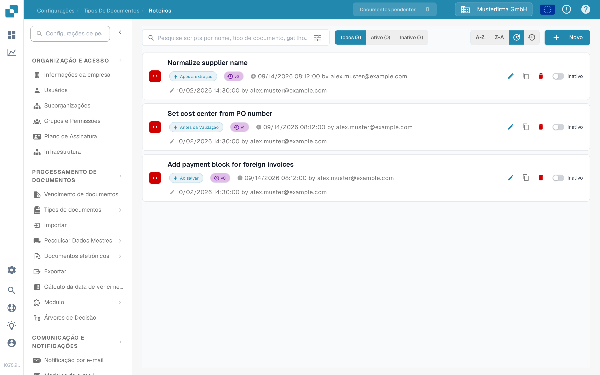
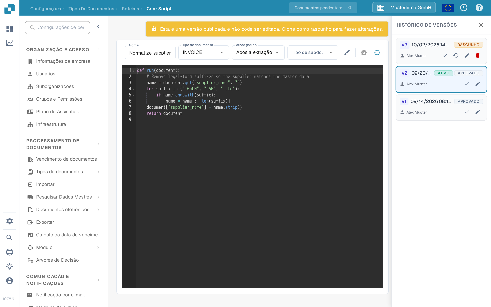
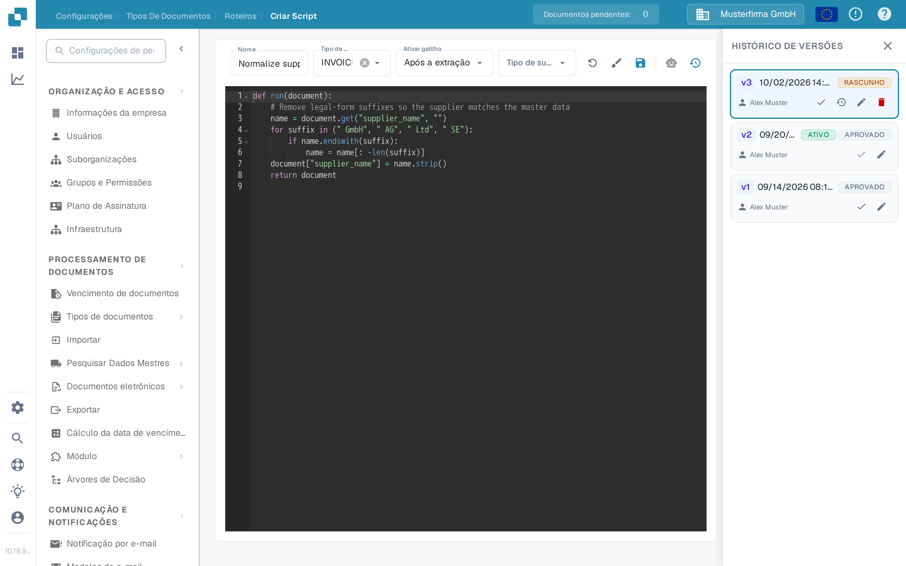

# Ativação e Gestão de Scripts

Os administradores podem usar **Scripts** para gerir regras de processamento de um tipo de documento. Este guia mostra onde encontrar scripts, como ativá-los ou desativá-los e como alterar um script publicado com segurança.

## Encontrar um script

1. Abra **Configurações → Tipos de Documentos**.
2. No tipo de documento que pretende gerir, selecione **Roteiros**. A página lista os scripts desse tipo de documento.
3. Pesquise pelo nome ou use **Todos**, **Ativo** e **Inativo** para limitar a lista. Também pode ordená-la por nome ou data de modificação.

Cada cartão mostra o nome do script, o gatilho, a versão e o estado. O ícone de lápis abre o editor; o ícone de cópia duplica o script. **Novo** abre o editor para um novo script.

<figure><figcaption>
Verifique o estado à direita do cartão do script antes de o alterar.
</figcaption></figure>

## Ativar ou desativar um script

Use o interruptor **Ativo/Inativo** no cartão do script. A alteração é guardada imediatamente; os contadores da lista atualizam-se para mostrar o resultado. Um script inativo continua disponível para consulta ou edição, mas não é executado durante o processamento de documentos.

**Verifique o estado depois de criar um script.** Na interface atual do Sandbox, ao guardar um novo script foi criada uma versão ativa e o cartão foi definido como **Ativo**. Coloque o interruptor em **Inativo** se for apenas um rascunho ou um exemplo de teste.

## Alterar um script existente

1. Selecione o cartão do script ou o seu ícone de lápis. Uma versão publicada é somente leitura, pelo que não pode escrever diretamente sobre ela.
2. Em **Histórico de Versões**, selecione o ícone de lápis da versão que pretende alterar. Isto cria um **Rascunho** com base nessa versão.
3. Edite o rascunho e selecione o ícone de guardar. Reveja o nome, o tipo de documento, o gatilho e o código antes de guardar.
4. Teste o script alterado com documentos representativos num ambiente de teste. Quando estiver pronto, selecione o ícone de verificação do rascunho no **Histórico de Versões** para tornar essa versão ativa.
5. Regresse à lista de scripts e verifique o interruptor **Ativo/Inativo** do cartão. A versão marcada como **ATIVO** no Histórico de Versões identifica a versão selecionada; o interruptor do cartão controla se o script é executado.

<figure><figcaption>
Uma versão publicada não pode ser editada diretamente. Use o lápis no Histórico de Versões para criar um rascunho.
</figcaption></figure>

<figure><figcaption>
Guarde e verifique o rascunho antes de o tornar a versão ativa.
</figcaption></figure>

Para exemplos de scripts e funções disponíveis, consulte [Scripting no DocBits](scripting-in-docbits/README.md).
