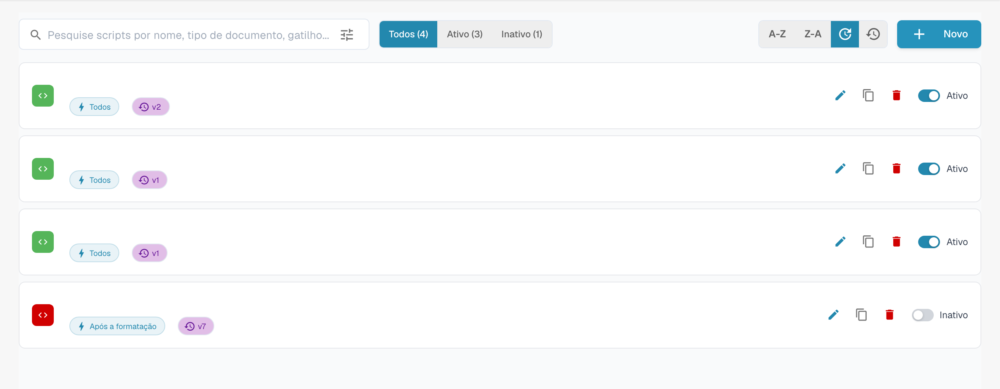

# Ativar e gerir scripts

## Vídeo tutorial: gerir roteiros


Gerir os roteiros de um tipo de documento


O vídeo mostra a lista de roteiros com filtro e ordenação, a ativação e desativação, a cópia, o histórico de versões e a eliminação com confirmação.

Abra o tipo de documento e a gestão de scripts. A lista mostra scripts e ações de edição, cópia e estado. Os nomes estão ocultos no exemplo.

<figure><figcaption>
Gestão de scripts e ações de edição; nomes ocultos.
</figcaption></figure>

Filtre por estado ou pesquise o script pretendido antes de o abrir. Verifique o tipo de documento, o momento da execução e o código antes de guardar.

As ações disponíveis dependem das suas permissões. Teste as alterações pretendidas com documentos representativos antes de as utilizar num fluxo real.
