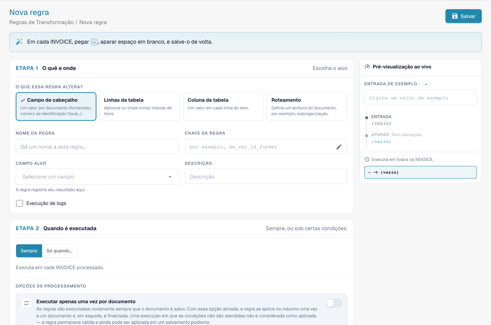
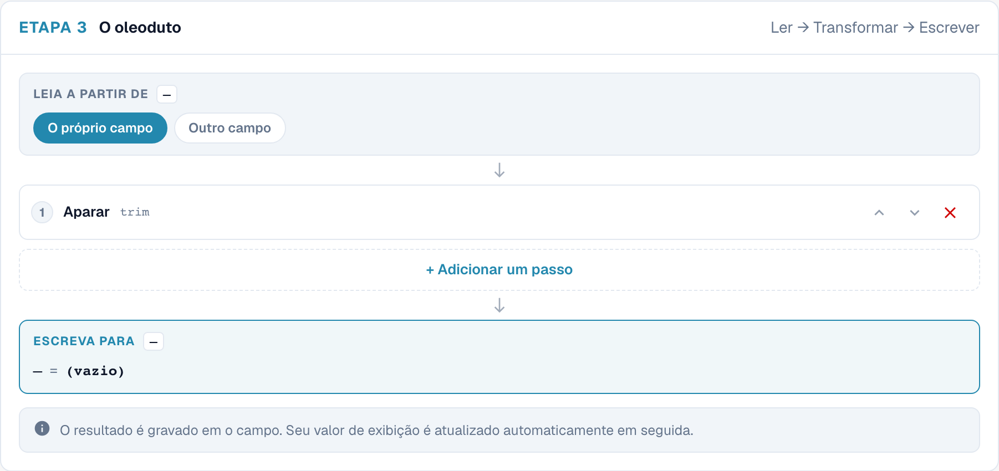
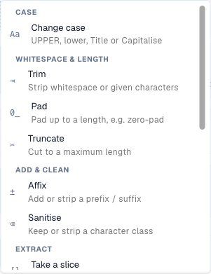
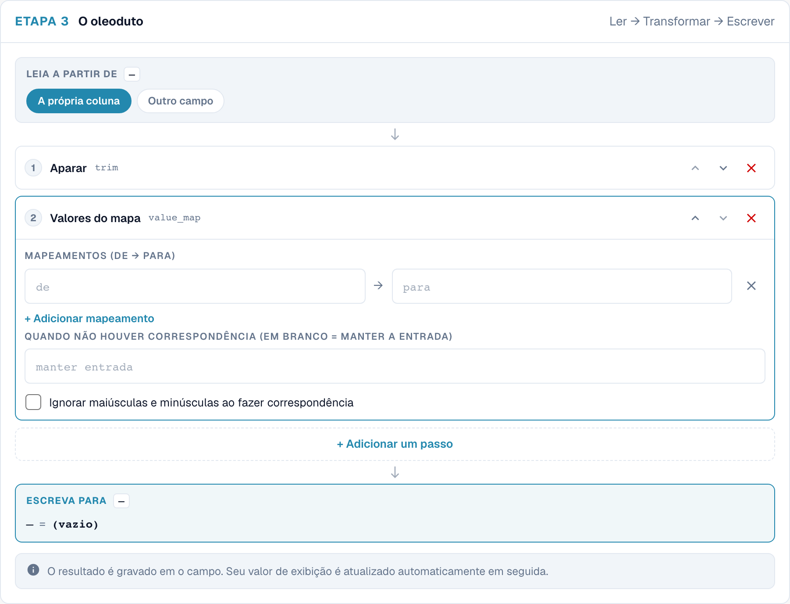
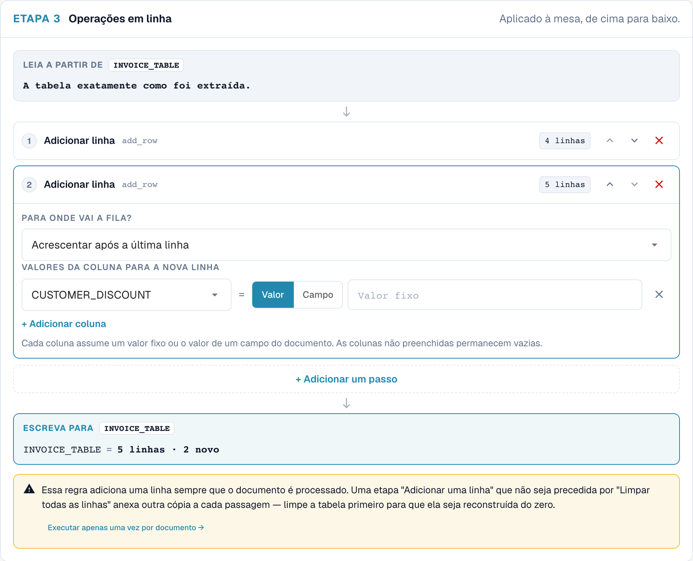
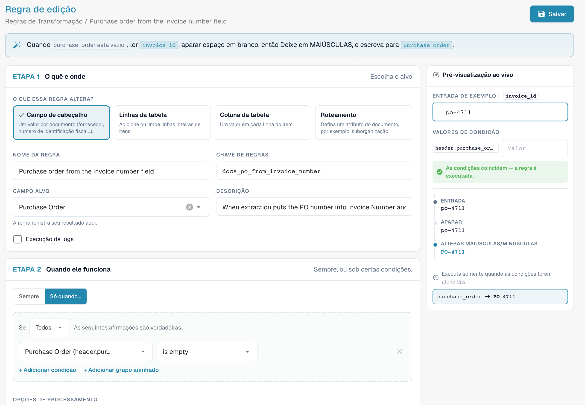
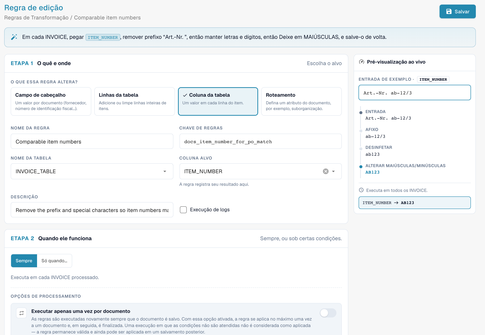

# Regras de transformação



## Visão geral

As regras de transformação limpam ou reescrevem os dados extraídos **automaticamente**, toda vez que um documento é processado e toda vez que é salvo. Uma regra pode alterar:

* um **campo de cabeçalho** (número da fatura, moeda, ID fiscal do fornecedor …),
* uma **coluna** em cada linha de uma tabela (unidade, número do item, base de preço …),
* as **linhas** de uma tabela (limpá-las, adicionar uma linha),
* um **atributo do documento** — atualmente a suborganização à qual ele pertence (**Roteamento**).

Cada regra **lê** um valor, passa-o por um curto **pipeline** de etapas e **grava** o resultado de volta. As regras são executadas **antes** da validação, dos scripts e da correspondência de pedidos de compra, de modo que tudo o que vem depois já enxerga os valores corrigidos.

As regras de transformação substituem a maioria dos pequenos scripts que as organizações costumavam escrever para "sempre aparar este campo", "mapear os códigos de unidade deste fornecedor", "adicionar o prefixo que o nosso ERP espera" ou "agrupar as linhas deste fornecedor em uma única linha de total" — com um formulário, uma pré-visualização ao vivo e sem código.

### Problemas que elas resolvem

| Requisito | Regra |
| --- | --- |
| Um fornecedor imprime o número da fatura sem o prefixo `INV-` que o nosso ERP espera | Campo de cabeçalho *Invoice Number*, somente para esse fornecedor: Aparar → UPPERCASE → Afixo: adicionar prefixo `INV-` |
| Os fornecedores enviam códigos de unidade alemães (`STK`, `Std`) e o ERP espera códigos UN/ECE (`PCE`, `HUR`) | Coluna de tabela *UNIT*: Map values `STK → PCE`, `KG → KGM`, `Std → HUR` |
| Os números de item vêm com um prefixo como `Art.-Nr. 4711` | Coluna de tabela *ITEM_NUMBER*: Afixo: remover prefixo `Art.-Nr. ` |
| Os IDs fiscais contêm espaços e pontos | Campo de cabeçalho *Supplier Tax ID*: Desinfetar, manter alfanumérico |
| Um fornecedor é correspondido pelo total, não pelas linhas | Linhas da tabela: Clear all rows → Add a row com o valor líquido |
| Todos os documentos de determinados fornecedores pertencem a uma suborganização | Routing: definir a suborganização quando *Supplier ID is one of …* |
| As datas devem ser gravadas em um formato fixo em um campo de texto livre | Campo de cabeçalho: Reformat date `%d.%m.%Y` |
| O número do pedido de compra está no campo errado (por exemplo, em *Invoice Number*) | Campo de cabeçalho *Purchase Order*: Read from *Invoice Number*, somente quando *Purchase Order is empty* |
| O número do pedido de compra tem zeros à esquerda ou um prefixo que o pedido de compra não tem | Campo de cabeçalho *Purchase Order*: Aparar `0` à esquerda ou Afixo: remover prefixo |
| Os números de item diferem das linhas do pedido de compra em maiúsculas/minúsculas, espaços ou prefixos | Coluna de tabela *ITEM_NUMBER*: Afixo: remover prefixo → Desinfetar → UPPERCASE |

## Ativar as regras de transformação

As regras de transformação são ativadas **por tipo de documento** por um **administrador da organização**.

1. Acesse **Settings → Global Settings → Document Types**.
2. Clique no ícone de **configurações** (engrenagem) no cartão do tipo de documento.
3. Abra **Regras de Transformação** e ative o botão. Clique em **Gerenciar regras de transformação** para abrir a lista.

<figure><figcaption>
O botão Transformation Rules nas configurações adicionais de um tipo de documento
</figcaption></figure>

O cartão do tipo de documento agora exibe um link **Regras de Transformação** e um link **Registros** para os logs de execução.

## A lista de regras

A lista mostra todas as regras do tipo de documento na ordem em que são executadas, cada uma com um resumo de uma frase ("When invoice_id is abcd, take invoice_id, make it UPPERCASE, and save it back."), seu escopo (**Cabeçalho**, **Tabela**, **Coluna**, **Roteamento**), o número de etapas, sua origem e se **Execução de logs** está ativado. Filtre por escopo e por **Active / Inactive**, pesquise e use o menu **⋮** para duplicar ou excluir uma regra.

As regras vêm de três origens, como as regras de validação: regras **Padrão do sistema** fornecidas com o DocBits (clique em **Personalizar** para obter uma cópia editável), regras do sistema **Personalizado** (**Restaurar padrões de fábrica** restaura o original) e regras **Personalizado** que você criou.

## Criar uma regra

Clique em **Nova regra**. O construtor tem três etapas à esquerda e uma **Pré-visualização ao vivo** à direita. No topo, ele resume a regra em uma frase enquanto você a constrói.

<figure><figcaption>
Âmbito da transformação: cabeçalho, linhas da tabela, coluna e encaminhamento.
</figcaption></figure>

### Etapa 1 — O quê e onde

**O que essa regra altera?** — o escopo:

| Escopo | Altera | Destino | Executa |
| --- | --- | --- | --- |
| **Campo de cabeçalho** | um valor por documento | um campo de cabeçalho, por exemplo *Invoice Number* | uma vez por documento |
| **Linhas da tabela** | linhas inteiras de itens — limpá-las ou adicionar linhas | uma tabela, por exemplo `INVOICE_TABLE` | uma vez por documento |
| **Coluna da tabela** | um valor em cada linha de itens | uma tabela e uma coluna, por exemplo `INVOICE_TABLE` / `UNIT` | uma vez por linha |
| **Roteamento** | um atributo do documento — atualmente a suborganização | *suborganização* | uma vez por documento |

Depois, informe o **Nome da regra** (a **Chave de regras** é gerada a partir dele), escolha o **Campo alvo** / **Nome da tabela** / **Coluna alvo** e, opcionalmente, uma **Descrição**. **Execução de logs** grava uma entrada de log por aplicação — útil enquanto você ajusta uma regra.

### Etapa 2 — Quando ele funciona

* **Sempre** — a regra é executada em todos os documentos do tipo.
* **Só quando…** — a regra é executada somente se uma condição for verdadeira, por exemplo *Supplier ID is HP0000278*. Para regras de **Coluna da tabela**, a condição pode usar as colunas da linha atual e é verificada linha por linha. Consulte [Condições da regra (Applies when)](rule-conditions-applies-when.md) para ver todos os campos, operadores e exemplos.

Duas opções controlam com que frequência a regra se aplica:

| Opção | Efeito |
| --- | --- |
| **Executar apenas uma vez por documento** | Normalmente, as regras são executadas novamente a cada salvamento. Com esta opção ativada, a regra se aplica **no máximo uma vez** a um documento e depois termina com ele. Uma passagem em que as condições não correspondem não conta, portanto a regra ainda pode se aplicar em um salvamento posterior. Necessário para etapas que alterariam o valor novamente a cada salvamento (consulte [Idempotência](#execucao-unica-e-idempotencia)) e para regras de tabela que não devem reconstruir as linhas novamente. |
| **Run after lookup population (before PO match)** | *(versões mais recentes)* Executa a regra em uma passagem adicional depois que os dados de consulta (por exemplo, dados mestres do fornecedor) foram preenchidos e antes da correspondência de pedidos de compra. Use quando a regra precisar de um valor fornecido por uma consulta. A regra continua sendo executada também nas etapas habituais; uma regra de execução única com esta opção aguarda esta passagem em vez de ser executada logo após a extração. |

### Etapa 3 — O pipeline

<figure><figcaption>
Etapas de uma regra de transformação. O oleoduto representa a sequência de transformação, não uma conduta de petróleo.
</figcaption></figure>

* **Leia a partir de** — **o próprio campo (ou coluna)** ou **outro campo**. Ler de outro campo permite preencher um campo a partir de um diferente, por exemplo copiar o número do pedido de compra de um campo de texto livre.
* **Passos** — o valor passa pelas etapas **de cima para baixo**; a saída de uma etapa é a entrada da próxima. Adicione etapas com **+ Add a step**, reordene-as com as setas e remova-as com **✕**. Cada etapa mostra à direita o valor intermediário da amostra.
* **Escreva para** — o destino da etapa 1. O DocBits grava o valor armazenado e depois atualiza automaticamente o valor exibido.

### As etapas

<figure><figcaption>
Todas as etapas, agrupadas por finalidade
</figcaption></figure>

| Etapa | Configurações | Exemplo de entrada → saída |
| --- | --- | --- |
| **Alterar maiúsculas/minúsculas** (Change case) | UPPERCASE, lowercase, Title Case, Capitalise first | `inv-4711` → `INV-4711` |
| **Aparar** (Trim) | lado (ambos, esquerdo, direito); caracteres (vazio = espaço em branco) | `  4711 ` → `4711`; com o caractere `0` e lado esquerdo: `004711` → `4711` |
| **Almofada** | comprimento, caractere de preenchimento, lado | comprimento 10, `0`, esquerda: `4711` → `0000004711` |
| **Truncar** | comprimento máximo | 10: `ABCDEFGHIJKL` → `ABCDEFGHIJ` |
| **Afixo** (Affix) | adicionar prefixo, adicionar sufixo, remover prefixo, remover sufixo; texto | adicionar prefixo `INV-`: `4711` → `INV-4711`; remover prefixo `Art.-Nr. `: `Art.-Nr. 4711` → `4711` |
| **Desinfetar** (Sanitise) | manter somente (alfanumérico, letras, dígitos, alfanumérico + espaço) ou remover os caracteres informados | manter alfanumérico: `DE 123.456.789` → `DE123456789` |
| **Selecionar um segmento** | início, comprimento ou fim | início 0, comprimento 4: `2026-09-29` → `2026` |
| **Extrair** | padrão, grupo de captura | padrão `PO[- ]?(\d+)`, grupo 1: `Order PO-45001234` → `45001234` |
| **Localizar e substituir** | padrão, substituir por, quantidade (0 = todas) | padrão `\s+`, substituir por ` `: `ACME    GmbH` → `ACME GmbH` |
| **Mapear valores** | mapeamentos (de → para), valor quando não há correspondência (vazio = manter a entrada), ignorar maiúsculas/minúsculas | `STK → PCE`: `stk` → `PCE` |
| **Data de reformatação** | padrão de saída (`%d.%m.%Y`, `%m/%d/%Y`, `%Y-%m-%d`, `%d %b %Y`) | `%d.%m.%Y`: `2026-09-29` → `29.09.2026` |
| **Formatar número** | localidade (de_DE, en_US, en_GB, fr_FR), mín. e máx. de casas decimais | de_DE, 2 casas decimais: `1234.5` → `1.234,50` |
| **Valor fixo** | o valor | sempre grava o valor, seja qual for o conteúdo do campo |
| **Limpar** | – | esvazia o campo |

As regras de **Linhas da tabela** usam duas etapas diferentes, que trabalham com linhas em vez de valores:

| Etapa | Efeito |
| --- | --- |
| **Limpar todas as linhas** | exclui todas as linhas extraídas. As linhas adicionadas por uma etapa posterior são mantidas. |
| **Add a row** | adiciona uma linha **após a última linha** ou **antes da primeira linha**. Para cada coluna, escolha **Valor** (um valor fixo) ou **Campo** (o valor de um campo de cabeçalho). As colunas que você deixar de fora permanecem vazias. |


**Data de reformatação** espera a data como o DocBits a armazena internamente (`YYYY-MM-DD`). Aplique-a ao próprio campo, não a um texto que já contém uma data formatada.


### Pré-visualização ao vivo

A pré-visualização ao vivo executa a regra em uma amostra enquanto você a constrói:

* **Entrada de exemplo** — digite um valor como ele viria do documento. Para regras de tabela, informe o número de linhas extraídas (**Tabela de exemplo**) e os valores dos campos que as novas linhas leem (**Valores de origem da linha**).
* **Valores de condição** — para regras com condição, digite os valores dos campos da condição. A pré-visualização mostra **As condições coincidem — a regra é executada.** ou **As condições não correspondem — a regra foi ignorada.**.
* Abaixo, você vê o valor após **cada etapa** e o resultado final que seria gravado ("invoice_id → INV-230620-03A" ou "unchanged").

Nada é salvo enquanto você usa a pré-visualização. Clique em **Salvar** para armazenar a regra.

## Exemplos

### Limpar o número da fatura de um fornecedor

Campo de cabeçalho **Número da fatura** · somente quando *Supplier ID is HP0000278* · Aparar → Alterar maiúsculas/minúsculas UPPERCASE → Afixo adicionar prefixo `INV-`.
Amostra `  230620-03a ` → `INV-230620-03A`. Veja a captura de tela do pipeline acima.

### Mapear códigos de unidade

Coluna de tabela **INVOICE_TABLE / UNIT** · sempre · Aparar → Map values `STK → PCE`, `KG → KGM`, `Std → HUR`, **Ignorar maiúsculas e minúsculas ao fazer correspondência** ativado, valor sem correspondência vazio (manter a entrada).

<figure><figcaption>
Mapeamento de valores de uma coluna da tabela. O oleoduto representa a sequência de transformação, não uma conduta de petróleo. Valores do mapa significa mapear valores.
</figcaption></figure>

### Uma linha de total para um fornecedor correspondido pelo total

Linhas da tabela **INVOICE_TABLE** · somente quando *Supplier ID is HP0000278* · Clear all rows → Add a row com `POSITION` = valor `001`, `QUANTITY` = valor `1`, `NET_AMOUNT` = campo *Total Net Amount*.

<figure><figcaption>
Etapa de transformação para adicionar uma linha à tabela, sem guardar. A pergunta sobre a fila indica a posição da nova linha da tabela.
</figcaption></figure>

A ordem importa: **Limpar todas as linhas** deve vir **antes** de **Add a row**. O construtor avisa você caso contrário ("Clear all rows runs after Add a row …") e também avisa se uma etapa **Add a row** não for precedida por **Limpar todas as linhas**, pois a regra acrescentaria outra cópia da linha a cada salvamento. Combine esta regra com uma regra de correspondência de pedidos de compra por total que esteja ativa para documentos de uma linha.

### Preencher o pedido de compra a partir do campo do número da fatura

Campo de cabeçalho **Ordem de compra** · somente quando *Purchase Order is empty* · **Leia a partir de** *Invoice Number* → Aparar → Alterar maiúsculas/minúsculas UPPERCASE.

<figure><figcaption>
A regra e sua pré-visualização ao vivo: <code>po-4711</code> vira <code>PO-4711</code> em <code>purchase_order</code>. Regra de exemplo em um tipo de documento de teste.
</figcaption></figure>

Alguns fornecedores imprimem o número do pedido onde a extração espera o número da fatura. Nesse caso, **Número da fatura** contém o número do pedido de compra e **Ordem de compra** fica vazio, e o sistema de correspondência de pedidos de compra não encontra nada para corresponder. Esta regra copia o valor antes de a correspondência começar. Em um teste em um sistema de desenvolvimento, um documento com exatamente esse problema passou de *não correspondido* para *totalmente correspondido* (2 de 2 linhas) ao ser salvo com a regra. A regra só é executada enquanto **Ordem de compra** estiver vazio, portanto nunca sobrescreve um número que foi extraído corretamente.

### Tornar os números de item comparáveis para a correspondência de pedidos de compra

Coluna de tabela **INVOICE_TABLE / ITEM_NUMBER** · sempre · Afixo: remover prefixo `Art.-Nr. ` → Desinfetar: manter alfanumérico → Alterar maiúsculas/minúsculas UPPERCASE.

<figure><figcaption>
A pré-visualização ao vivo mostra cada etapa: <code>Art.-Nr. ab-12/3</code> vira <code>AB123</code>
</figcaption></figure>

Se a fatura traz `Art.-Nr. ab-12/3` e o pedido de compra tem `AB123`, as linhas não correspondem. A regra leva o valor da fatura à forma do pedido de compra. Verifique a forma usada nos seus pedidos de compra e adapte as etapas.

### Mais exemplos

| Objetivo | Escopo | Condição | Etapas |
| --- | --- | --- | --- |
| Remover espaços e pontos do ID fiscal | Cabeçalho *Supplier Tax ID* | sempre | Desinfetar: manter alfanumérico |
| Remover o prefixo do artigo | Coluna *ITEM_NUMBER* | sempre | Afixo: remover prefixo `Art.-Nr. ` |
| Números de fornecedor com 10 dígitos | Cabeçalho *Supplier ID* | sempre | Aparar → Pad comprimento 10 com `0`, esquerda |
| Extrair o número do pedido de compra de um texto de referência | Cabeçalho *Purchase Order*, lido de outro campo | somente quando *Purchase Order is empty* | Extract `PO[- ]?(\d+)`, grupo 1 |
| Sempre usar uma única moeda para um fornecedor | Cabeçalho *Currency* | somente quando *Supplier ID is 10040* | Fix value `CHF` |
| Remover um valor extraído incorretamente | Cabeçalho *Discount Term* | somente quando *Supplier ID is 20723* | Clear |
| Base de preço por unidade | Coluna *UNIT_PRICE_PER* | somente quando *row.UNIT_PRICE_PER is empty* | Fix value `1` |
| Direcionar fornecedores para uma suborganização | Routing | *Supplier ID is one of* `10040, 10041` | atribuir uma suborganização fixa |
| Remover zeros à esquerda do número do pedido de compra | Cabeçalho *Purchase Order* | sempre | Aparar caracteres `0`, lado esquerdo |
| Manter apenas os dígitos do número do pedido de compra | Cabeçalho *Purchase Order* | sempre | Desinfetar: manter somente dígitos (`PO-45001234` → `45001234`) |
| Cortar uma referência de pedido de compra longa demais | Cabeçalho *Purchase Order* | somente quando *Supplier ID is 20723* | Truncate para 10 caracteres |
| Adicionar ao número do pedido de compra o prefixo que o seu ERP espera | Cabeçalho *Purchase Order* | somente quando *Supplier ID is 10040* | Afixo: adicionar prefixo `4500` |
| Gravar os valores no formato que o seu ERP lê | Cabeçalho *Total Amount* | sempre | Format number, localidade `de_DE`, 2 casas decimais |
| Remover espaços dentro dos números de item | Coluna *ITEM_NUMBER* | sempre | Desinfetar: remover os caracteres ` ` (espaço) |
| Usar maiúsculas nos números de item | Coluna *ITEM_NUMBER* | sempre | Alterar maiúsculas/minúsculas UPPERCASE |
| Direcionar os pedidos de compra de uma planta para uma suborganização | Routing | *Purchase Order starts with* `4500` | atribuir uma suborganização fixa |

## Regras de roteamento (suborganização)

Uma regra de **Roteamento** não altera um campo. Ela grava um atributo no documento quando suas condições correspondem — atualmente a **suborganização**. Escolha **Atribua uma suborganização fixa.** e selecione-a na lista, ou **Mapear a partir de um campo** para mapear valores de um campo extraído para suborganizações. O documento passa então a pertencer a essa suborganização, com seus usuários, permissões e configurações. Um valor que não seja uma suborganização válida nunca é gravado.

## Quando as regras são executadas

* **Durante o processamento**, após a extração e antes da consulta de dados mestres, da validação, dos scripts e da correspondência de pedidos de compra.
* Em **cada salvamento** do documento em que os dados extraídos mudaram. As regras sem **Executar apenas uma vez por documento** são aplicadas novamente a cada vez.
* Em uma mesma passagem, as regras são executadas escopo por escopo nesta ordem: **Campo de cabeçalho → Roteamento → Linhas da tabela → Coluna da tabela**. Uma regra de coluna, portanto, também se aplica às linhas que uma regra de tabela acabou de adicionar. Dentro de um escopo, as regras são executadas por prioridade e depois por chave.

### Execução única e idempotência

A maioria das etapas dá o mesmo resultado quando executada sobre a própria saída — aparar um valor já aparado, mapear `PCE` novamente, adicionar um prefixo que já existe. Essas regras podem ser executadas com segurança a cada salvamento.

**Selecionar um segmento**, **Extrair** e **Localizar e substituir** são diferentes: executadas novamente sobre o próprio resultado, elas continuam alterando-o (um corte pega os primeiros quatro caracteres dos primeiros quatro caracteres …). Por isso, o DocBits não permite salvar uma regra que aplique essas etapas ao seu próprio campo de destino. Você pode:

* ativar **Executar apenas uma vez por documento**, ou
* usar **Leia a partir de** com outro campo, para que a entrada permaneça inalterada.

## Regras de transformação e correspondência de pedidos de compra

As regras são executadas **antes** da correspondência de pedidos de compra, portanto podem preparar exatamente o que o sistema de correspondência lê:

| O sistema de correspondência lê | Uma regra pode | Exemplo |
| --- | --- | --- |
| O número do pedido de compra no cabeçalho | copiá-lo de outro campo, extraí-lo de um texto, remover prefixos e zeros à esquerda | [Preencher o pedido de compra a partir do campo do número da fatura](#preencher-o-pedido-de-compra-a-partir-do-campo-do-numero-da-fatura) |
| Os números de item das linhas | remover prefixos, remover caracteres especiais, uniformizar maiúsculas/minúsculas | [Tornar os números de item comparáveis](#tornar-os-numeros-de-item-comparaveis-para-a-correspondencia-de-pedidos-de-compra) |
| Os códigos de unidade | mapear os códigos do fornecedor para os seus | [Mapear códigos de unidade](#mapear-codigos-de-unidade) |
| O número de linhas | reduzir as linhas a uma única linha de total | [Uma linha de total](#uma-linha-de-total-para-um-fornecedor-correspondido-pelo-total) |

As regras de tabela e de coluna alteram o que o sistema de correspondência de pedidos de compra enxerga:

* Uma regra de tabela que **reconstrói** linhas (por exemplo, limpar todas as linhas e adicionar uma linha de total) mantém uma correspondência de pedido de compra existente, desde que produza **as mesmas linhas novamente** — os valores são comparados pelo significado, então `1.0` e `1.00` são a mesma linha. As linhas mantêm sua identidade e a correspondência sobrevive a cada salvamento.
* Se uma regra **substitui ou remove linhas que foram correspondidas**, a correspondência não pode ser mantida. O documento registra então qual regra a descartou, a tela de correspondência de pedidos de compra mostra isso como motivo ("_The PO match could not be saved: the transformation rule "…" rebuilt the table_") e os administradores recebem um link para a regra. O **histórico de correspondência** do documento mostra uma etapa _Transformation rules_ antes da primeira etapa de correspondência, com as regras que foram executadas.
* O número de linhas após as regras é o que as [condições de ativação](more-settings/purchase-order/purchase-order-matching-rules.md#condicoes-de-ativacao) das regras de correspondência contam. Uma regra que reduz uma fatura a **uma** linha só faz sentido junto com uma regra de correspondência por total que esteja ativa para documentos de uma linha (`[[count(table_lines)]] >= 1`).

## Logs

Com **Execução de logs** ativado, cada aplicação da regra é gravada em **Document Types → (tipo de documento) → Logs**, com o resultado (aplicada, sem alteração, ignorada), o documento e — para regras ignoradas — o rastreamento da condição que explica o motivo. Consulte [Ler o rastreamento da condição](rule-conditions-applies-when.md#ler-o-rastreamento-da-condicao-nos-logs).

## Melhores práticas

* **Uma finalidade por regra.** "Limpar o número da fatura" e "Mapear códigos de unidade" são duas regras, não uma.
* **Construa com a pré-visualização ao vivo**, usando valores reais copiados de documentos, inclusive os incomuns (espaços, minúsculas, prefixos).
* **Limite as regras específicas de fornecedor com uma condição** em vez de deixá-las rodar em tudo.
* **Prefira etapas idempotentes.** Use a execução única somente onde precisar.
* **Observe a correspondência do pedido de compra** depois de adicionar regras de tabela; verifique o histórico de correspondência de alguns documentos.
* **Desative Execução de logs** quando a regra estiver funcionando.

## Solução de problemas

| Sintoma | O que verificar |
| --- | --- |
| A regra não alterou nada | Ela está ativa e o recurso está ativado para o tipo de documento? A condição é verdadeira para este documento (valor exato, incluindo espaços e maiúsculas/minúsculas)? Uma regra de **execução única** já foi aplicada ao documento? Verifique o rastreamento no log. |
| O valor muda novamente a cada salvamento | O pipeline contém Take a slice, Extract ou Find & replace. Ative **Executar apenas uma vez por documento** ou use Read from com outro campo. |
| Uma tabela ganha mais uma linha a cada salvamento | Uma etapa **Add a row** sem **Limpar todas as linhas** antes dela. Adicione primeiro a etapa de limpeza ou ative a execução única. |
| A correspondência do pedido de compra é perdida após salvar | Uma regra de tabela substituiu as linhas correspondidas. O motivo no documento nomeia a regra; faça a regra reproduzir as mesmas linhas ou defina-a para execução única. |
| Uma regra de correspondência nunca é executada após a transformação | A regra alterou o número de linhas; ajuste a condição de ativação da regra de correspondência. |
| A regra precisa de um valor dos dados mestres do fornecedor, mas ele ainda está vazio | Ative **Run after lookup population (before PO match)**. |
| Uma data não é reformatada | Reformat date espera `YYYY-MM-DD` como entrada. |

## Relacionado

* [Condições da regra (Applies when)](rule-conditions-applies-when.md) — condições em detalhes
* [Custom Validation Rules](custom-validation-rules.md) — verifique os valores transformados
* [Layout Selection Rules](layout-manager/layout-selection-rules.md) — escolha o layout que um documento usa
* [Purchase Order Matching Rules](more-settings/purchase-order/purchase-order-matching-rules.md)
