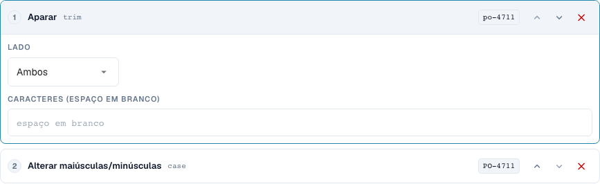
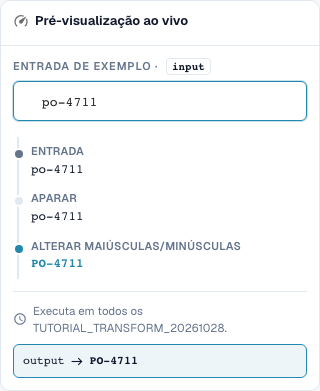
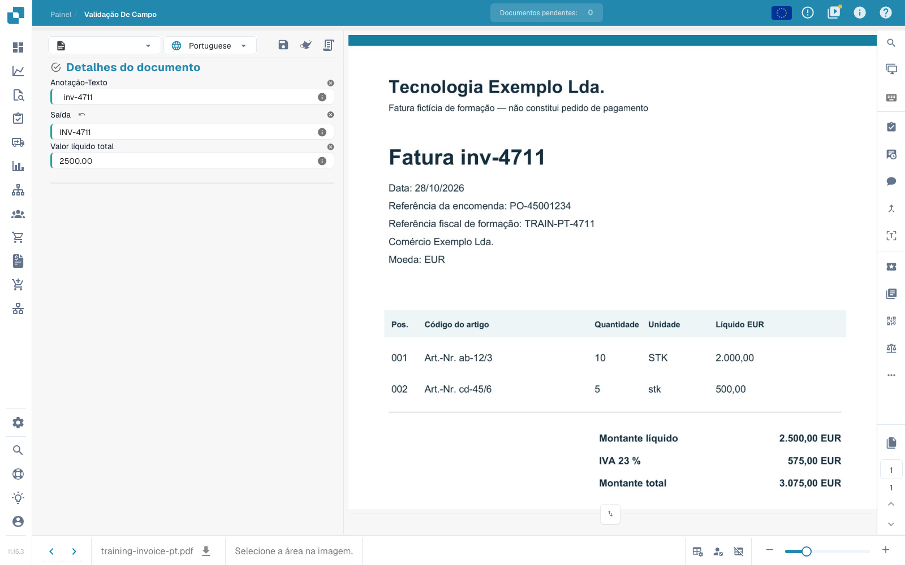

# Fundamentos, Âmbitos de Aplicação e Testes Seguros

[Voltar à visão geral completa da prática](complete-practical-guide.md)

Campo de cabeçalho · Resultado alvo · Origem texto original · Aparar → Maiúsculas → Prefixo INV-.

## Etiquetas visíveis no editor

Algumas etiquetas da interface atual apresentam traduções imprecisas. A tabela indica o texto realmente apresentado para encontrar o passo correto; a explicação funcional utiliza terminologia técnica. As capturas mostram a interface sem alterações.

| Operação | Etiqueta visível |
| --- | --- |
| trim | Aparar |
| case | Alterar maiúsculas/minúsculas |

## Procedimento no editor

1. No tipo de documento de formação isolado, criar uma nova regra para um **campo de cabeçalho**. Como alvo `output` e como origem separada `header.input` escolher; os nomes de campo reais da sua organização podem divergir.
2. Adicionar os passos **Aparar**, lado ambos, caráter em branco e depois **Alterar maiúsculas/minúsculas**, modo upper. A ordem deve ser Aparar → Maiúsculas.
3. Introduzir o valor de teste `  inv-4711  `. O último valor de pré-visualização deve ser `INV-4711`; os valores intermédios mostram primeiro `inv-4711`.
4. Ativar a regra exclusivamente para o âmbito de formação e guardar. Reabrir a entrada e verificar origem, alvo e ambos os passos.
5. Guardar o documento de exercício, recarregar e verificar ambos os campos: A origem contém ainda os espaços originais, a saída é `INV-4711`. Guardar novamente e repetir a mesma verificação.

<figure><figcaption>
Configuração de passos. Interface real em português (Portugal). A pré-visualização não altera documentos armazenados.
</figcaption></figure>


Configuração de passos. Interface real em português (Portugal). A pré-visualização não altera documentos armazenados.


<figure><figcaption>
Pré-visualização em direto com valores de treino. Interface real em português (Portugal). A pré-visualização não altera documentos armazenados.
</figcaption></figure>


Pré-visualização em direto com valores de treino. Interface real em português (Portugal). A pré-visualização não altera documentos armazenados.


## 1. Âmbito de aplicação

Uma transformação altera dados já extraídos. Não substitui o reconhecimento de texto. No editor, escolho primeiro o âmbito de aplicação. Um campo de cabeçalho é processado uma vez por documento. Uma coluna de tabela é processada para cada linha. As regras de tabela alteram posições completas. O encaminhamento atribui o documento a uma suborganização. Estas quatro tarefas têm objetivos diferentes e passos diferentes. Crio os meus exemplos num tipo de documento de teste próprio, para que não sejam alteradas faturas produtivas.

## 2. Origem e processamento

Depois escolho o campo de destino. A origem pode ser esse próprio campo ou outro campo. Os passos executam de cima para baixo. Cada valor intermédio serve como entrada do passo seguinte. O meu exemplo lê um número de fatura, remove espaços exteriores e escreve maiúsculas. De uma letra minúscula passa a ser uma maiúscula. Com uma condição limito a regra ao fornecedor adequado. Numa coluna de tabela, a condição pode também verificar valores da linha atual. Várias condições podem ser combinadas com E, Ou e grupos.

## 3. Verificar o efeito

A pré-visualização em tempo real ainda não guarda nada. Verifico um valor adequado, um caso contrário e um resultado já corrigido. De seguida, guardo a regra, reabro-a e controlo as definições guardadas. Para o efeito real no documento, preciso adicionalmente de um documento de teste, de uma operação de guardar e do resultado recarregado. Uma pré-visualização não comprova nem uma exportação efetuada nem uma reconciliação de encomenda bem-sucedida. Os registos de execução ajudam-me a distinguir condições aplicadas de condições ignoradas. Nos próximos episódios, vamos percorrer as transformações individuais e os seus limites.

## Exemplos verificados e casos contrários

Estes valores foram verificados do lado do servidor como teste seco. Um teste deste tipo não altera documentos guardados.

| Caso | Entrada | Resultado do servidor |
| --- | --- | --- |
| copy | `  po-4711  ` | `PO-4711` |

## Aceitação

Verifique um caso adequado, um caso contrário, um valor vazio e um resultado já processado. Repita a operação de guardar do documento. Verifique também a reconciliação de PO e a receção no ERP, se pertencerem ao objetivo funcional.

## Efeito guardado no documento de exercício

<figure><figcaption>
O valor original preparado mantém-se; a saída mostra INV-4711. Duas operações de guardar nativas, recarregamento e uma consulta separada do servidor confirmam o resultado estável. Isto comprova o efeito da regra sobre valores de teste preparados, não a exatidão de uma extração automática.
</figcaption></figure>


O valor original preparado mantém-se; a saída mostra INV-4711. Duas operações de guardar nativas, recarregamento e uma consulta separada do servidor confirmam o resultado estável. Isto comprova o efeito da regra sobre valores de teste preparados, não a exatidão de uma extração automática.


## Tutorial em vídeo


Configuração, exemplos práticos e casos contrários.


[Abrir o vídeo com legendas em português e capítulos](https://docbits-videos.fra1.cdn.digitaloceanspaces.com/settings-assistant/transformation-rules-01-foundations-preview-admin/v1/pt.html). Esta versão de revisão aguarda a avaliação funcional e uma audição completa.
