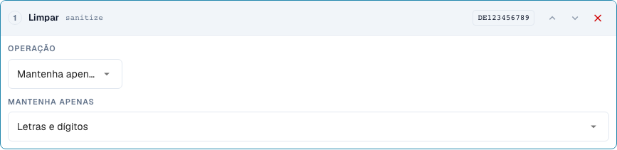
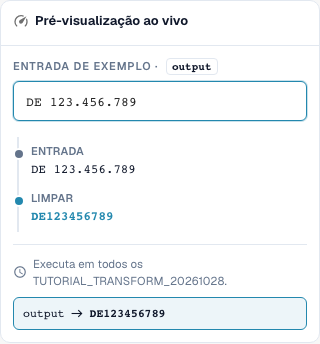

# Limpar texto: Escrita, corte e carateres

[Voltar à visão geral completa da prática](complete-practical-guide.md)

Campo de cabeçalho · Resultado pretendido · Testar passos individualmente: case, trim, sanitize.

## Etiquetas visíveis no editor

Algumas etiquetas da interface atual apresentam traduções imprecisas. A tabela indica o texto realmente apresentado para encontrar o passo correto; a explicação funcional utiliza terminologia técnica. As capturas mostram a interface sem alterações.

| Operação | Etiqueta visível |
| --- | --- |
| case | Alterar maiúsculas/minúsculas |
| trim | Aparar |
| sanitize | Limpar |

## Procedimento no editor

1. Para o campo de cabeçalho de formação, criar um único passo **Alterar maiúsculas/minúsculas**. Verificar os modos upper, lower, title e capitalize sucessivamente com os exemplos da tabela.
2. Para o número de fatura, iniciar uma nova pipeline com **Aparar**. Ambos os lados e um campo de carateres vazio removem o espaço exterior; `47 11` deve manter o seu espaço interior.
3. Como prova de contraste separada no corte, definir lado esquerdo e carater `0`: `004711` torna-se `4711`, `000` torna-se vazio. Não adotar este passo sem verificação para identificadores reais.
4. Num número de identificação fiscal, utilizar **Limpar carateres** com manter alfanumérico. `DE 123.456.789` deve resultar em `DE123456789`. Verificar os restantes modos de retenção com `DE-123` e `ACME GmbH!` respetivamente.
5. Para capitalize, comparar explicitamente pré-visualização e servidor: para o `aCME GMBH` verificado, estes resultados são diferentes. O resultado do servidor é `Acme gmbh`; uma representação adequada no browser por si só não é suficiente.

<figure><figcaption>
Configuração de passos. Interface real em português (Portugal). A pré-visualização não altera documentos armazenados.
</figcaption></figure>


Configuração de passos. Interface real em português (Portugal). A pré-visualização não altera documentos armazenados.


<figure><figcaption>
Pré-visualização em direto com valores de treino. Interface real em português (Portugal). A pré-visualização não altera documentos armazenados.
</figcaption></figure>


Pré-visualização em direto com valores de treino. Interface real em português (Portugal). A pré-visualização não altera documentos armazenados.


## 1. Escrita

A maiúscula uniformiza, por exemplo, um número de fatura. A minúscula pode uniformizar uma chave de comparação técnica. Title Case e a maiúscula do primeiro carater também podem alterar o resto da palavra. De uma abreviatura empresarial pode resultar assim uma outra escrita. Para nomes próprios, utilizo estas variantes apenas com uma especificação funcional clara. No modo Capitalise first existe uma discrepância no estado verificado: a pré-visualização do browser mantém a escrita restante, enquanto o servidor coloca o resto em minúscula. Não confio portanto apenas na pré-visualização, mas comparo explicitamente o valor do servidor.

## 2. Corte

O corte remove carateres nas extremidades. Ambos os lados remove espaços exteriores, mas nenhum espaço no meio de um número. À esquerda com o carater zero remove todos os zeros à esquerda. Um valor que consiste apenas em zeros torna-se vazio. À direita funciona de forma correspondente no final. O campo Carateres é um conjunto de carateres individuais e não um prefixo completo. Um prefixo de artigo fixo remove-se portanto com Affix. Preenchimento e truncagem são tratados na sequência seguinte.

## 3. Limpar carateres

Na limpeza, posso manter apenas letras e algarismos, apenas letras, apenas algarismos ou adicionalmente espaços. Um número de identificação fiscal alemão com espaços e pontos torna-se assim numa chave contínua. Num número de artigo, os hífenes podem ser funcionalmente importantes. A remoção de tais carateres deve corresponder à escrita no sistema de destino. A remoção alternativa de carateres funciona com uma classe de carateres de expressão regular. Um hífen requer nela uma atenção especial. Para o meu exemplo, verifico portanto o valor real do servidor além da pré-visualização. Valores já limpos e entradas vazias devem constar de todos os testes.

## Exemplos verificados e casos de contraste

Estes valores foram verificados do lado do servidor como teste seco. Tal teste não altera documentos guardados.

| Caso | Entrada | Resultado do servidor |
| --- | --- | --- |
| case-upper | `inv-4711` | `INV-4711` |
| case-upper | `INV-4711` | `INV-4711` |
| case-lower | `INFO@BEISPIEL.DE` | `info@beispiel.de` |
| case-title | `acme gmbh` | `Acme Gmbh` |
| case-capitalize | `aCME GMBH` | `Acme gmbh` |
| trim | `  4711  ` | `4711` |
| trim | `47 11` | `47 11` |
| trim-zero | `004711` | `4711` |
| trim-zero | `000` | `` |
| sanitize | `DE 123.456.789` | `DE123456789` |
| sanitize-alpha | `DE-123` | `DE` |
| sanitize-numeric | `DE-123` | `123` |
| sanitize-space | `ACME GmbH!` | `ACME GmbH` |
| sanitize-strip | `ab-12/3.` | `ab123` |

## Aceitação

Verifique um caso adequado, um caso de contraste, um valor vazio e um resultado já processado. Repita a operação de guardar documento. Verifique adicionalmente a reconciliação de PO e a receção no ERP, se pertencerem ao objetivo funcional.

## Tutorial em vídeo


Configuração, exemplos práticos e casos contrários.


[Abrir o vídeo com legendas em português e capítulos](https://docbits-videos.fra1.cdn.digitaloceanspaces.com/settings-assistant/transformation-rules-02-text-cleaning-preview-admin/v1/pt.html). Esta versão de revisão aguarda a avaliação funcional e uma audição completa.
