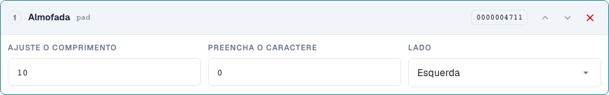
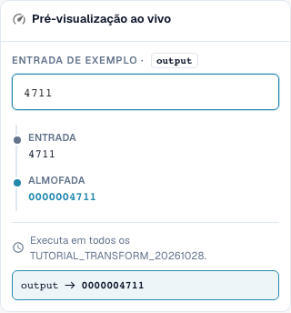

# Formatação de números: Preenchimento, Truncagem, Prefixo e Sufixo

> Limitação conhecida da pré-visualização (verificada em 29 de outubro de 2026, versão 11.15.2): ao adicionar o prefixo `INV-`, a pré-visualização altera incorretamente `INV-4711` para `INV-INV-4711`. O teste independente do servidor mantém `INV-4711`. Verifique também a execução repetida com um teste do servidor; um resultado correto na pré-visualização, por si só, não comprova a execução completa ao guardar.

[Voltar à visão geral completa da prática](complete-practical-guide.md)

Campo de cabeçalho · pad: comprimento 10, caráter 0, esquerda; truncate: comprimento 10; affix: operação exata de prefixo/sufixo.

## Etiquetas visíveis no editor

Algumas etiquetas da interface atual apresentam traduções imprecisas. A tabela indica o texto realmente apresentado para encontrar o passo correto; a explicação funcional utiliza terminologia técnica. As capturas mostram a interface sem alterações.

| Operação | Etiqueta visível |
| --- | --- |
| pad | Almofada |
| truncate | Truncar |
| affix | Afixo |

## Procedimento no editor

1. Selecione o passo de preenchimento para o número. Defina comprimento mínimo 10, caráter de preenchimento `0`, e lado esquerdo. `4711` deve tornar-se `0000004711`.
2. Verificar com uma entrada já de onze dígitos: o preenchimento não deve truncar nada. Para complementos à direita, testar separadamente comprimento 6, caráter `_` e entrada `ABC`.
3. Numa regra própria, configurar **Truncagem** com comprimento máximo 10. `ABCDEFGHIJKL` torna-se `ABCDEFGHIJ`, `ABC` permanece inalterado. Verificar se diferentes entradas poderiam resultar no mesmo identificador após a truncagem.
4. Testar **Affix** com adição de prefixo `INV-`. De seguida, verificar com entrada `INV-4711`: o prefixo exato já existente não deve ser adicionado novamente.
5. Configurar separadamente as outras variantes de Affix: adição de sufixo `-DE`, remoção de prefixo `Art.-Nr. ` e remoção de sufixo ` EUR`. Ao remover, testar também uma extremidade não correspondente e capitalização diferente.
6. Utilizar novamente a saída como entrada. Particularmente ao remover afixos múltiplos presentes, uma segunda passagem pode alterar ainda mais.

<figure><figcaption>
Configuração de passos. Interface real em português (Portugal). A pré-visualização não altera documentos armazenados.
</figcaption></figure>


Configuração de passos. Interface real em português (Portugal). A pré-visualização não altera documentos armazenados.


<figure><figcaption>
Pré-visualização em direto com valores de treino. Interface real em português (Portugal). A pré-visualização não altera documentos armazenados.
</figcaption></figure>


Pré-visualização em direto com valores de treino. Interface real em português (Portugal). A pré-visualização não altera documentos armazenados.


## 1. Comprimento

O preenchimento complementa à esquerda ou à direita com um único caráter de preenchimento até ao comprimento mínimo. Com dez posições e zero à esquerda, um número de quatro dígitos torna-se um identificador de dez dígitos. Um número já mais longo permanece mais longo. O preenchimento não é, portanto, uma verificação de comprimento. A truncagem, pelo contrário, mantém apenas os primeiros caracteres até ao comprimento máximo selecionado. Esta informação perde-se. Antes de uma implementação ERP, verifico se diferentes números poderiam tornar-se idênticos após a truncagem. Valores curtos permanecem inalterados.

## 2. Prefixo e Sufixo

Os resultados seguintes das operações de afixos descrevem a execução verificada no servidor.

O Affix oferece quatro variantes: adicionar prefixo, adicionar sufixo, remover prefixo e remover sufixo. Um prefixo adicionado não é complementado novamente se o valor já começar exatamente com ele. O mesmo aplica-se a um sufixo. A remoção, por outro lado, verifica exatamente o início ou o fim. Uma capitalização diferente não é automaticamente equiparada. Se o texto estiver no meio do valor, permanece inalterado. Para ocorrências arbitrárias, utilizo a funcionalidade de procurar e substituir.

## 3. Reaplicação

Mesmo um pipeline simples requer um teste de repetição. Se remover um prefixo de um prefixo duplamente anteposto, após a primeira passagem ainda resta um. Na passagem seguinte, este também desapareceria. Por isso, verifico a regra completa e não apenas cada passo individualmente. O pipeline típico de números de fatura é: trim, maiúsculas, adicionar prefixo. Testo um número bruto, um número já concluído e um fornecedor diferente. A condição garante que apenas o caso acordado é alterado.

## Exemplos verificados e casos de exceção

Estes valores foram verificados do lado do servidor como teste seco. Tal teste não altera documentos guardados.

| Caso | Entrada | Resultado do servidor |
| --- | --- | --- |
| pad | `4711` | `0000004711` |
| pad | `12345678901` | `12345678901` |
| pad-right | `ABC` | `ABC___` |
| truncate | `ABCDEFGHIJKL` | `ABCDEFGHIJ` |
| truncate | `ABC` | `ABC` |
| prefix-add | `4711` | `INV-4711` |
| prefix-add | `INV-4711` | `INV-4711` |
| suffix-add | `4711` | `4711-DE` |
| suffix-add | `4711-DE` | `4711-DE` |
| prefix-strip | `Art.-Nr. 4711` | `4711` |
| prefix-strip | `ART.-NR. 4711` | `ART.-NR. 4711` |
| prefix-strip | `Art.-Nr. Art.-Nr. 4711` | `Art.-Nr. 4711` |
| suffix-strip | `123 EUR` | `123` |
| suffix-strip | `123 EUR netto` | `123 EUR netto` |

## Aceitação

Verifique um caso apropriado, um caso de exceção, um valor vazio e um resultado já processado. Repita a operação de guardar documento. Verifique também a reconciliação de PO e o recebimento ERP, se forem relevantes para o objetivo funcional.

## Tutorial em vídeo


Configuração, exemplos práticos e casos contrários.


[Abrir o vídeo com legendas em português e capítulos](https://docbits-videos.fra1.cdn.digitaloceanspaces.com/settings-assistant/transformation-rules-03-numbers-and-affixes-preview-admin/v1/pt.html). Esta versão de revisão aguarda a avaliação funcional e uma audição completa.
