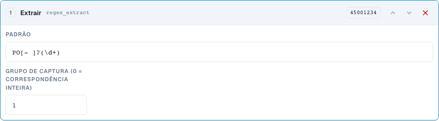
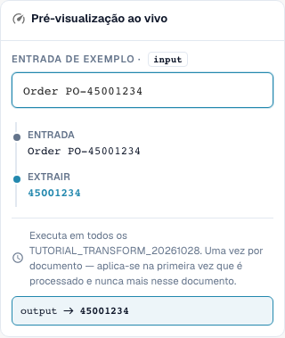

# Fragmentos e Padrões: Cortar, Extrair, Substituir

[De volta à visão geral completa da prática](complete-practical-guide.md)

Campo de cabeçalho · Origem header.input · Destino output · regex_extract: PO[- ]?(\d+), grupo 1. Origem e destino permanecem separados.

## Etiquetas visíveis no editor

Algumas etiquetas da interface atual apresentam traduções imprecisas. A tabela indica o texto realmente apresentado para encontrar o passo correto; a explicação funcional utiliza terminologia técnica. As capturas mostram a interface sem alterações.

| Operação | Etiqueta visível |
| --- | --- |
| substring | Pegue uma fatia |
| regex_extract | Extrair |
| regex_replace | Localizar e substituir |

## Procedimento no editor

1. Para os três passos, escolher um destino como `output` e uma **origem original separada** como `header.input`. Também "Apenas uma vez por documento" não permite auto-origem.
2. Para **fragmento** definir primeiro início 0 e comprimento 4: `2026-10-28` resulta em `2026`. Depois testar início 3 e fim 7 com `DE-4711-X`; o fim não conta.
3. Como variante própria, testar início −4 sem comprimento/fim: `INV-4711` resulta em `4711`. Uma entrada mais curta é um caso de exceção necessário.
4. Para **extrair** usar padrão `PO[- ]?(\d+)` e grupo de captura 1. `Order PO-45001234` resulta em `45001234`; `Invoice 4711` resulta vazio. O grupo 0, por outro lado, devolve toda a correspondência.
5. Para **procurar e substituir** configurar padrão `\s+`, substituição um espaço e quantidade 0. `ACME    GmbH` deve resultar em `ACME GmbH`. Depois testar padrão `-`, substituição `/`, quantidade 1 com `AB-CD-EF`: apenas o primeiro hífen é substituído.
6. Testar os padrões concretos também do lado do servidor. Um padrão de navegador bem-sucedido por si só não comprova processamento idêntico do servidor em expressões complexas.

<figure><figcaption>
Configuração de passos. Interface real em português (Portugal). A pré-visualização não altera documentos armazenados.
</figcaption></figure>


Configuração de passos. Interface real em português (Portugal). A pré-visualização não altera documentos armazenados.


<figure><figcaption>
Pré-visualização em direto com valores de treino. Interface real em português (Portugal). A pré-visualização não altera documentos armazenados.
</figcaption></figure>


Pré-visualização em direto com valores de treino. Interface real em português (Portugal). A pré-visualização não altera documentos armazenados.


## 1. Fragmento

Um fragmento é definido através de início e comprimento ou através de início e fim. O primeiro índice é zero. O fim já não pertence ao resultado. Um início negativo conta a partir da margem direita. Para os últimos quatro caracteres, utilizo um início de menos quatro e nenhum fim. Escolho uma origem diferente do destino. Assim, cada execução lê novamente o texto original. O servidor rejeita estes passos no próprio campo de destino, porque o valor poderia ser alterado sucessivamente em cada reprocessamento. Apenas executar uma vez não substitui aqui esta origem separada.

## 2. Extrair

Extrair procura a primeira correspondência de uma expressão regular. O meu padrão reconhece as letras P e O, opcionalmente um hífen ou um espaço, e depois algarismos. O grupo um devolve apenas os algarismos, o grupo zero a correspondência completa. Sem correspondência, devolve-se uma cadeia de caracteres vazia. Por isso, defino uma condição adequada ou verifico conscientemente se um valor de destino vazio é desejado neste caso. Vários números de encomenda num texto não são automaticamente convertidos em vários resultados.

## 3. Substituir

Procurar e substituir processa correspondências de um padrão. Com uma quantidade de zero, todas as correspondências são substituídas. Um altera apenas a primeira correspondência. Posso substituir múltiplos espaços por um único espaço. Também aqui utilizo uma origem original separada. A pré-visualização no navegador e o processamento no servidor podem utilizar regras diferentes em expressões regulares exigentes. Por isso, testo primeiro padrões simples e comparo depois o valor real do servidor. Um caso adequado, nenhuma correspondência e várias correspondências constituem a minha verificação mínima.

## Exemplos verificados e casos de exceção

Estes valores foram verificados do lado do servidor como teste seco. Tal teste não altera documentos guardados.

| Caso | Entrada | Resultado do servidor |
| --- | --- | --- |
| substring | `2026-10-28` | `2026` |
| substring | `AB` | `AB` |
| substring-end | `DE-4711-X` | `4711` |
| substring-negative | `INV-4711` | `4711` |
| regex-extract | `Order PO-45001234` | `45001234` |
| regex-extract | `Invoice 4711` | `` |
| regex-replace | `ACME    GmbH` | `ACME GmbH` |
| regex-count | `AB-CD-EF` | `AB/CD-EF` |

## Aceitação

Verifique um caso adequado, um caso de exceção, um valor vazio e um resultado já processado. Repita a operação de guardar documento. Verifique também a reconciliação de PO e o recebimento ERP, se pertencerem ao objetivo funcional.

## Tutorial em vídeo


Configuração, exemplos práticos e casos contrários.


[Abrir o vídeo com legendas em português e capítulos](https://docbits-videos.fra1.cdn.digitaloceanspaces.com/settings-assistant/transformation-rules-04-substrings-and-patterns-preview-admin/v1/pt.html). Esta versão de revisão aguarda a avaliação funcional e uma audição completa.
