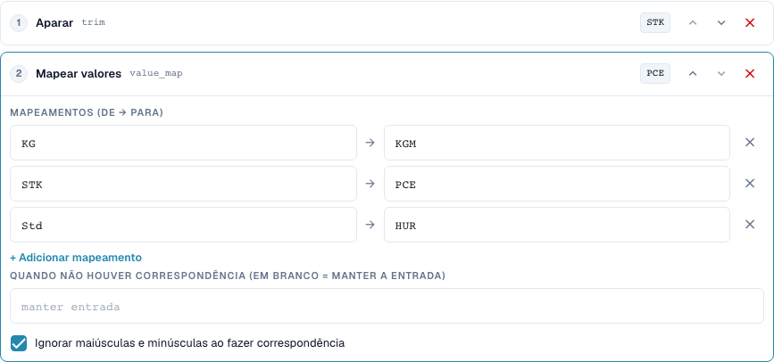
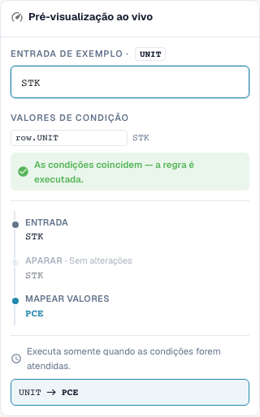

# Mapeamentos de valores e regras por linha de tabela

[Voltar à visão geral completa da prática](complete-practical-guide.md)

Coluna de tabela UNIT · Trim · value_map: STK→PCE, KG→KGM, Std→HUR · Ignorar maiúsculas/minúsculas.

## Etiquetas visíveis no editor

Algumas etiquetas da interface atual apresentam traduções imprecisas. A tabela indica o texto realmente apresentado para encontrar o passo correto; a explicação funcional utiliza terminologia técnica. As capturas mostram a interface sem alterações.

| Operação | Etiqueta visível |
| --- | --- |
| trim | Aparar |
| value_map | Mapear valores |

## Procedimento no editor

1. Selecionar **Coluna de tabela**, tabela `INVOICE_TABLE` e coluna de destino `UNIT`. Aqui cada linha de tabela é processada individualmente.
2. Colocar **Trim** antes de **Mapear valores**. Registar pares `STK→PCE`, `KG→KGM` e `Std→HUR` e ativar ignorar maiúsculas/minúsculas.
3. Deixar o campo para a substituição sem correspondência vazio, para que códigos desconhecidos sejam preservados. `stk` deve resultar em `PCE`, `BOX` deve permanecer `BOX`.
4. Verificar uma pré-visualização com condição de linha correspondente e com condição não correspondente. A condição não deve capturar involuntariamente as outras linhas.
5. Para uma verdadeira prova de múltiplas linhas, preparar valores de origem `STK`, `STK`, `BOX`. No teste de servidor verificado, resulta `PCE`, `PCE`, `BOX`; quantidade e preço permanecem a verificar separadamente ao nível funcional.
6. Verificar novamente cada código de destino como entrada. Uma substituição genérica como `C62` e mapeamentos encadeados podem ocultar valores desconhecidos ou alterá-los posteriormente em execuções seguintes.

<figure><figcaption>
Configuração de passos. Interface real em português (Portugal). A pré-visualização não altera documentos armazenados.
</figcaption></figure>


Configuração de passos. Interface real em português (Portugal). A pré-visualização não altera documentos armazenados.


<figure><figcaption>
Pré-visualização em direto com valores de treino. Interface real em português (Portugal). A pré-visualização não altera documentos armazenados.
</figcaption></figure>


Pré-visualização em direto com valores de treino. Interface real em português (Portugal). A pré-visualização não altera documentos armazenados.


## 1. Pares de valores

Um mapeamento de valores traduz valores de entrada completos. O meu exemplo mapeia a unidade "Stück" para o código P C E, "Kilogramm" para o código K G M e "Stunden" para o código H U R. Registo os códigos reais do fornecedor e os códigos de destino esperados como pares. Com a maiúsculas/minúsculas ignorada, também um código em minúsculas é reconhecido. Isto ainda não remove espaços. Por isso coloco um passo de trim antes do mapeamento. Testo explicitamente um código desconhecido.

## 2. Sem correspondência

Um campo vazio para o valor sem correspondência significa: manter a entrada. Não significa: eliminar a entrada. Um valor de substituição registado de forma fixa substitui, por outro lado, cada código desconhecido. Isto pode ocultar erros. Para unidades funcionalmente diferentes, não atribuiria um código de substituição genérico. Um mapeamento também não é automaticamente repetível em todas as combinações. Se a saída de um par é simultaneamente a entrada de outro par, uma execução posterior pode continuar a mapear. Por isso testo também cada código de destino como nova entrada.

## 3. Por linha de tabela

Para tabelas, seleciono a tabela concreta e a coluna de destino. A pipeline corre então para cada linha. Uma condição pode ligar o código de unidade da linha atual com uma característica do fornecedor do cabeçalho. No exemplo, duas linhas correspondentes são alteradas, enquanto um código de unidade desconhecido é preservado. Isto não altera quantidades ou preços através de uma conversão de unidades. Renomear uma cadeia de caracteres não é uma conversão matemática. A reconciliação efetiva de encomendas e uma exportação verifico separadamente da transformação.

## Exemplos verificados e casos de exceção

Estes valores foram verificados do lado do servidor como teste a seco. Tal teste não altera documentos guardados.

| Caso | Entrada | Resultado do servidor |
| --- | --- | --- |
| map | `stk` | `PCE` |
| map | `PCE` | `PCE` |
| map | `BOX` | `BOX` |
| map-fallback | `BOX` | `C62` |
| item-pipeline | `Art.-Nr. ab-12/3` | `AB123` |

## Aceitação

Verifique um caso correspondente, um caso de exceção, um valor vazio e um resultado já processado. Repita a operação de guardar o documento. Verifique a reconciliação de PO e a receção no ERP adicionalmente, se pertencerem ao objetivo funcional.

## Tutorial em vídeo


Configuração, exemplos práticos e casos contrários.


[Abrir o vídeo com legendas em português e capítulos](https://docbits-videos.fra1.cdn.digitaloceanspaces.com/settings-assistant/transformation-rules-05-value-mapping-preview-admin/v1/pt.html). Esta versão de revisão aguarda a avaliação funcional e uma audição completa.
