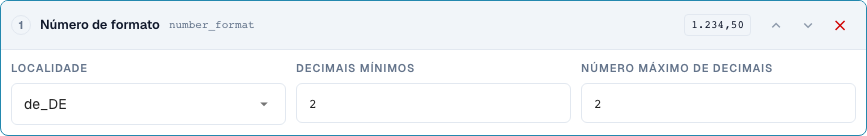
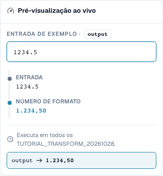

# Formatar corretamente datas e números

[De volta à visão geral completa da prática](complete-practical-guide.md)

Texto de destino · date_format: %d.%m.%Y; number_format: de_DE, mín. 2, máx. 2 casas decimais.

## Etiquetas visíveis no editor

Algumas etiquetas da interface atual apresentam traduções imprecisas. A tabela indica o texto realmente apresentado para encontrar o passo correto; a explicação funcional utiliza terminologia técnica. As capturas mostram a interface sem alterações.

| Operação | Etiqueta visível |
| --- | --- |
| date_format | Data de reformatação |
| number_format | Número de formato |

## Procedimento no editor

1. Para uma primeira tentativa bem legível, utilizar um **texto de destino** e o passo **formatar data**. Definir padrão de saída `%d.%m.%Y` e entrada `2026-10-28`; espera-se `28.10.2026`.
2. Comparar as variantes `%m/%d/%Y`, `%Y-%m-%d` e `%d %b %Y` com a mesma entrada inequívoca. Os padrões não são um reconhecimento fiável de qualquer formato de data arbitrário.
3. Verificar com `kein Datum` e uma entrada ambígua. No caso de um campo de cabeçalho DATE real, controlar separadamente o valor ISO armazenado e a apresentação visível.
4. Numa regra própria **formatar número**, escolher localidade `de_DE`, casas decimais mínimas e máximas ambas 2. A entrada do servidor `1234.5` deve produzir `1234,50`.
5. Verificar com `en_US` a mesma entrada: resultado do servidor `1234.50`. O separador de milhares da pré-visualização do browser verificada não é escrito do lado do servidor.
6. Verificar zero, um montante negativo e casas decimais adicionais. De seguida, voltar a processar a saída e controlar o valor efetivamente armazenado.

<figure><figcaption>
Configuração de passos. Interface real em português (Portugal). A pré-visualização não altera documentos armazenados.
</figcaption></figure>


Configuração de passos. Interface real em português (Portugal). A pré-visualização não altera documentos armazenados.


<figure><figcaption>
Pré-visualização em direto com valores de treino. Interface real em português (Portugal). A pré-visualização não altera documentos armazenados. O separador de milhares visível pertence à pré-visualização do navegador; o resultado do servidor verificado é 1234,50.
</figcaption></figure>


Pré-visualização em direto com valores de treino. Interface real em português (Portugal). A pré-visualização não altera documentos armazenados. O separador de milhares visível pertence à pré-visualização do navegador; o resultado do servidor verificado é 1234,50.


## 1. Data e tipo de dados

Reformatar data escreve uma data segundo o padrão escolhido. Uma data ISO inequívoca é uma boa entrada de teste. Dia, mês e ano podem ser apresentados com pontos, por exemplo. Num campo de cabeçalho de data real, o valor interno pode permanecer em formato ISO enquanto a apresentação muda. Um campo de texto ou uma célula de tabela pode, por sua vez, conter o texto formatado. Por isso, comparo não apenas o campo visível, mas também o valor armazenado e a utilização posterior.

## 2. Dados ilegíveis e ambíguos

Uma data ilegível não é simplesmente inventada. No meu teste de servidor, o texto permanece inalterado, e o resultado indica a razão. Indicações ambíguas como dia e mês com números pequenos necessitam de um contexto inequivocamente acordado. Uma data formatada não deve ser lida como um dia diferente no próximo guardar. Por isso, verifico uma segunda passagem. A partir de um texto arbitrário sem data válida, esta transformação não pode produzir uma data fiável.

## 3. Formato de números

Formatar números utiliza uma localidade e um número mínimo e máximo de casas decimais. Isso altera a apresentação e eventualmente o arredondamento, mas não uma taxa de câmbio nem uma unidade de quantidade. Para a minha entrada mil duzentos e trinta e quatro vírgula cinco, o servidor atual com duas casas decimais fornece uma escrita alemã com vírgula ou uma escrita inglesa com ponto. Um separador de milhares não está contido no resultado do servidor verificado. Por isso, não assumo uma apresentação mais elegante do browser como prova para a exportação. Zero, montantes negativos, casas decimais adicionais e o valor do resultado armazenado necessitam de testes próprios.

## Exemplos verificados e casos contrários

Estes valores foram verificados do lado do servidor como teste seco. Um tal teste não altera documentos armazenados.

| Caso | Entrada | Resultado do servidor |
| --- | --- | --- |
| date | `2026-10-28` | `28.10.2026` |
| date | `kein Datum` | `kein Datum` |
| number-de | `1234.5` | `1234,50` |
| number-us | `1234.5` | `1234.50` |

## Aceitação

Verifique um caso adequado, um caso contrário, um valor vazio e um resultado já processado. Repita a operação de guardar documento. Verifique também a reconciliação de PO e a receção ERP, se pertencerem ao objetivo funcional.

Na situação verificada, a pré-visualização de números e o servidor diferem quanto a separadores de milhares. A tabela indica o valor real do servidor.

## Tutorial em vídeo


Configuração, exemplos práticos e casos contrários.


[Abrir o vídeo com legendas em português e capítulos](https://docbits-videos.fra1.cdn.digitaloceanspaces.com/settings-assistant/transformation-rules-06-dates-and-numbers-preview-admin/v1/pt.html). Esta versão de revisão aguarda a avaliação funcional e uma audição completa.
