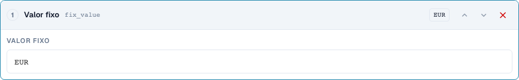
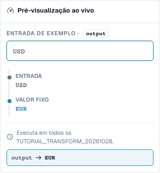
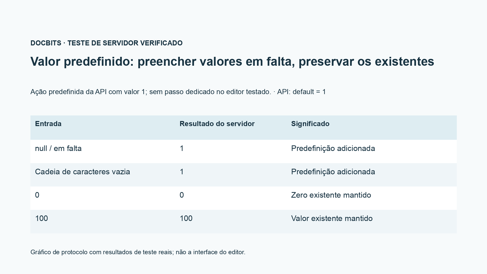

# Transferir campos, valores fixos, limpar e valores predefinidos

[Voltar à visão geral completa da prática](complete-practical-guide.md)

Objetivo Resultado · Fonte Texto original para transferência de campo; valor fixo apenas sob condição estrita; limpar testado separadamente.

## Etiquetas visíveis no editor

Algumas etiquetas da interface atual apresentam traduções imprecisas. A tabela indica o texto realmente apresentado para encontrar o passo correto; a explicação funcional utiliza terminologia técnica. As capturas mostram a interface sem alterações.

| Operação | Etiqueta visível |
| --- | --- |
| trim | Aparar |
| case | Alterar maiúsculas/minúsculas |
| fix_value | Valor fixo |
| clear | Limpar |

## Procedimento no editor

1. Para uma **transferência de campo**, escolher um campo de origem diferente do campo de destino. No âmbito do exercício, o destino é `output`, a origem `header.input`.
2. Configurar os passos Aparar → Maiúsculas e testar `  po-4711  `. A saída será `PO-4711`; a origem original não deve ser esvaziada no processo.
3. Para um número de encomenda produtivo, utilizar uma condição adicional que apenas se aplique quando o destino estiver vazio. Testar um valor de destino correto já existente como caso contrário.
4. Numa regra própria, criar **valor fixo** com `EUR`. Mesmo uma entrada `USD` será assim substituída; isto não é uma conversão de moeda.
5. **Limpar** separadamente com `Altwert`. A saída é a cadeia de caracteres vazia. Ter em atenção a diferença funcional entre limpar intencionalmente e um valor de saída em falta.
6. Testar o passo de interface `default` apenas através do contrato API previsto para o efeito; no menu de passos normais verificado não existe uma entrada própria para este efeito. O gráfico de protocolo mostra: em falta e vazio são complementados, `0` e `100` são preservados.

<figure><figcaption>
Configuração de passos. Interface real em português (Portugal). A pré-visualização não altera documentos armazenados.
</figcaption></figure>


Configuração de passos. Interface real em português (Portugal). A pré-visualização não altera documentos armazenados.


<figure><figcaption>
Pré-visualização em direto com valores de treino. Interface real em português (Portugal). A pré-visualização não altera documentos armazenados.
</figcaption></figure>


Pré-visualização em direto com valores de treino. Interface real em português (Portugal). A pré-visualização não altera documentos armazenados.


## 1. Transferência de campo

Para uma transferência de campo, escolho primeiro o campo de destino e depois uma origem diferente. Se o número de encomenda estiver no campo errado, posso lê-lo desse campo, aparar e guardar no campo de destino correto. Uma condição destino está vazio protege um número de encomenda já existente. A origem é preservada. É uma cópia com processamento e não uma movimentação. Verifico um destino vazio, um destino já preenchido e uma origem vazia.

## 2. Valor fixo e limpar

Um valor fixo ignora o conteúdo anterior. Se definir a moeda para Euro, a regra também substitui uma outra moeda já existente. Para isso, preciso de uma condição funcional estrita. Limpar escreve uma cadeia de caracteres vazia no campo de destino. Não é uma eliminação de todo o campo ou documento. Na pré-visualização, verifico sobretudo o caso contrário, para que a regra não remova valores válidos. A gravação da regra por si só ainda não prova uma alteração de um documento.

## 3. Valores predefinidos

A interface do servidor suporta adicionalmente uma ação de valor predefinido. Ela complementa um valor apenas quando a entrada está em falta ou vazia. Um zero existente permanece zero. Esta ação não está presente como passo próprio na seleção de passos verificada do editor normal. No editor, posso frequentemente representar o caso predefinido pretendido com a condição destino está vazio e um valor fixo. Mostro esta distinção de forma transparente e não afirmo nenhum ponto de menu adicional. Um valor predefinido é sempre uma decisão funcional, especialmente em preço base, quantidade ou moeda.

## Exemplos verificados e casos contrários

Estes valores foram verificados do lado do servidor como teste seco. Tal teste não altera documentos guardados.

| Caso | Entrada | Resultado do servidor |
| --- | --- | --- |
| fixed | `USD` | `EUR` |
| fixed | `null` | `EUR` |
| clear | `Altwert` | `` |
| clear | `` | `` |
| default-api | `null` | `1` |
| default-api | `` | `1` |
| default-api | `0` | `0` |
| default-api | `100` | `100` |
| copy | `  po-4711  ` | `PO-4711` |

## Aceitação

Verifique um caso adequado, um caso contrário, um valor vazio e um resultado já processado. Repita o processo de gravação do documento. Verifique também a reconciliação de PO e o recebimento ERP, se fizerem parte do objetivo funcional.

<figure><figcaption>
Resultados reais de teste de servidor e persistência apresentados como gráfico de protocolo. Esta não é uma interface de editor recriada.
</figcaption></figure>


Resultados reais de teste de servidor e persistência apresentados como gráfico de protocolo. Esta não é uma interface de editor recriada.


## Tutorial em vídeo


Configuração, exemplos práticos e casos contrários.


[Abrir o vídeo com legendas em português e capítulos](https://docbits-videos.fra1.cdn.digitaloceanspaces.com/settings-assistant/transformation-rules-07-field-copy-and-defaults-preview-admin/v1/pt.html). Esta versão de revisão aguarda a avaliação funcional e uma audição completa.
