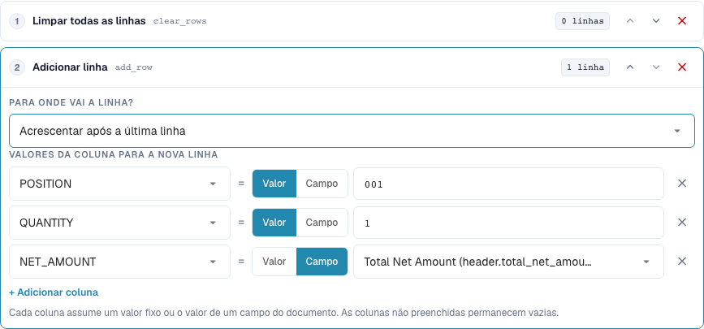
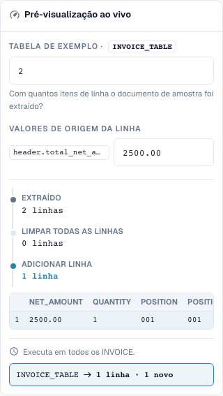

# Reconstrução de linhas de tabela

[De volta à visão geral completa da prática](complete-practical-guide.md)

Tabela INVOICE_TABLE · clear_rows → add_row no final · POSITION=001, QUANTITY=1, NET_AMOUNT do header.total_net_amount.

## Etiquetas visíveis no editor

Algumas etiquetas da interface atual apresentam traduções imprecisas. A tabela indica o texto realmente apresentado para encontrar o passo correto; a explicação funcional utiliza terminologia técnica. As capturas mostram a interface sem alterações.

| Operação | Etiqueta visível |
| --- | --- |
| clear_rows | Limpar todas as linhas |
| add_row | Adicionar linha |

## Procedimento no editor

1. Selecionar o âmbito de aplicação **Linhas de tabela** e a tabela concreta `INVOICE_TABLE`. Uma condição de fornecedor adequada limita a reconstrução completa.
2. Primeiro configurar **Eliminar todas as linhas**, depois **Adicionar linha**. Para a nova linha definir valores fixos `POSITION=001`, `QUANTITY=1` e para `NET_AMOUNT` a fonte `header.total_net_amount`.
3. Testar com o montante do cabeçalho `2500.00` e duas linhas existentes: permanece exatamente a nova linha total definida. Verificar também um montante de cabeçalho em falta antes de a regra ficar ativa.
4. Ao adicionar, comparar a posição antes da primeira linha e depois da última linha. Para esta prova de posição, remover a eliminação anterior ou testar separadamente, caso contrário não existe linha existente como referência.
5. Verificar intencionalmente a ordem inversa dos passos **Adicionar → Eliminar** como caso contrário: o resultado está vazio. Restaurar depois a ordem pretendida.
6. Verificar a gravação dupla. Adicionar sem eliminar previamente pode multiplicar linhas; uma reconstrução pode remover irremediavelmente posições de fornecedor do resultado de trabalho do ponto de vista funcional. Aprovar a conciliação de encomendas separadamente.

<figure><figcaption>
Configuração de passos. Interface real em português (Portugal). A pré-visualização não altera documentos armazenados.
</figcaption></figure>


Configuração de passos. Interface real em português (Portugal). A pré-visualização não altera documentos armazenados.


<figure><figcaption>
Pré-visualização em direto com valores de treino. Interface real em português (Portugal). A pré-visualização não altera documentos armazenados.
</figcaption></figure>


Pré-visualização em direto com valores de treino. Interface real em português (Portugal). A pré-visualização não altera documentos armazenados.


## 1. Construção de linhas

Eliminar todas as linhas remove as linhas existentes da tabela selecionada. Adicionar linha constrói subsequentemente uma nova linha. Para cada coluna, seleciono ou um valor fixo ou o valor de um campo de cabeçalho. No meu exemplo, cria-se uma posição total com quantidade um e um montante líquido do cabeçalho da fatura. Colunas não preenchidas permanecem vazias. A nova linha pode estar no início ou no final. Isto não é uma agrupação ou somatização automática de posições existentes selecionadas.

## 2. Ordem dos passos

A ordem é decisiva. Eliminar e depois adicionar produz a nova linha desejada. Adicionar e depois eliminar remove também a linha recém-criada. Sem eliminação prévia, uma nova execução acrescentaria ainda uma linha. Para isso, a regra exige uma execução única adequada. Uma pré-visualização com uma contagem de linhas verifica a estrutura, mas ainda não substitui um teste com uma tabela extraída real. Controlo os valores das colunas e a contagem de linhas após a gravação.

## 3. Verificação separada da conciliação de encomendas

Uma regra de tabela executa-se antes das regras de coluna. Uma regra de coluna subsequente pode, por isso, também limpar linhas recém-adicionadas. A reconstrução de posições pode alterar identificações de linhas existentes e atribuições de encomendas. Para uma fatura que é conscientemente conciliada com o montante total, necessito adicionalmente da regra de conciliação de encomendas adequada. A transformação por si só não confirma uma conciliação completa. Testo isto apenas com um documento isolado e verifico após nova gravação a contagem de linhas e o estado de conciliação separadamente.

## Aprovação

Verifique um caso adequado, um caso contrário, um valor vazio e um resultado já processado. Repita a operação de gravação do documento. Verifique a conciliação de PO e a receção no ERP adicionalmente, se pertencerem ao objetivo funcional.

## Tutorial em vídeo


Configuração, exemplos práticos e casos contrários.


[Abrir o vídeo com legendas em português e capítulos](https://docbits-videos.fra1.cdn.digitaloceanspaces.com/settings-assistant/transformation-rules-08-table-rows-preview-admin/v1/pt.html). Esta versão de revisão aguarda a avaliação funcional e uma audição completa.
