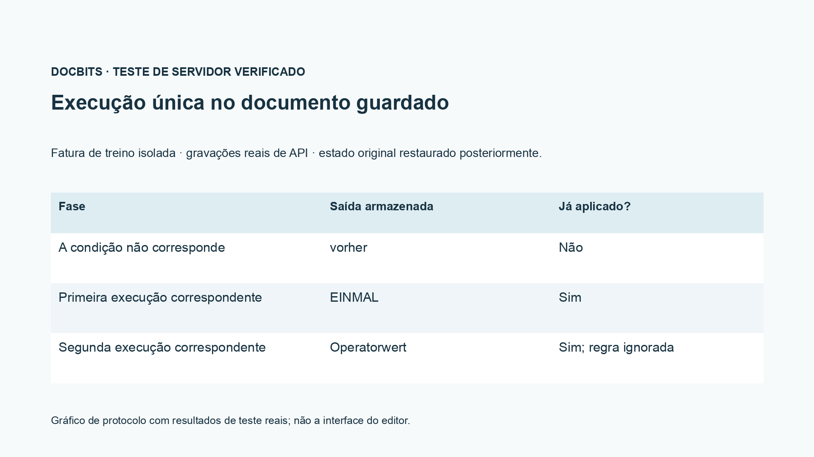
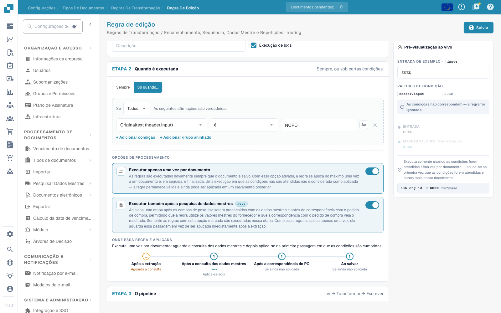

# Encaminhamento, Sequência, Dados Mestre e Repetições

[De volta à visão geral completa da prática](complete-practical-guide.md)

Encaminhamento · Destino Suborganização · utilizar destino existente; verificar condições, fases de execução e repetição separadamente.

Na gravação de vídeo, o nome e a identificação interna do destino de encaminhamento existente estão ocultados. Para a configuração própria, o destino deve provir da seleção de suborganizações efetivamente existentes.

## Procedimento no editor

1. Para **Encaminhamento**, selecionar o atributo de documento oferecido `sub_org_id`. Utilizar exclusivamente uma suborganização efetivamente existente como destino fixo ou como resultado de uma mapeamento de valores.
2. Complementar uma condição adequada de fornecedor ou de identificação. No exemplo de exercício, `NORD` deve satisfazer a condição e `SUED` deve ignorá-la. A gravação mostra apenas a pré-visualização e não desloca documentos produtivos.
3. Comparar a indicação de fases com o fluxo Campo de cabeçalho → Encaminhamento → Linhas de tabela → Coluna de tabela. Prioridade e chave de regra ordenam apenas dentro do mesmo âmbito.
4. Ativar **Também executar após a pesquisa de dados mestre** e observar a fase adicional antes da reconciliação de encomenda. Uma fonte que provém apenas de dados mestre necessita de um passo adequado.
5. **Apenas uma vez por documento**: primeiro verificar com condição não adequada, depois executar pela primeira vez de forma adequada. No caso de formação verificado, a primeira passagem ignorada não consome a aplicação.
6. Após a primeira aplicação adequada, inserir um valor de operador e guardar novamente. O teste deve demonstrar que a regra de uma única vez não sobrescreve novamente este valor; controlar condição, resultado, fase e comprovativo de aplicação no registo.

## 1. Suborganização

O encaminhamento escreve atualmente a suborganização do documento. Posso definir um destino fixo da seleção existente ou mapear um valor de origem para uma suborganização. Uma condição adequada de fornecedor limita a atribuição. Isto não é uma autorização de utilizador nem uma decisão de libertação. Utilizo apenas suborganizações existentes válidas e verifico o caso contrário. Nesta sequência, o exemplo de encaminhamento permanece uma pré-visualização; não desloca documentos produtivos.

## 2. Fases de execução

Os âmbitos de validade decorrem na sequência Campo de cabeçalho, Encaminhamento, Linhas de tabela e Coluna de tabela. Dentro de um âmbito, aplicam-se prioridade e chave de regra. Uma fonte de cabeçalho limpa pode, portanto, já ser lida pelo encaminhamento. Com a execução adicional após a pesquisa de dados mestre, uma regra pode utilizar valores que são apenas complementados a partir de dados mestre. Esta opção acrescenta uma passagem antes da reconciliação de encomenda. Não desloca todas as outras execuções para lá.

## 3. Regras de uma única vez e comprovativo

Executar apenas uma vez por documento limita uma regra efetivamente aplicada. Uma condição não satisfeita ainda não consome esta execução. Juntamente com a opção de pesquisa, a regra aguarda na primeira passagem de extração pela fase posterior. Para subcadeias e expressões regulares, a fonte separada continua a ser necessária. Verifico uma aplicação inaugural, um caso não adequado e um novo guardar. No registo, procuro por condição, resultado e fase de execução. Apenas um documento recarregado comprova o efeito guardado. Uma entrada no ERP e uma reconciliação de encomenda necessitam cada uma do seu próprio comprovativo.

## Aceitação

Verifique um caso adequado, um caso contrário, um valor vazio e um resultado já processado. Repita o processo de guardar do documento. Verifique também a reconciliação de PO e a receção no ERP, se pertencerem ao objetivo funcional.

<figure><figcaption>
Resultados reais de teste de servidor e persistência apresentados como gráfico de protocolo. Esta não é uma interface de editor recriada.
</figcaption></figure>


Resultados reais de teste de servidor e persistência apresentados como gráfico de protocolo. Esta não é uma interface de editor recriada.


No teste de integração guardado, uma condição não adequada não consumiu a execução de uma única vez. No primeiro guardar adequado, foi escrito EINMAL. No segundo guardar adequado, o valor de operador preparado foi mantido, e o comprovativo de aplicação guardado continuou definido. O documento de teste foi posteriormente restaurado. O teste seco no servidor pode continuar a calcular um resultado hipotético; verifique, por isso, também a sua indicação `already_applied` e o documento efetivamente guardado.

<figure><figcaption>
Execução única e a fase de pesquisa adicional no editor real. A condição de exemplo não correspondente é ignorada; os identificadores internos de destino de encaminhamento estão ocultos. Estas opções são uma pré-visualização não guardada.
</figcaption></figure>


Execução única e a fase de pesquisa adicional no editor real. A condição de exemplo não correspondente é ignorada; os identificadores internos de destino de encaminhamento estão ocultos. Estas opções são uma pré-visualização não guardada.


## Tutorial em vídeo


Configuração, exemplos práticos e casos contrários.


[Abrir o vídeo com legendas em português e capítulos](https://docbits-videos.fra1.cdn.digitaloceanspaces.com/settings-assistant/transformation-rules-09-routing-and-execution-preview-admin/v1/pt.html). Esta versão de revisão aguarda a avaliação funcional e uma audição completa.
