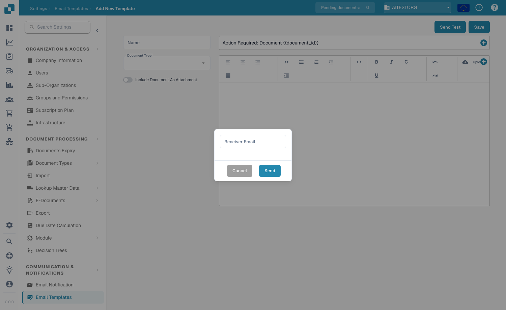

# Modelos de e-mail

## **Visão geral**

Os modelos de e-mail permitem personalizar os e-mails automáticos que o DocBits envia — por exemplo, lembretes de aprovação ou notificações de erro. Um modelo define a linha de assunto e o corpo e pode incluir campos dinâmicos (por exemplo, `{{InvoiceNumber}}`), imagens e formatação de texto rico.

## **Acessando os modelos de e-mail**

Acesse **Settings → Communication & Notifications → Email Templates**. A lista mostra todos os modelos com **Name**, **Subject**, **Document Type**, data de **Last Modified** e **Actions** (editar ou excluir).

<figure><figcaption>
A lista de Email Templates
</figcaption></figure>

## **Criando um modelo**

1. Clique em **+ New** no canto superior direito.
2. Preencha os campos:
   * **Name** — um identificador descritivo (por exemplo, "Document Error Notification").
   * **Document Type** — o tipo de documento ao qual o modelo se aplica (por exemplo, `INVOICE`).
   * **Include Document As Attachment** — ative este botão para anexar o documento de origem ao e-mail.
   * **Subject** — a linha de assunto do e-mail. Clique no botão **+** ao lado do campo para inserir um campo dinâmico ou digite `{{FieldID}}` diretamente.
3. Crie o corpo no editor de texto rico — formate o texto (negrito, itálico, listas, alinhamento), insira imagens com **Upload**, edite o HTML bruto com o botão `<>` e use o botão **+** para inserir campos dinâmicos.
4. Clique em **Save**.

<figure><figcaption>
O editor de modelos — nome, tipo de documento, botão de anexo, assunto e corpo em texto rico
</figcaption></figure>

## **Campos dinâmicos**

Os campos dinâmicos são substituídos pelos dados do documento quando o e-mail é enviado. Insira-os com o botão **+** ou digite-os manualmente usando chaves duplas:

* `{{invoice_id}}` — o número da fatura
* `{{supplier_name}}` — o nome do fornecedor
* `{{total_amount}}` — o valor total
* `{{status}}` — o status atual do documento

## **Enviando um e-mail de teste**

Clique em **Send Test** no editor, informe um endereço em **Receiver Email** e clique em **Send**. O DocBits envia uma pré-visualização do modelo para que você verifique o layout e confirme que os campos dinâmicos são resolvidos corretamente antes de salvar.

<figure><figcaption>
A caixa de diálogo Send Test
</figcaption></figure>

## **Usando modelos em notificações**

Os modelos salvos podem ser vinculados a fluxos de [**Email Notification**](email-notification/) — por exemplo, lembretes de aprovação ou atualizações de mudança de status.
