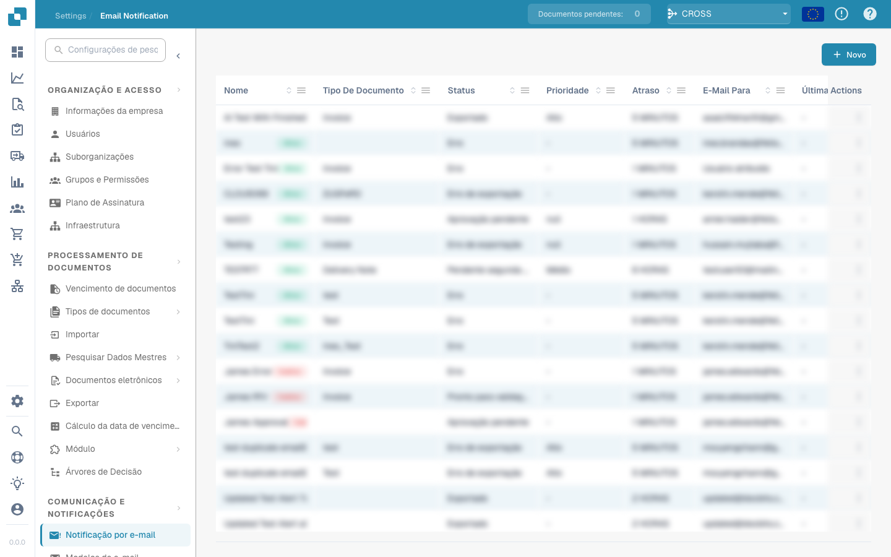

# Notificações por e-mail


Tutorial de tarefas e notificações do DocBits: atribuir trabalho, acompanhar estados e gerir tarefas de fluxo de trabalho


<figure><figcaption></figcaption></figure>

As notificações por e-mail do DocBits podem informar os utilizadores sobre eventos dos documentos, como a conclusão do processamento, erros de importação ou exportação e pedidos de intervenção. A configuração destas notificações ajuda a manter a comunicação e a continuidade operacional no processamento de documentos:

**Comunicação em tempo real:**

* Os alertas por e-mail informam imediatamente os utilizadores sobre eventos ou alterações importantes no sistema de gestão documental, mantendo as pessoas envolvidas a par das atualizações relevantes.

**Transparência e rastreabilidade:**

* As notificações permitem acompanhar e monitorizar o estado dos eventos de processamento de documentos, melhorando a transparência e a rastreabilidade.

**Reações atempadas:**

* As notificações automáticas de libertações de documentos, comentários ou aprovações permitem responder rapidamente a pedidos e atualizações, aumentando a eficiência e a produtividade.

**Automatização dos fluxos de trabalho:**

* As notificações por e-mail podem ser integradas nos fluxos de trabalho para avisar automaticamente os utilizadores relevantes quando determinadas ações forem executadas.

**Lembretes e prazos:**

* As notificações por e-mail podem lembrar os utilizadores de prazos próximos ou tarefas pendentes, ajudando a concluir o trabalho importante dentro do prazo.

A configuração das notificações melhora a comunicação e a eficiência e ajuda a gerir os eventos de processamento de documentos atempadamente. A automatização ajuda a evitar a perda de informação importante e a manter as pessoas envolvidas informadas.

Esta configuração mantém as pessoas envolvidas informadas sobre o estado dos documentos importantes, apoiando a tomada de decisões e a gestão eficiente dos fluxos de trabalho.
