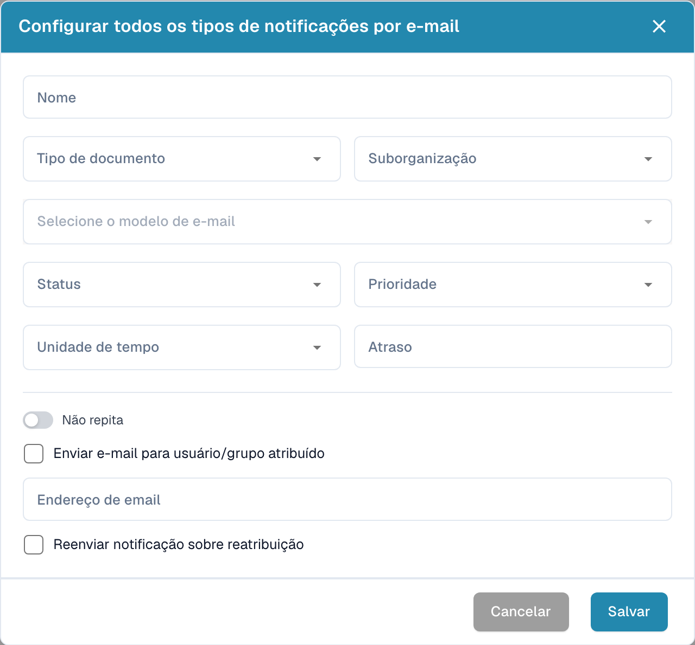

# Configurar notificações por e-mail

Abra as definições de notificações por e-mail e crie uma configuração. Determine o momento do envio e os destinatários.

<figure><figcaption>
Janela de configuração de uma notificação por e-mail.
</figcaption></figure>

1. Introduza um nome e escolha o tipo de documento e, se necessário, a suborganização.
2. Selecione o modelo de e-mail e o estado do documento.
3. Defina a prioridade, unidade de tempo e atraso.
4. Verifique se a notificação deve repetir-se.
5. Escolha o utilizador ou grupo atribuído, ou introduza o endereço de e-mail pretendido.
6. Determine se uma nova atribuição deve provocar novo envio.

Verifique destinatários, atrasos e mensagens antes de guardar. A imagem mostra uma configuração vazia sem guardar e não comprova o envio de e-mail.
