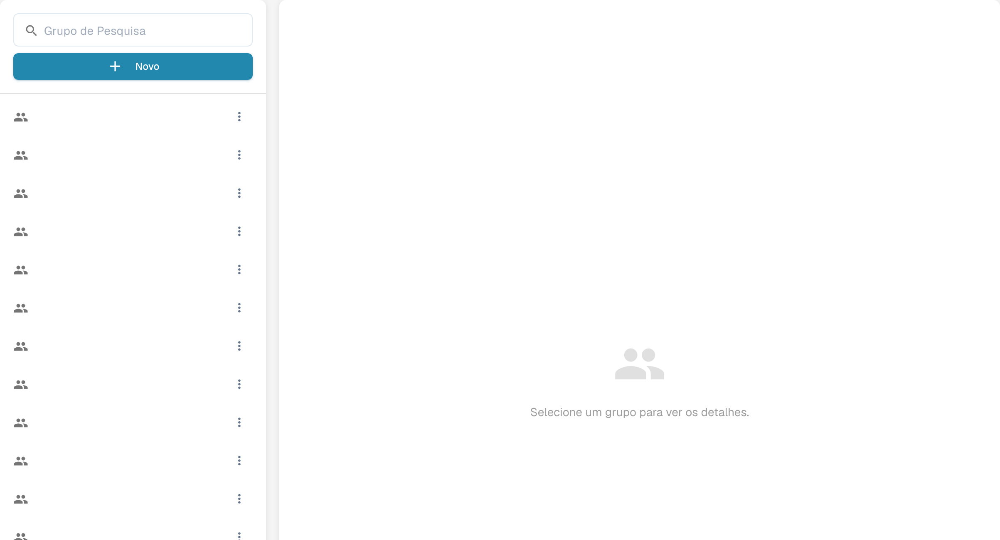

# Grupos, usuários e permissões

## Criar um grupo e testar o acesso aos documentos

Com as permissões de grupo já ativadas, crie um grupo de revisão e adicione um utilizador de teste sem direitos de administrador. Permita listar, consultar e editar faturas atribuídas; mantenha desativadas a eliminação, as alterações em massa e as aprovações. Guarde e reabra as definições. Depois inicie sessão como utilizador normal: a fatura atribuída está visível e o documento de controlo não atribuído não aparece.



[Ver com legendas](https://docbits-videos.fra1.cdn.digitaloceanspaces.com/settings-assistant/groups-permissions-admin/v1/pt.html)

Essas configurações respondem a três perguntas diferentes: quem pode entrar, em qual suborganização essa pessoa trabalha e o que o grupo dela pode fazer.

| Se você precisa… | Abra… |
| --- | --- |
| Adicionar ou editar a conta de uma pessoa | **Configurações** → **Usuários**; depois leia [Users](users/README.md). |
| Organizar o acesso entre unidades da empresa | **Configurações** → **Suborganizações**; depois leia [Sub-Organizations](sub-organizations/README.md). |
| Controlar o acesso por grupo | **Configurações** → **Grupos e Permissões**; depois leia [Groups and Permissions](groups-and-permissions/README.md). |

<figure><figcaption>
Painel de seleção de grupos.
</figcaption></figure>

Se um usuário não consegue ver um documento ou uma ação, verifique primeiro a conta e a organização dele. Depois, verifique as permissões do grupo correspondente. Use uma conta de teste sem privilégios de administrador para confirmar o acesso que um usuário comum realmente terá antes de alterar uma organização em produção.
