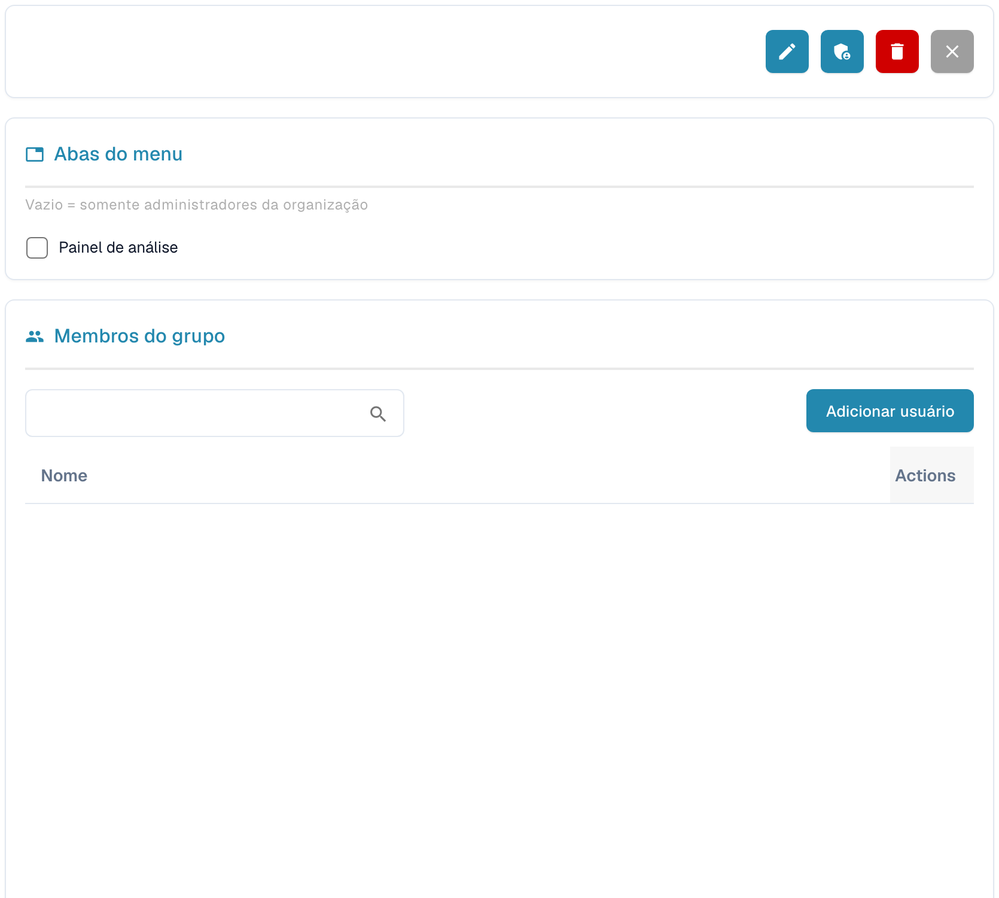

# Grupos e Permissões


Tutorial de grupos e permissões do DocBits: definir funções dos utilizadores, direitos de acesso e proteger a sua área de trabalho


<figure><figcaption>
Detalhes do grupo selecionado; dados pessoais ocultos.
</figcaption></figure>

Grupos e Permissões permitem controlar quais usuários podem acessar tipos de documento específicos e quais ações podem executar.

## Ativar/Desativar Grupos e Permissões

Use o interruptor na parte superior da página para habilitar ou desabilitar o sistema de grupos e permissões. Quando desabilitado, o sistema usa um modelo de acesso mais simples, sem restrições baseadas em grupos.

## Lista de Grupos

A tabela exibe todos os grupos configurados com:

| Coluna | Descrição |
|--------|-------------|
| **Nome do grupo** | O nome do grupo. |
| **Descrição do Grupo** | Uma breve descrição da finalidade do grupo. |
| **Ações** | Menu com opções para editar ou excluir o grupo. |

Use a barra **Procurar** para encontrar grupos pelo nome. Clique em **+ New** para criar um novo grupo.

## Configurando as Permissões do Grupo

Ao selecionar um grupo (pelo menu Actions → Edit), aparece uma tabela de permissões na qual você pode configurar o acesso por tipo de documento:

| Permissão | Descrição |
|------------|-------------|
| **Visualizar** | Permissão para ver documentos deste tipo. |
| **Atualizar** | Permissão para modificar documentos deste tipo. |
| **Excluir** | Permissão para remover documentos deste tipo. |
| **Primeira Aprovação** | Permissão para realizar a aprovação inicial. |
| **Segunda Aprovação** | Permissão para realizar um nível secundário de aprovação (se aplicável). |

Cada linha da tabela de permissões representa um tipo de documento (por exemplo, Fatura, Nota de Crédito, Nota de Entrega). Marque ou desmarque as caixas de seleção para conceder ou revogar permissões para esse grupo.

## Criando um Novo Grupo

1. Clique em **+ New** no canto superior direito.
2. Informe um **Nome do grupo** e, opcionalmente, uma **Descrição**.
3. Configure as permissões para cada tipo de documento.
4. Atribua usuários ao grupo.
5. Clique em **Salvar** para aplicar.
