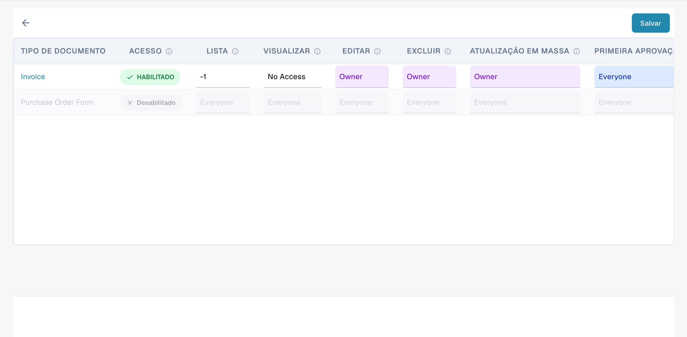
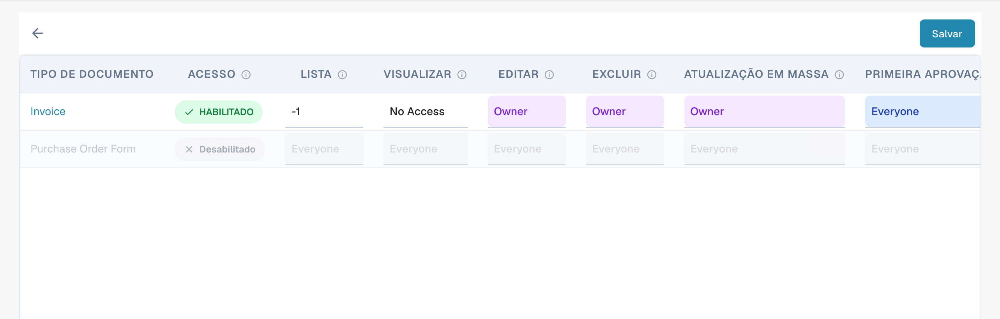
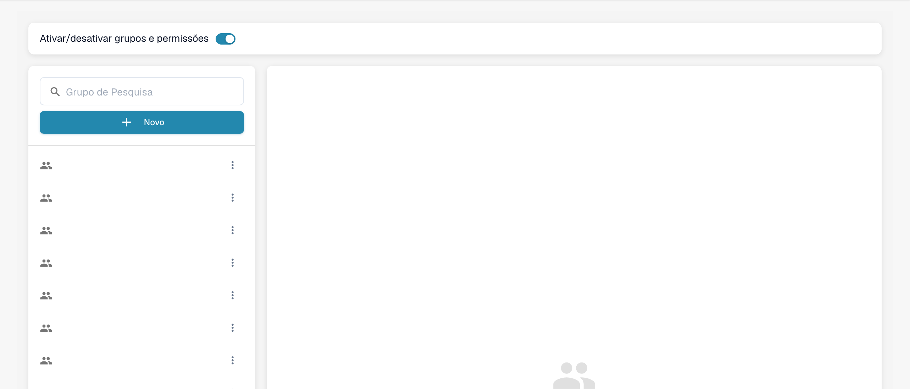

# Ativando Permissões


DocBits Groups & Permissions Tutorial: Set User Roles, Access Rights & Secure Your Workspace


Habilitar ou desabilitar o sistema de permissões usando o interruptor tem vários efeitos na funcionalidade do DocBits.

## **Habilitando o sistema de permissões:**

<figure><figcaption>
Seleção de um grupo para consultar as permissões.
</figcaption></figure>

* Quando o sistema de permissões está habilitado, as permissões de acesso para usuários e grupos são aplicadas.
* Os usuários só recebem acesso aos recursos que estão explicitamente autorizados a acessar com base nas permissões atribuídas.
* Os administradores podem gerenciar as permissões para usuários e grupos individuais e garantir que apenas pessoas autorizadas possam visualizar ou editar os dados.

<figure><figcaption>
Matriz de permissões por tipo de documento e ação. Alguns níveis de acesso permanecem em inglês.
</figcaption></figure>

## Only Assigned Documents

<figure><figcaption>
Níveis de acesso por ação na matriz de permissões. Alguns níveis de acesso permanecem em inglês.
</figcaption></figure>

O botão de alternância **Only Assigned Documents** controla a visibilidade dos documentos para os usuários com base em suas atribuições de grupo. Quando habilitado, os usuários só podem ver documentos atribuídos especificamente a eles ou a um grupo do qual façam parte. Quando desabilitado, os usuários com a permissão de visualização apropriada podem ver todos os documentos, independentemente da atribuição.

#### Funcionalidade

* **Estado desligado (padrão)**:
  * Quando a alternância está desligada, os usuários que fazem parte de um grupo podem ver todos os documentos se tiverem a permissão de visualização apropriada. A atribuição de documentos não afeta a visibilidade.
* **Estado ligado**:
  * Quando a alternância está ligada, os usuários só podem ver documentos atribuídos explicitamente a eles ou a um grupo do qual façam parte. Isso impõe uma visibilidade de documentos mais restrita, baseada nas atribuições de grupo.

#### Cenário de Exemplo

1. **Padrão (estado desligado)**:
   * Um usuário que faz parte do grupo "Sales" pode ver todos os documentos do sistema que tem permissão para visualizar, mesmo que não estejam atribuídos a ele.
2. **Habilitado (estado ligado)**:
   * Um usuário do grupo "Sales" só pode ver documentos atribuídos a ele ou ao grupo "Sales", o que restringe o acesso a documentos fora de suas atribuições.

## Desabilitando o sistema de permissões:

<figure><figcaption>
Opção para ativar a gestão de permissões.
</figcaption></figure>

* Quando o sistema de permissões está desabilitado, todas as permissões de acesso são removidas e os usuários normalmente têm acesso irrestrito a todos os recursos.
* Isso pode ser útil quando a colaboração aberta é temporariamente necessária sem as restrições do controle de acesso.
* No entanto, pode haver um risco aumentado de vazamento de dados ou acesso não autorizado, pois os usuários podem ser capazes de acessar informações sensíveis às quais não estão autorizados a acessar.

Habilitar ou desabilitar o sistema de permissões é uma decisão importante com base nos requisitos de segurança e na forma como a organização opera. Em ambientes onde a privacidade e o controle de acesso são críticos, é comum deixar o sistema de permissões habilitado para garantir a integridade e a confidencialidade dos dados. Em outros casos, desabilitar o sistema de permissões pode ser temporariamente necessário para facilitar a colaboração, mas deve ser usado com cautela para minimizar os potenciais riscos de segurança.

A interface atual utiliza uma matriz de permissões por tipo de documento e ação. Alguns níveis de acesso podem permanecer em inglês. As instruções do antigo controlo Only Assigned Documents aplicam-se apenas às versões que o disponibilizam.
