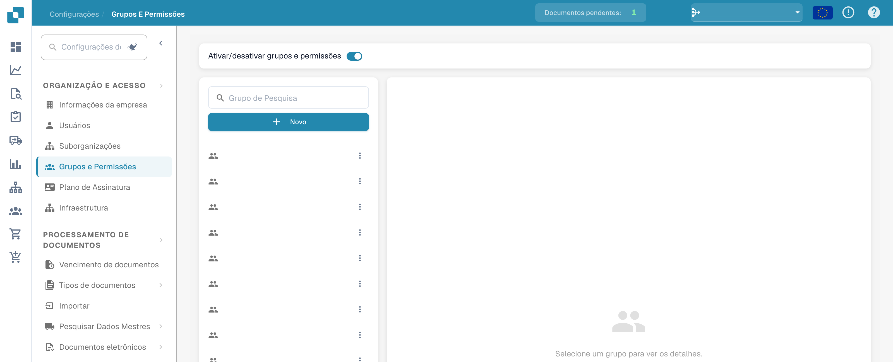
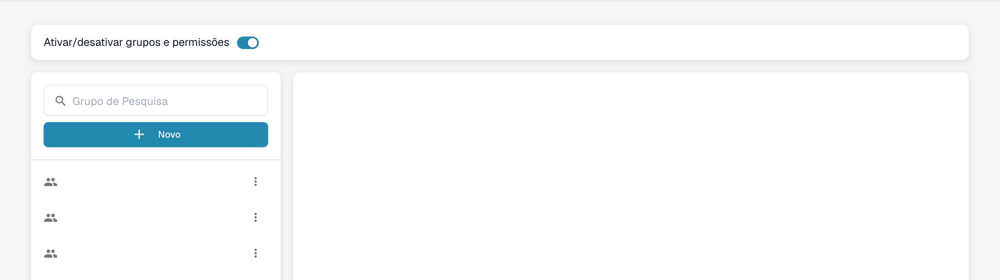
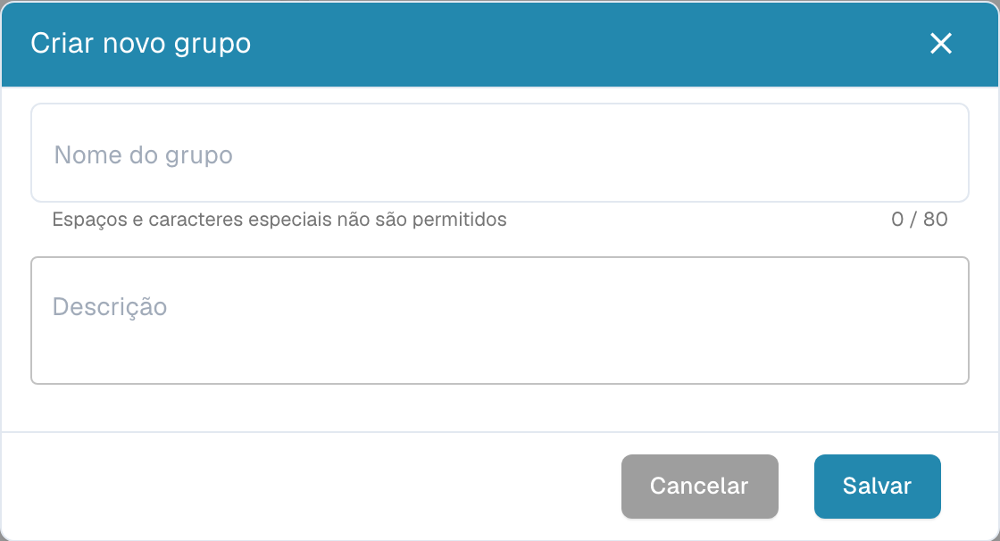
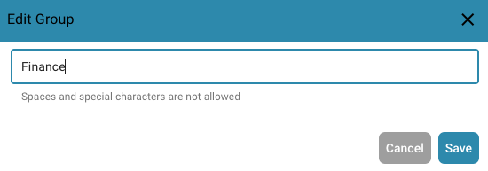
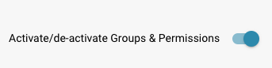

# Adicionando/Editando Grupos


Tutorial de grupos e permissões do DocBits: definir funções dos utilizadores, direitos de acesso e proteger a sua área de trabalho


## Para adicionar um novo grupo ou alterar as permissões de um grupo existente, você pode fazer o seguinte:

* **Navegue até Configurações do Grupo:** Faça login na sua conta de administrador e vá para Configurações do Grupo no painel de administração.

<figure><figcaption>
Acesso às definições de grupos e permissões.
</figcaption></figure>

Esta janela será aberta:

<figure><figcaption>
Lista de grupos com nomes ocultos.
</figcaption></figure>

* **Clique no botão + Novo:** Se você deseja adicionar um novo grupo, clique no botão + Novo para iniciar o processo de adição de um novo grupo.

<figure><figcaption>
Janela de um novo grupo sem guardar.
</figcaption></figure>

* **Preencha a tabela:** Forneça o nome do grupo e uma descrição do grupo.
* **Salve os detalhes:** Depois de preencher o nome e a descrição do grupo, clique no botão "Salvar".

<figure><figcaption>
Gestão de grupos e permissões.
</figcaption></figure>

## Editando Grupos:

* **Editar Grupos:** Para editar grupos, clique em "editar", aqui você pode alterar o nome do grupo.

<figure><figcaption></figcaption></figure>

<figure><figcaption></figcaption></figure>

* **Ativar Grupos e permissões:** Para tornar o grupo visível, "Grupos e permissões" devem ser ativados.

<figure><figcaption></figcaption></figure>

* **Verifique os resultados:** Após salvar, revise os resultados para garantir que o grupo foi adicionado, editado ou atualizado com sucesso.
