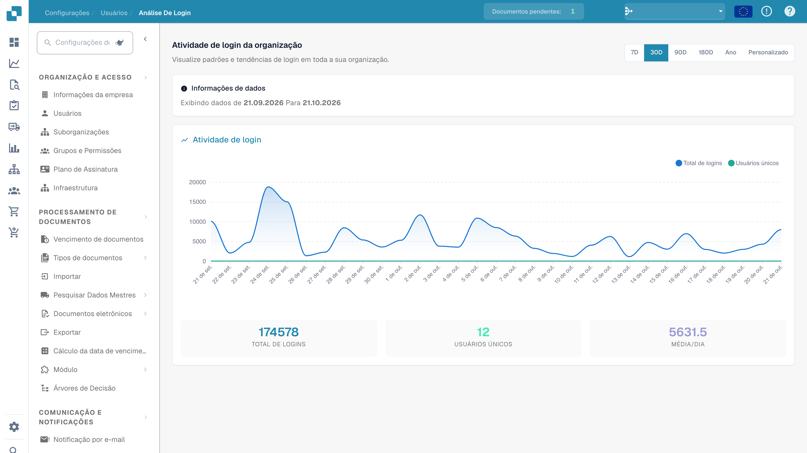

# Análise de Logins

A **Análise de Logins** oferece aos administradores uma visão somente leitura, abrangendo toda a organização, sobre *quando* e *com que frequência* as pessoas acessam o DocBits. Ela responde a perguntas como "os logins estão em tendência de alta?", "quantos usuários distintos estiveram ativos neste mês?" e "quando ocorrem os picos de uso?" — sem expor as credenciais ou os dados pessoais de qualquer usuário individual.

> **Acesso:** Abra **Configurações → Organização e Acesso → Usuários** e clique no botão **Análise de Logins** no canto superior direito (`/settings/login-analytics`).

<figure><figcaption>
Resumo da análise de acessos.
</figcaption></figure>

## Intervalo de tempo

Escolha o período a ser analisado com o seletor no canto superior direito: **7D**, **30D**, **90D**, **180D**, **Ano** ou **Personalizado** para um intervalo de datas livre. Tudo na página — o gráfico e os cartões de resumo — é recalculado para o período que você escolher.

O banner **Informações de dados** indica novamente a janela exata em exibição (por exemplo, *Showing data from 19.05.2026 to 18.06.2026*), de modo que fica sempre claro quais datas os números abrangem.

## Gráfico de atividade de login

O gráfico traça duas séries ao longo do período selecionado:

| Série | Significado |
|--------|-------------|
| **Total de logins** | O número de acessos por dia, incluindo logins repetidos pela mesma pessoa. |
| **Usuários únicos** | Quantos usuários *distintos* fizeram login naquele dia. |

Passe o cursor sobre qualquer ponto para ler o valor exato daquele dia. Os picos mostram os seus dias de maior movimento; uma linha de **Usuários únicos** plana sob uma linha de **Total de logins** cheia de picos significa que poucas pessoas fizeram login muitas vezes.

## Cartões de resumo

Abaixo do gráfico, três cartões resumem todo o período selecionado:

| Cartão | Significado |
|------|-------------|
| **Total de logins** | Todos os acessos ao longo do período. |
| **Usuários únicos** | Usuários distintos que fizeram login pelo menos uma vez. |
| **Média/Dia** | Número médio de logins por dia ao longo do período. |

## Privacidade

A Análise de Logins informa apenas números **agregados** — contagens e tendências da organização como um todo. Ela não lista usuários individuais, endereços de e-mail ou endereços IP. Para visualizar ou editar a conta de uma pessoa específica, utilize a página [Usuários](README.md).
