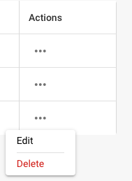

# Modificando Detalhes do Usuário

<figure><figcaption>
Configurações do Usuário
</figcaption></figure>

* **Fazendo login como administrador:** Faça login com seus privilégios de administrador.
* **Acessando a gestão de usuários:** Navegue até as configurações do usuário onde você pode editar usuários existentes.
* **Selecionando usuários:** Encontre e selecione o usuário cujos detalhes você deseja alterar. Isso pode ser feito clicando no nome de usuário ou em um botão de edição ao lado do usuário.

<figure><figcaption></figcaption></figure>

*   **Editando detalhes do usuário:** Um formulário aparecerá contendo os detalhes atuais do usuário. Edite os campos necessários de acordo com as alterações que você deseja fazer. Os detalhes típicos a serem editados incluem:

    * Nome e sobrenome
    * Endereço de e-mail
    * Função do usuário ou nível de permissão

    <figure><figcaption></figcaption></figure>
* **Salvando Alterações:** Revise quaisquer alterações que você fez e clique em Salvar para salvar os novos detalhes do usuário.

<figure><figcaption></figcaption></figure>

* **Revise o impacto das alterações de função:** Se você alterou a função do usuário, revise o impacto dessa mudança nos níveis de acesso de segurança. Certifique-se de que, após a mudança de função, o usuário tenha as permissões necessárias para continuar desempenhando suas funções.
* **Enviar notificação (opcional):** Você pode enviar uma notificação ao usuário para informá-lo sobre as alterações feitas.

Após concluir essas etapas, os detalhes do usuário são atualizados com sucesso e o usuário possui as novas informações e permissões de acordo com as alterações feitas.

## Removendo Usuários:

* **Selecionando Usuários:** Encontre e selecione o usuário cujo acesso você deseja remover. Isso pode ser feito clicando no nome do usuário ou em um botão de edição ao lado do usuário.

<figure><figcaption></figcaption></figure>

* **Removendo Acesso:** Clique em "deletar" para remover o usuário.

<figure><figcaption></figcaption></figure>

* **Confirmação:** Você será solicitado a confirmar a remoção do usuário.

<figure><figcaption></figcaption></figure>

* **Notificação Opcional:** Você pode opcionalmente enviar uma notificação ao usuário para informá-lo sobre a remoção de seu acesso.
* **Revisar Tarefas e Documentos:** Antes de remover o usuário, revise quais tarefas ou documentos estão atribuídos ao usuário. Mova ou transfira a responsabilidade por essas tarefas ou documentos para outro usuário para garantir que nada seja perdido ou deixado inacabado.
* **Salvar Alterações:** Confirme a remoção do usuário e salve as alterações.

Seguindo essas etapas, você pode garantir que o acesso do usuário seja removido com segurança enquanto gerencia adequadamente todas as tarefas e documentos relevantes.
