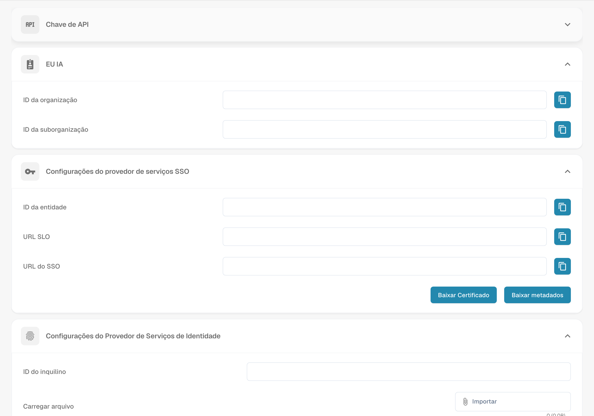

# Integração e SSO

<figure><figcaption>
Configuração da integração e dos fornecedores SSO. ID do inquilino refere-se ao identificador do tenant no fornecedor de identidade.
</figcaption></figure>

A página Integration & SSO gerencia as chaves de API para acesso programático, os IDs da organização e a configuração de Single Sign-On (SSO).

## API Key

Gerencie as chaves de API usadas para o acesso programático ao DocBits.

| Coluna | Descrição |
|--------|-------------|
| **Chave** | O valor mascarado da chave de API. Clique no ícone de cópia para copiar a chave completa. |
| **Nome** | Um nome descritivo para a chave. |
| **Expira** | Data de expiração (ou "Never"). |
| **Último uso** | Quando a chave foi usada pela última vez. |
| **Status** | Active ou Inactive. |
| **Ações** | Menu de três pontos para revogar ou excluir. |

Clique em **+ Create API Key** para gerar uma nova chave.

## ID

Mostra os identificadores da sua organização:

| Campo | Descrição |
|-------|-------------|
| **ID da organização** | O identificador único da sua organização. |
| **ID da suborganização** | O ID da suborganização atualmente selecionada. |

## SSO Service Provider Settings

Valores de configuração de SSO do DocBits necessários ao configurar o seu Identity Provider:

| Campo | Descrição |
|-------|-------------|
| **ID da entidade** | A URL de metadados SAML do DocBits. |
| **SLO URL** | URL de Single Logout. |
| **SSO URL** | URL do Assertion Consumer Service. |

Você também pode usar **Baixar Certificado** e **Baixar metadados** para a configuração do seu IdP.

## Identity Service Provider Settings

Configure o seu Identity Provider (IdP) externo:

| Campo | Descrição |
|-------|-------------|
| **ID do tenant** | O identificador do tenant do seu IdP. |
| **Carregar arquivo** | Faça o upload do arquivo XML de metadados do seu IdP. |

Clique em **Configurar** para salvar as configurações do seu IdP.

* **Maior eficiência:** A integração com outras ferramentas e serviços pode agilizar os fluxos de trabalho e aumentar a eficiência. Por exemplo, documentos podem ser trocados automaticamente entre o Docbits e um sistema de CRM, reduzindo a entrada manual e aumentando a produtividade
* **Consistência dos dados:** A integração permite que os dados sejam trocados de forma contínua entre diferentes sistemas, melhorando a consistência e a precisão dos dados. Isso evita inconsistências ou entradas de dados duplicadas que poderiam levar a erros.
* **Atualizações em tempo real**: A integração possibilita atualizações em tempo real entre diferentes plataformas, de modo que os usuários sempre tenham as informações mais recentes. Isso é especialmente importante para processos de negócio críticos que exigem informações em tempo real.
* **Automação de tarefas:** A integração permite automatizar tarefas de rotina, economizando tempo e recursos. Por exemplo, notificações podem ser acionadas automaticamente quando um determinado evento ocorre em outro sistema, sem necessidade de intervenção manual.
* **Melhor experiência do usuário:** Uma integração bem configurada garante uma experiência do usuário contínua, pois os usuários não precisam alternar entre diferentes sistemas para acessar as informações relevantes. Isso melhora a satisfação dos usuários e contribui para a eficiência.

Para configurar corretamente as definições de integração, é importante entender os requisitos da organização e garantir que a integração se encaixe perfeitamente nos fluxos de trabalho e processos existentes. Isso exige planejamento, configuração e monitoramento cuidadosos da integração para garantir que ela funcione sem problemas e entregue o valor desejado.
