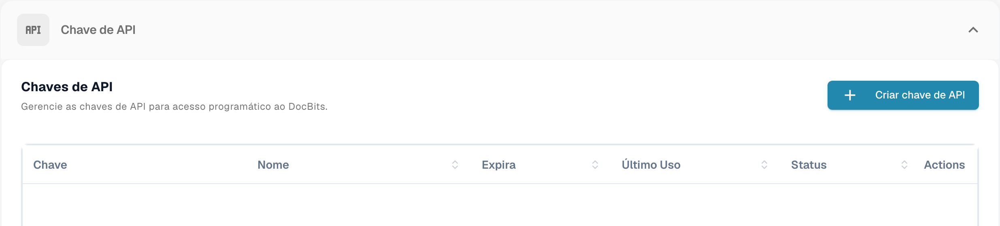
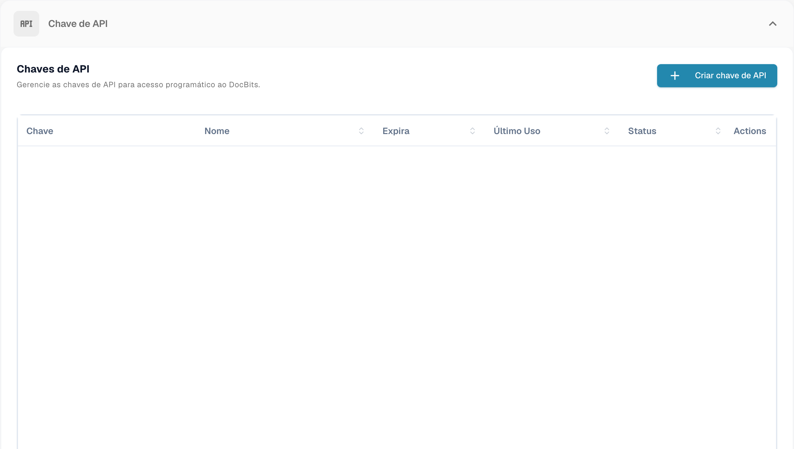
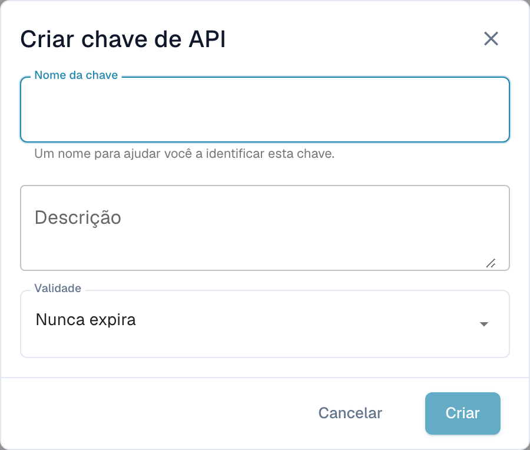

# Gestão de chaves API

Uma API key permite que outro sistema — o seu ERP, um script ou uma aplicação de um parceiro — fale com o DocBits sem que um utilizador inicie sessão. A sua organização pode ter tantas chaves quantas precisar, e cada uma é gerida em separado: dê-lhe um nome próprio, decida se expira e revogue-a isoladamente se alguma vez for exposta.

Como cada integração pode ter a sua própria chave, pode desligar uma sem perturbar nenhuma das outras.

## Abrir a gestão de chaves API

Vá a **Configurações** e selecione **Integração e SSO** em **Sistema e Administração**.

<figure><figcaption>
Acesso à gestão de chaves API.
</figcaption></figure>

A secção **Chave de API** no topo da página lista todas as chaves que a sua organização tem.

<figure><figcaption>
Lista de chaves API sem chaves nem nomes associados.
</figcaption></figure>

## Compreender a lista

<figure><figcaption>
Lista de chaves API; chaves e dados das contas ocultos. A coluna Actions significa ações.
</figcaption></figure>

| Coluna | O que lhe diz |
| --- | --- |
| **Chave** | Os primeiros caracteres da chave, seguidos de `****`. O resto nunca mais é mostrado depois de a criar — consulte [Criar uma chave API](#criar-uma-chave-api). |
| **Nome** | O nome que deu à chave, com a descrição por baixo. |
| **Expira** | A data em que a chave deixa de funcionar, ou **Nunca** se não tiver definido nenhuma. |
| **Último uso** | Quando chegou pela última vez um pedido com esta chave. **Nunca usado** significa que nenhum sistema a usou ainda — útil para detetar chaves que pode remover com segurança. |
| **Status** | **Ativo** significa que a chave funciona. Uma chave revogada fica desligada permanentemente. |
| **Ações** | O menu de três pontos, onde pode revogar a chave. |

Se tiver mais chaves do que cabem numa página, use os controlos de paginação no fundo da lista.


**Último uso** é a forma mais rápida de encontrar chaves de que já ninguém precisa. Uma chave que nunca foi usada, ou que não é usada há meses, é uma boa candidata a revogação.


## Criar uma chave API

1. Clique em **+ Create API Key** no canto superior direito da secção API Keys.
2. Preencha a caixa de diálogo:

<figure><figcaption>
Janela para criar uma chave API antes de guardar.
</figcaption></figure>

| Campo | O que introduzir |
| --- | --- |
| **Nome da chave** | Obrigatório. Dê-lhe o nome do sistema que a vai usar — `M3 Production`, `Invoice Import Script` — para conseguir perceber mais tarde a que integração pertence cada chave. |
| **Descrição** | Opcional. Espaço para uma nota sobre para que serve a chave ou quem a configurou. |
| **Validade** | Escolha uma data de expiração, ou deixe em **Nunca expira**. Uma data de expiração é a opção mais segura: a chave reforma-se sozinha se a integração alguma vez for esquecida. |

3. Clique em **Criar**. O DocBits mostra-lhe a nova chave:

4. Copie a chave com o ícone de cópia e cole-a diretamente no sistema que a vai usar, ou no seu gestor de palavras-passe.
5. Assinale **Copiei e salvei esta chave.** e clique em **Feito**.


**A chave completa é mostrada apenas uma vez.** O DocBits guarda um hash unidirecional da chave e um prefixo curto para identificação. Nem os seus administradores nem o suporte do DocBits podem recuperar a chave original completa a partir desse hash. Se a perder, revogue-a e crie uma nova.


Trate a chave como uma palavra-passe. Qualquer pessoa que a tenha pode atuar sobre os documentos e os dados da sua organização.

Consulte [Armazenamento seguro de credenciais](../../../../security/secure-storage-of-credentials.md).

A chave API completa aparece apenas uma vez, durante a criação. Copie-a para o armazenamento seguro aprovado e verifique a cópia antes de fechar a janela. A lista não volta a mostrar a chave secreta completa.
