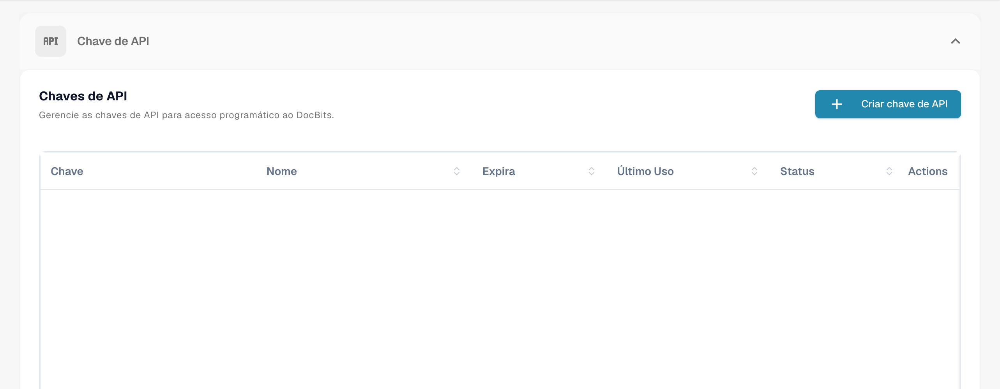

# Chave API

<figure><figcaption>
Lista de chaves de API com chaves e dados da conta ocultos.
</figcaption></figure>

### Lista de chaves de API

Uma chave de API permite que outros sistemas acedam ao DocBits sem iniciar uma sessão de utilizador. A imagem acima oculta as chaves e os dados da conta.

* **Chave:** A lista mostra apenas o prefixo, seguido de `****`. O ícone de cópia copia esse prefixo, não a chave completa. A chave completa é apresentada uma única vez, logo após a sua criação.
* **Nome / Expira / Último Uso / Status:** As colunas mostram o nome, a data de expiração, a última utilização e o estado da chave.
* **Criar chave de API:** Abre o diálogo para uma nova chave. A chave só é criada após a confirmação no diálogo. Consulte [Gestão de chaves de API](api-key-management.md) para conhecer os campos e a apresentação única da chave completa.
* **Actions (menu de três pontos):** Para chaves ativas, o menu permite editar o nome e a descrição ou revogar a chave. Para chaves inativas ou revogadas, apresenta a opção de eliminar. A alteração é confirmada no diálogo seguinte.

### Configurações do fornecedor de serviços SSO (Single Sign-On)

* **Entity ID:** Este é o identificador do DocBits como service provider na configuração de SSO. Ele identifica o DocBits de forma única dentro da estrutura de SSO.
* **SLO (Single Logout) URL:** O endpoint do serviço de encerramento de sessão único SAML do DocBits.
* **SSO URL:** O endpoint do Assertion Consumer Service (ACS) do DocBits recebe as respostas SAML do fornecedor de identidade. Utilize este endereço como URL de resposta (URL ACS) na configuração do fornecedor de identidade.
* Ações como "Download Certificate" e "Download Metadata" estão disponíveis para obter os certificados de segurança e as informações de metadados necessários para configurar e manter a integração de SSO.


Consulte a configuração de SSO


### Configurações do fornecedor de identidade

* Tenant ID: Pode ser usado quando o DocBits se integra a serviços em nuvem que exigem um identificador de tenant para gerenciar dados e configurações de acesso específicos da empresa que usa o Docbits.
* Upload file: Selecione o ficheiro XML de metadados fornecido pelo seu fornecedor de identidade.
* Configure: Depois de selecionar o ficheiro XML, clique em Configure para o carregar e guardar a configuração do fornecedor de identidade.
