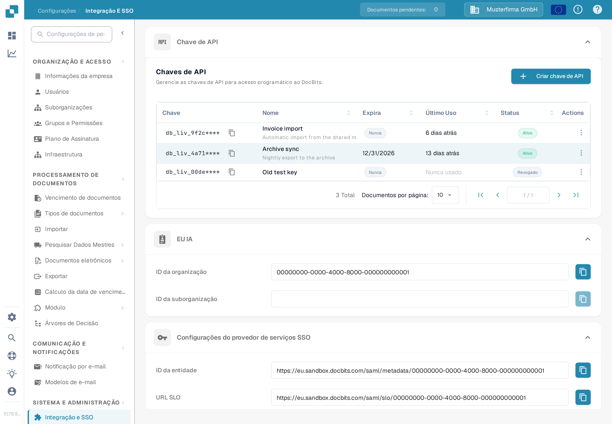

# Chave de API

<figure><figcaption>
Configurações → Integração e SSO → Chave de API. O prefixo da chave está oculto nesta captura de ecrã.
</figcaption></figure>

A secção **Chave de API**, no topo da página Integração e SSO, lista todas as chaves de API que a sua organização criou. Uma chave de API permite que outro sistema — o seu ERP, um script ou uma aplicação de um parceiro — aceda ao DocBits sem que um utilizador inicie sessão. Para instruções passo a passo, consulte [Gestão de Chaves API](api-key-management.md).

### Lista de chaves de API

* **Chave:** Os primeiros caracteres da chave, seguidos de `****`. A chave completa é mostrada apenas uma vez, quando é criada, pelo que não pode ser consultada novamente mais tarde. O ícone de copiar junto à chave copia o prefixo visível para a área de transferência.
* **Nome / Expira / Último Uso / Status:** Cada linha mostra o nome da chave, quando deixa de funcionar, quando um pedido a utilizou pela última vez e se ainda está ativa.
* **Criar chave de API:** Abre uma janela para criar uma nova chave para uma integração. Consulte [Gestão de Chaves API](api-key-management.md) para os campos e a apresentação única da chave.
* **Actions (menu de três pontos):** Abre as ações de uma chave, onde pode editar o nome, revogá-la ou eliminar uma chave que já tenha sido revogada. A revogação desativa a chave permanentemente.

### Configurações do provedor de serviços SSO (Single Sign-On)

Estes são os valores de que o seu Identity Provider precisa para permitir que os utilizadores iniciem sessão no DocBits com o login da sua empresa. Para o guia de configuração completo, consulte [Configuração de Single Sign-On (SSO)](configuring-single-sign-on-sso/).

* **ID da entidade:** O identificador do DocBits como provedor de serviços na configuração de SSO. O ícone de copiar copia o valor para a área de transferência.
* **URL SLO (Single Logout):** O URL utilizado para terminar a sessão de um utilizador em todas as aplicações ligadas através de SSO ao mesmo tempo. O ícone de copiar copia o valor.
* **URL do SSO:** O URL utilizado para iniciar o processo de início de sessão único. O ícone de copiar copia o valor.
* **Baixar Certificado:** Transfere o certificado de segurança de que o seu Identity Provider precisa para confiar no DocBits.
* **Baixar metadados:** Transfere o ficheiro de metadados SAML que pode ser importado diretamente na maioria dos Identity Providers.

### Configurações do Provedor de Serviços de Identidade

Configure o DocBits para utilizar o seu Identity Provider (IdP) externo no início de sessão. Para o guia completo, consulte [Configuração do Identity Service Provider](https://github.com/Fellow-Consulting-AG/docbits/tree/pt/readme/administration-and-setup/settings/global-settings/integration/identity-service-provider-configuration.md).

* **ID do inquilino:** O identificador de inquilino do seu Identity Provider, utilizado quando o DocBits se integra com serviços em nuvem que gerem o acesso por inquilino.
* **Carregar arquivo:** Carrega o ficheiro de metadados ou de configuração que recebeu do seu Identity Provider.
* **Configurar:** Guarda as definições e aplica a configuração carregada. Introduza primeiro o ID do inquilino ou carregue o ficheiro e, em seguida, clique em **Configurar**.
