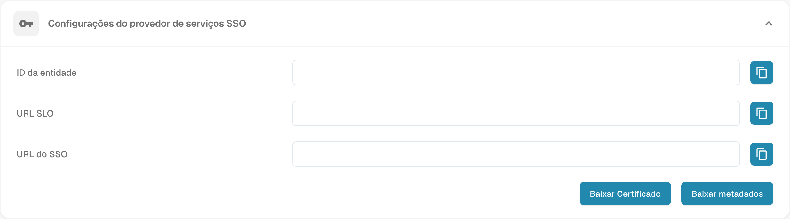

# Configurar o início de sessão único (SSO)

Configure o DocBits como fornecedor de serviços SAML (SP) e ligue o seu fornecedor de identidade (IdP). Precisa de acesso de administrador às definições relevantes de ambos os sistemas.

## Abrir as definições de SSO

Inicie sessão no DocBits como administrador e abra Início de sessão único nas definições de integração.

<figure><figcaption>
Definições do fornecedor de serviços SSO: dados da organização ocultos; nenhuma configuração foi guardada.
</figcaption></figure>

## Consultar os valores do fornecedor de serviços do DocBits

O DocBits apresenta Entity ID, SSO URL e SLO URL como valores só de leitura. Copie estes valores ou utilize os metadados do SP para configurar a aplicação DocBits no seu IdP; não introduza valores de substituição nestes campos do DocBits. Entity ID identifica o fornecedor de serviços. Utilize os pontos de ligação apresentados de acordo com os requisitos SAML do seu IdP.

## Transferir o certificado e os metadados do SP

Utilize Download Certificate e a transferência de metadados nas definições do fornecedor de serviços do DocBits. Estes ficheiros descrevem o DocBits como SP. Forneça ao IdP os metadados do SP e, se necessário, o certificado do SP transferido. Este certificado é distinto dos metadados do IdP que carrega no DocBits.

## Configurar o fornecedor de identidade

1. No seu IdP, configure o DocBits com os valores do SP apresentados no DocBits ou com os metadados do SP transferidos.
2. Utilize a Tenant ID do DocBits se o seu fornecedor a exigir. Verifique o contexto do tenant e do fornecedor nas definições do fornecedor de identidade do DocBits.
3. Obtenha junto do IdP os metadados SAML XML da aplicação configurada e carregue esses metadados XML do IdP no DocBits. Não os substitua pelos metadados do SP do DocBits transferidos anteriormente.
4. Guarde a configuração através da ação Configure/Save nas definições do fornecedor de identidade do DocBits.

## Testar o início de sessão e o fim de sessão suportado

Verifique se um utilizador consegue iniciar sessão no DocBits através do IdP configurado. Teste Single Log-Out apenas se o DocBits e o IdP o suportarem e estiver configurado em ambos os sistemas. Terminar a sessão no DocBits não garante, por si só, o fim de sessão em todas as outras aplicações ligadas.
