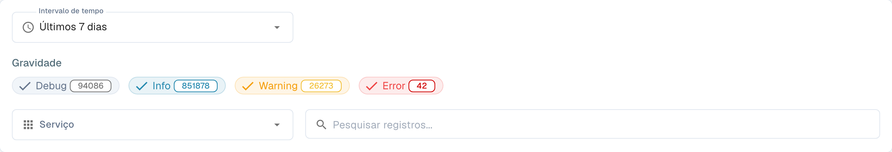
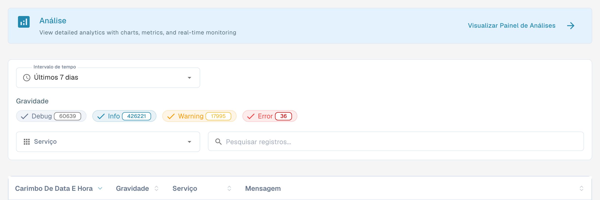

# Registo de atividade

<figure><figcaption>
Filtros do registo de atividade; entradas ocultas.
</figcaption></figure>

O Activity Logging oferece uma visão em tempo real dos eventos do sistema em todos os serviços do DocBits. Use-o para monitorar a atividade de processamento, solucionar erros e auditar o comportamento do sistema.

## Banner de Analytics

Na parte superior da página, um banner leva ao **Painel de Análise**, com gráficos, métricas e monitoramento em tempo real.

## Filtros

| Filtro | Descrição |
|--------|-------------|
| **Intervalo de tempo** | Selecione uma janela de tempo (por exemplo, Today, Last 7 Days, Last 30 Days). |
| **Gravidade** | Ative ou desative os níveis de severidade a incluir ou excluir: **Depurar**, **Informações**, **Aviso**, **Erro**. Cada chip mostra a contagem atual. |
| **Serviço** | Filtre os logs por serviço (por exemplo, api, auth, api-service). |
| **Search logs** | Pesquisa de texto livre nas mensagens de log. |

## Tabela de Logs

<figure><figcaption>
Registo de atividade na interface portuguesa: a coluna Serviço identifica o serviço que gerou o registo e corresponde ao filtro Serviço. As entradas e os metadados de exportação ficam fora desta vista.
</figcaption></figure>

| Coluna | Descrição |
|--------|-------------|
| **Carimbo de data e hora** | Data e hora em que o evento ocorreu. Ordenável. |
| **Gravidade** | Selo colorido: Info (azul), Warning (amarelo), Error (vermelho), Debug (cinza). |
| **Serviço** | O serviço ou módulo que gerou o log (por exemplo, api, auth, api-service). |
| **Mensagem** | A mensagem de log completa com os detalhes do evento. |

Os resultados são paginados — use os controles na parte inferior para navegar entre as páginas.

## Ações do Rodapé

| Ação | Descrição |
|--------|-------------|
| **Auto-refresh** | Ative para atualizar automaticamente a visualização dos logs em intervalos regulares. |
| **Refresh Now** | Atualize manualmente os dados de log. |
| **Export JSON** | Exporte os logs filtrados atuais como um arquivo JSON. |
| **Download Logs** | Baixe os dados de log completos. |
