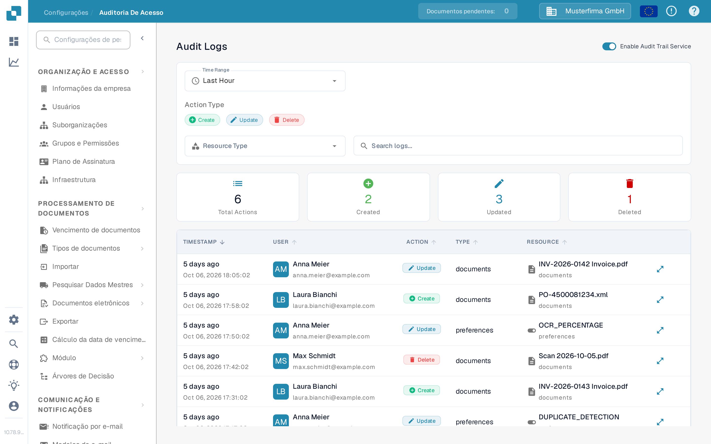
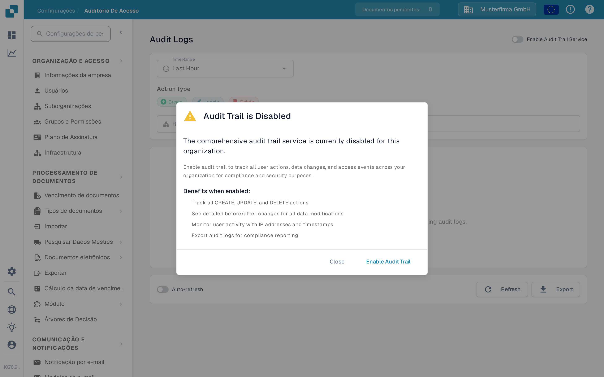

# Auditoria de Acesso

## Vídeo tutorial: Empresa, assinatura e auditoria


Informações da empresa, plano de assinatura e registros de auditoria no DocBits


O vídeo mostra as informações e as preferências da empresa, o plano de assinatura, a atividade de login e os registros de auditoria.

<figure><figcaption>
Exemplo de registo de auditoria ativado. A navegação está em português; os controlos do registo permanecem em inglês na ilustração.
</figcaption></figure>

A Auditoria de Acesso registra quem criou, alterou ou excluiu um recurso e quando. Abra **Configurações → Registro de atividades → Auditoria de Acesso** para consultar o registro. Ative o serviço para uma organização apenas quando você pretender coletar eventos de auditoria.

## Quando a gravação de auditoria está desativada

<figure><figcaption>
A caixa de diálogo explica o que será registrado antes de você ativar o serviço.
</figcaption></figure>

A primeira visita em uma sessão do navegador pode exibir **Audit Trail is Disabled**. **Close** fecha a caixa de diálogo e mantém a gravação de auditoria desativada. **Enable Audit Trail** ativa o serviço para a organização atual. Na página atrás da caixa de diálogo, **Enable Now** e o controle **Enable Audit Trail Service** também o ativam. Esses controles alteram a configuração da organização; eles não apenas mostram uma prévia do recurso.

Enquanto o serviço estiver desativado, os filtros e a tabela de logs não poderão mostrar eventos. O estado vazio explica como ativar a gravação. Após a ativação, use o controle para desativá-lo novamente, se necessário. Os eventos estão disponíveis somente quando o serviço está ativado e coletou dados.

## Encontrar um evento

| Controle | O que faz |
|---|---|
| **Time Range** | Limita a lista a um período, como Last Hour, Today ou Last 7 Days. |
| **Create**, **Update**, **Delete** | Inclui ou exclui esses tipos de ação. |
| **Resource Type** | Limita os resultados a um tipo de recurso, como documentos ou configurações. |
| **Search logs...** | Pesquisa por texto nas entradas de auditoria visíveis. |
| **Refresh** | Carrega uma vez as entradas correspondentes mais recentes. |
| **Auto-refresh** | Mantém a lista atualizada automaticamente enquanto a página estiver aberta. |
| **Export** | Baixa os dados atuais do log de auditoria como um arquivo JSON. |

Os cartões de resumo mostram as ações totais, criadas, atualizadas e excluídas para os filtros selecionados. Na tabela, **TIMESTAMP** mostra quando um evento ocorreu, **USER** identifica o autor, **ACTION** nomeia a alteração e **RESOURCE** identifica o item afetado. Abra o controle de detalhes de uma linha para inspecionar a alteração registrada. Se nenhum evento aparecer, verifique se o serviço está ativado e amplie o intervalo de tempo antes de alterar os outros filtros.
