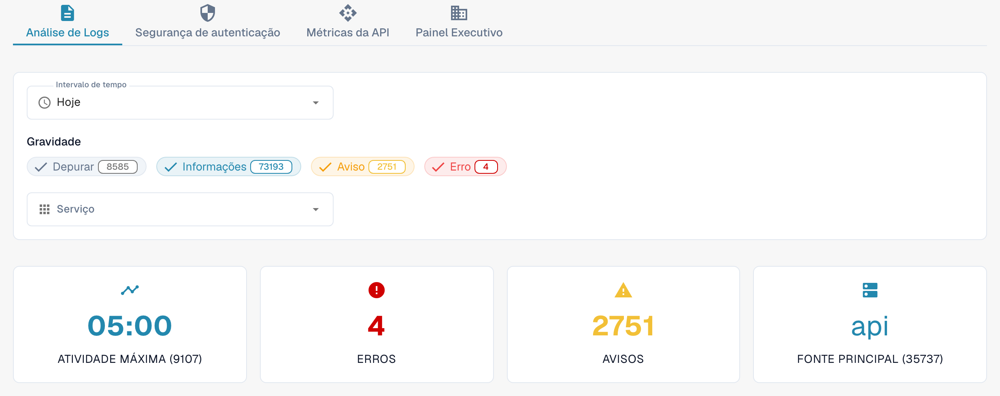

# Análise

Abra **Configurações → Registro de atividades → Análise** com uma conta de administrador da organização. A página reúne a atividade dos logs, eventos de autenticação, uso da API e uma visão executiva. Comece por **Análise de Logs**. Selecione **Visualizar registros de eventos** para abrir a lista de eventos e investigar uma entrada específica.

<figure><figcaption>
Visão atual do Dev em português. As contagens pertencem ao ambiente de teste e serão diferentes na sua organização.
</figcaption></figure>

## Abas

| Aba | Descrição |
|-----|-----------|
| **Análise de Logs** | Distribuição dos níveis dos logs, evolução no tempo e divisão por serviço. |
| **Segurança de autenticação** | Eventos de autenticação, tentativas de login e métricas de segurança. |
| **Métricas da API** | Volume de requisições à API, tempos de resposta e taxas de erro. |
| **Painel Executivo** | Visão geral para administradores da organização; a disponibilidade depende do perfil. |

Cada aba tem seus próprios controles de período. Confira novamente o período selecionado ao trocar de aba.

## Filtros de logs

| Filtro | Descrição |
|--------|-----------|
| **Intervalo de tempo** | Escolha **Última hora**, **Hoje**, **Últimos 7 dias**, **Últimos 30 dias** ou **Personalizado**. A opção personalizada mostra campos de data e hora inicial e final. |
| **Gravidade** | Clique em **Depurar** (Debug), **Informações**, **Aviso** ou **Erro** para incluir ou excluir esse nível. O número em cada filtro mostra a contagem atual. |
| **Serviço** | Selecione um ou mais serviços cujos eventos deseja consultar. |

## Cartões de resumo

Quatro cartões aparecem abaixo dos filtros:

| Cartão | Descrição |
|--------|-----------|
| **Atividade máxima** | Momento com o maior volume de logs e a contagem correspondente. |
| **Erros** | Número de erros no período selecionado. |
| **Avisos** | Número de avisos no período selecionado. |
| **Fonte principal** | Serviço que gera mais logs, com sua contagem. |

## Monitoramento de usuários reais (RUM)

Quando há telemetria do navegador, a seção RUM mostra métricas de desempenho do frontend. Os dados disponíveis dependem do ambiente e do período. Um gráfico vazio, uma mensagem de dados indisponíveis ou um indicador de carregamento não constitui um resultado medido.

## Gráficos de logs e downloads

Em **Análise de Logs**, escolha uma destas visualizações:

| Visualização | Descrição |
|--------------|-----------|
| **Gravidade** | Gráfico de setores com a distribuição dos níveis de log. |
| **Linha do tempo** | Gráfico de linhas com o volume de logs ao longo do tempo. |
| **Serviço** | Gráfico de barras com a divisão por serviço. |

No gráfico **Linha do tempo**, abra o menu no canto superior direito e escolha **Download SVG**, **Download PNG** ou **Download CSV**. Essas opções se referem ao gráfico exibido; outros gráficos podem não oferecer a mesma barra de ferramentas.

Se não houver dados disponíveis, tente ampliar **Intervalo de tempo** ou usar menos filtros de **Gravidade**.

## Erros de JS com rastreamento de pilha

Quando esse cartão está disponível, sua etiqueta de ambiente identifica o escopo dos erros, por exemplo **dev apenas**. O cartão lista exceções recentes do navegador, limitadas a 24 horas. **Copiar todo o JSON** copia as entradas atualmente carregadas nesse cartão, em vez do registro completo de eventos. O botão fica desativado quando não há entradas.

Para uma entrada disponível, clique na mensagem para expandir o rastreamento de pilha. As ações da linha copiam essa entrada como JSON ou copiam seu rastreamento de pilha. Um link de rastreamento só aparece se a entrada tiver um identificador de rastreamento.
