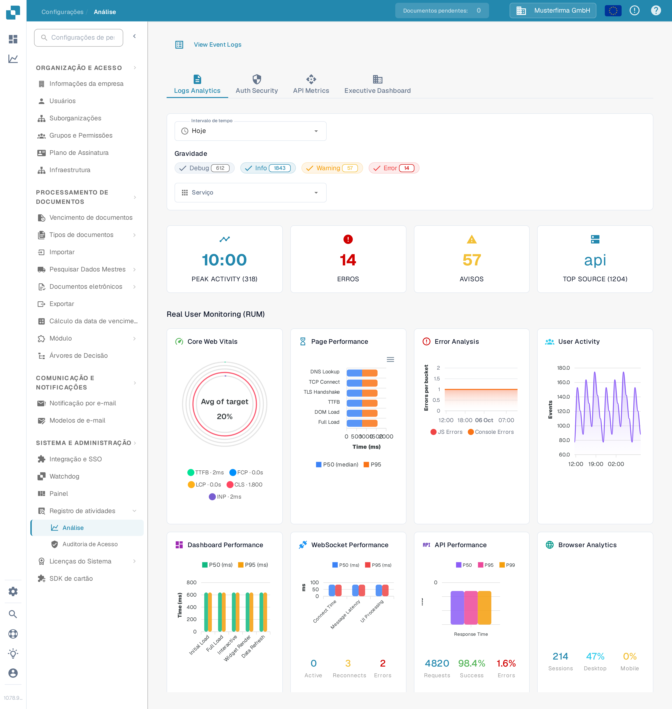

# Análise

<figure><figcaption>
Use as abas e os filtros para restringir as métricas que deseja examinar.
</figcaption></figure>

A página Análise ajuda você a examinar padrões de log, eventos de autenticação, uso da API e uma visão executiva. Comece por **Logs Analytics**. Escolha **View Event Logs** para abrir a lista de eventos subjacente quando precisar investigar uma entrada individual.

## Abas

| Aba                     | Descrição                                                                                      |
| ----------------------- | ---------------------------------------------------------------------------------------------- |
| **Logs Analytics**      | Distribuição de gravidade dos logs, gráficos de linha do tempo e divisão por serviço.          |
| **Auth Security**       | Eventos de autenticação, tentativas de login e métricas de segurança.                          |
| **API Metrics**         | Volumes de requisições de API, tempos de resposta e taxas de erro.                             |
| **Executive Dashboard** | Visão de alto nível para administradores da organização; outros perfis podem não ver esta aba. |

## Filtros

| Filtro                 | Descrição                                                                                                                  |
| ---------------------- | -------------------------------------------------------------------------------------------------------------------------- |
| **Intervalo de tempo** | Selecione uma janela de tempo (por exemplo, Hoje, Últimos 7 dias) para as métricas exibidas.                               |
| **Gravidade**          | Clique em Debug, Info, Warning ou Error para incluir ou excluir esse nível. Um número na etiqueta mostra a contagem atual. |
| **Serviço**            | Escolha o serviço cujos eventos deseja examinar.                                                                           |

## Cartões de resumo

Quatro cartões de resumo aparecem abaixo dos filtros:

| Cartão            | Descrição                                                     |
| ----------------- | ------------------------------------------------------------- |
| **PEAK ACTIVITY** | Horário do dia com o maior volume de logs e a contagem total. |
| **ERROS**         | Total de erros no período selecionado.                        |
| **AVISOS**        | Total de avisos no período selecionado.                       |
| **TOP SOURCE**    | O serviço que gera mais logs, com sua contagem.               |

## Real User Monitoring (RUM)

Abaixo dos cartões de resumo, as métricas de RUM mostram dados de desempenho do front-end coletados em sessões reais de navegadores de usuários.

## Gráficos de análise

Em **Logs Analytics**, selecione um dos três botões de gráfico para alterar a forma como os mesmos logs filtrados são exibidos:

| Visualização | Descrição                                                                                     |
| ------------ | --------------------------------------------------------------------------------------------- |
| **Severity** | Gráfico de setores que mostra a distribuição dos níveis de log (Debug, Info, Warning, Error). |
| **Timeline** | Gráfico de linhas que mostra o volume de logs ao longo do tempo.                              |
| **Service**  | Gráfico de barras que divide os logs por serviço.                                             |

Se um gráfico informar que não há dados disponíveis, tente um **Intervalo de tempo** mais amplo ou menos filtros de **Gravidade**. Os números na captura de tela pertencem à organização sintética da Sandbox e serão diferentes na sua organização.
