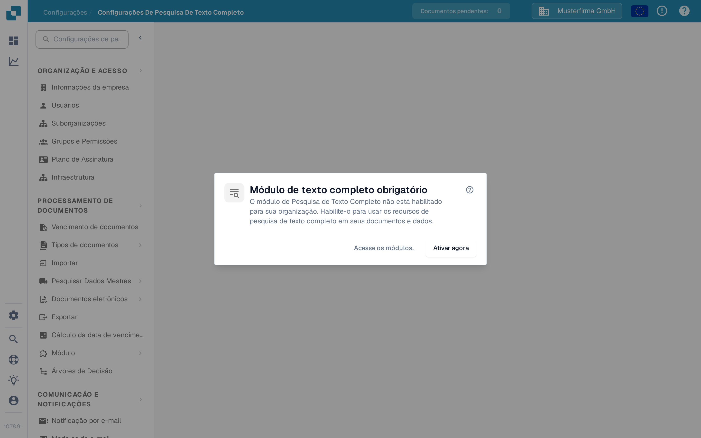

# Configurações de Pesquisa de Texto Completo

<figure><figcaption>
Quando a Pesquisa de Texto Completo está desativada, esta caixa de diálogo explica os próximos passos.
</figcaption></figure>

As Configurações de Pesquisa de Texto Completo definem o que o DocBits indexa e como torna esse conteúdo pesquisável em documentos, dados-mestre ERP e modelos. A página de configurações exibe uma caixa de diálogo de requisito até que o **módulo Pesquisa de Texto Completo** seja ativado — consulte [Pesquisa de texto completo](../document-processing/module/fulltext-search.md) para conhecer a linguagem de consulta voltada ao usuário.

## Pré-requisitos

O módulo Pesquisa de Texto Completo deve ser ativado em **Configurações → Módulo → Painéis e Análises → Pesquisa de texto completo**. Se o módulo não estiver ativado, a caixa de diálogo oferece três ações:

* **Ajuda (?)** — Abre a documentação da Pesquisa de Texto Completo em uma nova aba antes de alterar qualquer configuração.
* **Acesse os módulos.** — Abre as configurações do módulo Painéis e Análises para revisar a configuração.
* **Ativar agora** — Abre a caixa de diálogo de assinatura. Revise e confirme essa caixa de diálogo antes que o módulo seja ativado; clicar apenas neste botão não o ativa.

A própria página de configurações fica disponível assim que o módulo estiver ativo.

## Layout da página

A página de configurações é organizada em três abas, cada uma abrangendo um tipo de conteúdo diferente que a Pesquisa de Texto Completo pode indexar.

### Aba «Documentos»

A aba Documentos cobre tudo relacionado à indexação de documentos processados:

* **Estatísticas de indexação** — totais de documentos indexados e pendentes, atualizados sob demanda.
* **Preferências de vetor** — três interruptores no nível da organização que decidem se a indexação vetorial é executada junto com o índice de texto para documentos. A indexação vetorial alimenta o modo de consulta `vector:` e o recurso «Encontrar semelhantes».
* **Ações de reindexação** — inicie uma reindexação completa ou incremental. Enquanto uma reindexação é executada, você vê o progresso ao vivo (documentos por minuto, tempo restante estimado), o estado atual do fluxo e a última falha (se houver).
* **Diagnóstico de sincronização** — diagnóstico sob demanda para os casos em que o índice parece estar fora de sincronia com o repositório de documentos subjacente.

<mark>A reindexação não é destrutiva — a pesquisa existente continua funcionando enquanto o novo índice está sendo reconstruído.</mark>

### Aba «ERP»

A aba ERP controla a indexação dos dados-mestre ERP — fornecedores, clientes, itens e entidades semelhantes. Cada entidade tem seu próprio interruptor:

* **Indexação** — indexa a entidade textualmente para que possa ser pesquisada a partir do painel.
* **Vetor** — indexa a entidade vetorialmente para que possa ser correspondida por consultas semânticas.

Use a ação **Alternar tudo** no topo da lista para aplicar o mesmo estado ligado/desligado a todas as entidades de uma vez. A indexação é iniciada em segundo plano; um indicador em cada linha mostra quando está em andamento.

### Aba «Modelos»

A aba Modelos lista as versões de modelo conhecidas pelo índice de Pesquisa de Texto Completo. Use esta visualização para confirmar, após um novo deploy, que as versões de modelo das quais você depende estão presentes no índice.

## O que é indexado

Depois de ativada e configurada, a Pesquisa de Texto Completo permite que os usuários:

* Pesquisem em todo o conteúdo do documento (não apenas nos campos de metadados).
* Encontrem documentos pelo texto contido nos arquivos enviados.
* Usem operadores de pesquisa avançados para consultas precisas.
* Acessem os resultados de pesquisa diretamente do painel.
* Usem a pesquisa semântica (prefixo `vector:`) quando a indexação vetorial estiver ativa para aquele tipo de conteúdo.

Consulte a página do módulo [Pesquisa de texto completo](../document-processing/module/fulltext-search.md) para obter a referência completa da linguagem de consulta, incluindo consultas por intervalo, filtros inteligentes e o modo de pesquisa por IA.
