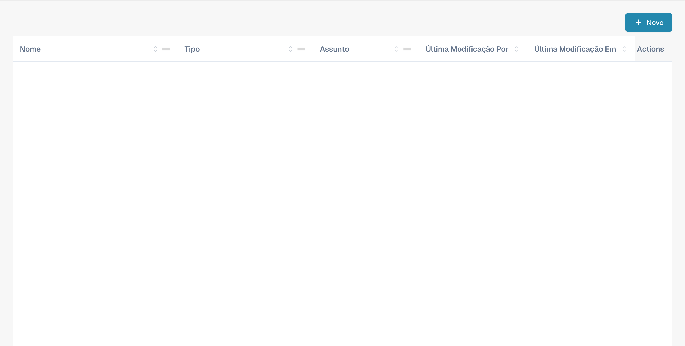
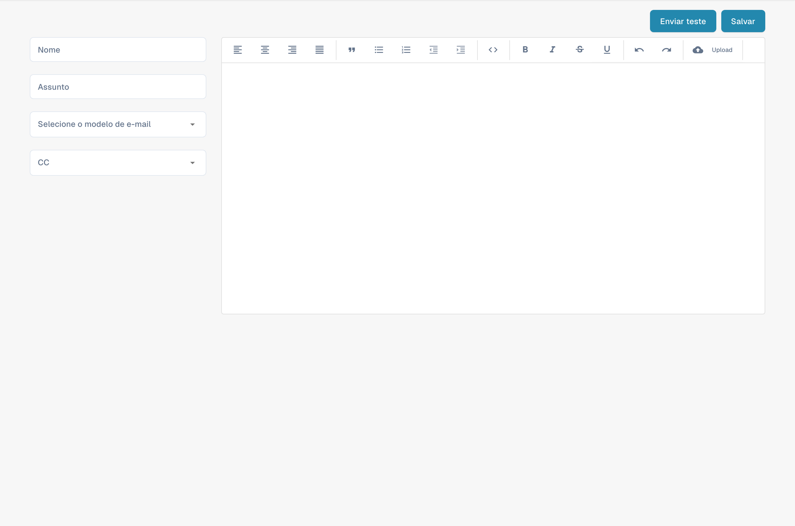

# Edição de Modelos de E-mail

<figure><figcaption><p>Lista de modelos de e-mail para fornecedores.</p></figcaption></figure>

### Visão Geral

O recurso de Modelos de E-mail permite que administradores criem e personalizem comunicações por e-mail que são enviadas automaticamente aos fornecedores. Um dos elementos-chave utilizados nesses modelos é o `{{magic_link}}`, que fornece um link dinâmico adaptado a cada destinatário.

#### O que é `{{magic_link}}`?

O `{{magic_link}}` é um espaço reservado que é substituído dinamicamente por uma URL única quando o e-mail é enviado. Essa URL geralmente direciona o destinatário para concluir uma ação, como registro, aprovação ou acesso a uma parte específica do portal do fornecedor.

### Edição de Modelos de E-mail

<figure><figcaption><p>Editor de um novo modelo de e-mail para fornecedores.</p></figcaption></figure>

#### Acessando o Editor de Modelos de E-mail

1. **Navegue até Modelos de E-mail**:
   * Vá para a seção **Modelos de E-mail** no menu principal.
2. **Selecione um Modelo para Editar**:
   * Escolha o modelo de e-mail que você deseja editar clicando no nome do modelo (por exemplo, "Supplier Invitation Email").
3. **Edite o Modelo**:
   * O editor permite modificar tanto o código HTML quanto o design visual do e-mail.
   * Você pode alternar entre a edição visual e a edição de código usando as abas fornecidas.

<figure><figcaption></figcaption></figure>

#### Definindo `{{magic_link}}` como um Link

Para definir `{{magic_link}}` como um link clicável no e-mail, é preciso garantir que ele esteja formatado corretamente no código HTML do modelo. Siga estas etapas:

1. **Localize a Seção do Link no Código HTML**:
   * No editor de código, encontre a seção onde você deseja que o magic link apareça. Isso geralmente fica dentro de uma tag `<a>` (âncora).
2.  **Insira o Espaço Reservado `{{magic_link}}`**:

    * Substitua o atributo `href` da tag âncora por `{{magic_link}}`.
    * Certifique-se de que o link esteja estilizado adequadamente para o modelo de e-mail. Aqui está um exemplo:

    ```html
    <a href="{{magic_link}}" target="_blank" style="
        background-color: #B7184B;
        border-radius: 25px;
        font-family: 'Montserrat', Arial, sans-serif;
        font-size: 14px;
        font-weight: bold;
        padding: 12px 25px;
        color: #FFFFFF;
        text-decoration: none;
        display: inline-block;
        cursor: pointer;">
        Complete Registration
    </a>
    ```

### 3. Personalize o Texto do Link:

• Modifique o texto entre as tags de abertura \<a> e de fechamento \</a> para refletir a ação que você deseja que o usuário execute. Por exemplo, “Concluir o registro” ou “Acessar sua conta”.

4\. Salve e Teste o Modelo:

• Depois de fazer as alterações, clique no botão Salvar.

• Você pode usar o botão Enviar Teste para enviar um e-mail de teste e garantir que o link funcione conforme o esperado.

## Melhores Práticas para Usar \{{magic\_link\}}

• Posicionamento do link: Coloque o \{{magic\_link\}} em destaque no e-mail para garantir que os destinatários o acessem com facilidade.

• Chamada para ação clara: O texto dentro do link deve ser uma chamada para ação clara, como “Concluir o registro” ou “Confirmar seu e-mail”.

• Estilo: Certifique-se de que o link esteja estilizado de forma consistente com o restante do modelo de e-mail e se destaque visualmente.

• Testes: Sempre envie um e-mail de teste depois de editar o modelo para verificar se o \{{magic\_link\}} é resolvido corretamente e se o estilo está apropriado.

## Conclusão

Ao definir corretamente o \{{magic\_link\}} nos seus modelos de e-mail, você garante que os destinatários recebam um e-mail personalizado e acionável, que os leve à tarefa apropriada no seu portal do fornecedor. Isso melhora a experiência do usuário e garante processos de integração e comunicação tranquilos.

\

Esta documentação fornece instruções passo a passo para administradores sobre como definir e usar o \{{magic\_link\}} em modelos de e-mail, garantindo que os e-mails sejam funcionais e visualmente atraentes.
