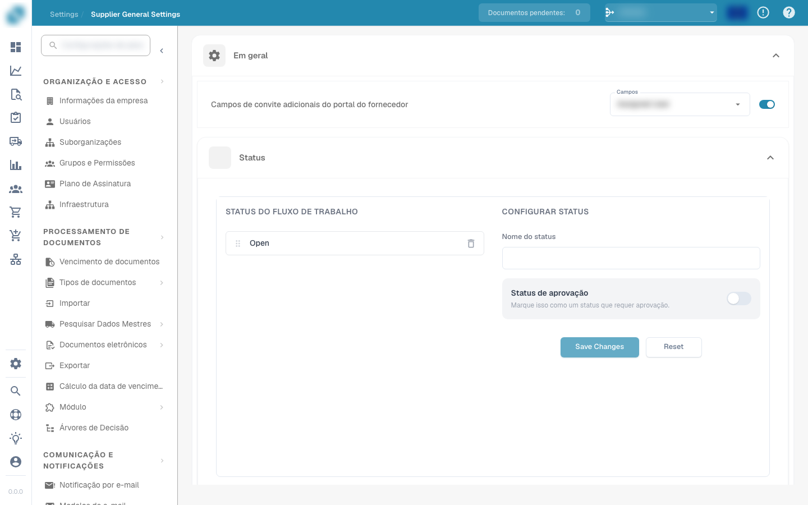

# Layout do Fornecedor

Aqui é onde você decide quais informações deseja incluir e define quais informações são necessárias. Você pode projetar facilmente o seu layout usando as funções de arrastar e soltar.

<figure><figcaption></figcaption></figure>

Você pode utilizá-lo para criar layouts para usuários fornecedores e para o gerenciamento de fornecedores.
