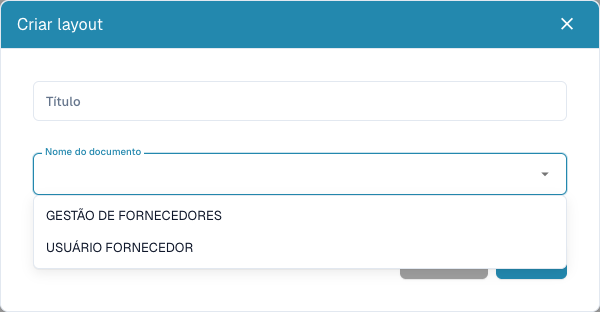

# Configurar formulários de fornecedores

<figure><figcaption>
Escolha o público externo ou interno antes de guardar um esquema.
</figcaption></figure>

Os esquemas de fornecedores definem formulários externos e internos. Não alteram a fatura impressa nem treinam a extração. Precisa de direitos administrativos e requisitos acordados para cada público.

## Escolher o público

1. Abra **Definições → Definições de fornecedores → Esquema de fornecedores**.
2. Analise os esquemas existentes e abra o correto antes de criar outro.
3. Para um novo, escolha **Novo**, título claro e tipo de documento: utilizador fornecedor para o externo, gestão de fornecedores para o interno.
4. Guarde a definição, abra o esquema na lista e confirme o público.

## Configurar campos e estrutura

1. Abra os campos de fornecedores. Verifique título, nome do campo ERP, lista de valores e propriedades obrigatório, só de leitura e oculto.
2. Crie um campo com nome, título e tipo. Seleção/pesquisa/opções exigem a lista correta. Ficheiros exigem o tipo de documento; nos outros campos confirme o nome ERP.
3. Guarde as definições corretas. Definição e disposição são etapas distintas.
4. Organize grupos e campos através de **Elementos** e **Campos** no esquema correto. Selecione um elemento e examine as propriedades disponíveis.
5. Atribua nomes e títulos válidos aos grupos. Não oculte/bloqueie um campo obrigatório sem valor existente ou processo adequado.
6. Guarde e reabra o esquema. **Cancelar** sai do editor. O modelo predefinido pode substituir a disposição atual; use-o deliberadamente.

## Testar as duas vistas

Com fornecedor fictício e conta de teste, verifique separadamente registo e detalhes internos: mensagens obrigatórias, opções, ficheiros e campos ocultos/só de leitura. Guardar no editor não comprova registo, aprovação ou exportação bem-sucedidos.

Para campos ausentes, verifique definição, visibilidade, esquema e público. Para valores ERP em falta, examine também o mapeamento de exportação.

Consulte [Portal de fornecedores](../../setup/supplier-portal/README.md), [Definições gerais](supplier-general-settings.md) e [Permissões](supplier-permissions.md).
