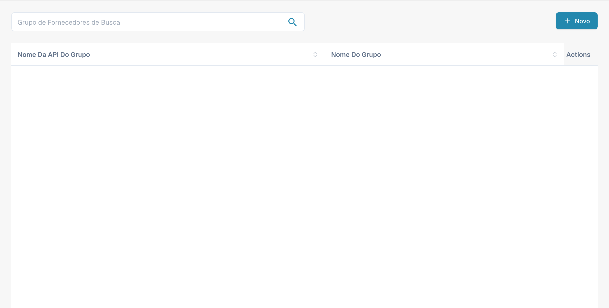
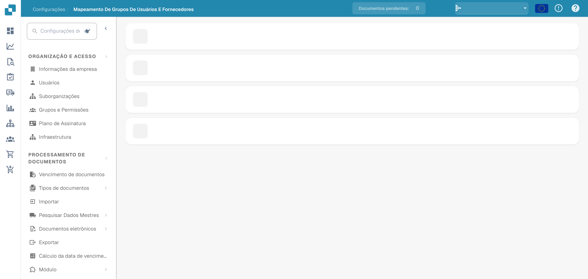

# Permissões do Fornecedor

### Grupo de Fornecedores

<figure><figcaption>
Grupos de fornecedores com nomes ocultos.
</figcaption></figure>

Gerencie grupos de fornecedores para categorizar os fornecedores por tipo, região ou função. Cada grupo tem um **Nome da API do grupo** (usado em integrações) e um **Nome do grupo** (nome de exibição).

Clique em **+ New** para criar um grupo. Use o menu de três pontos em cada linha para editar ou excluir.

### Mapeamento de Usuários e Grupos de Fornecedores

<figure><figcaption>
Associação de utilizadores aos grupos de fornecedores.
</figcaption></figure>

Atribua usuários a grupos de fornecedores para controlar quais colaboradores podem acessar e gerenciar conjuntos específicos de fornecedores. Cada grupo é exibido como uma seção expansível que lista os usuários atribuídos, com a contagem de membros.

Clique em **+ New** dentro de um grupo para adicionar um mapeamento de usuário. Use o menu de três pontos para remover um mapeamento.
