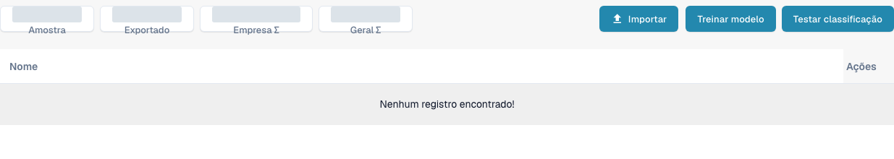

# Treino de documentos

O treino de documentos ensina o DocBits a encontrar valores nos documentos que ainda não lê corretamente. Treine separadamente os campos de cabeçalho e os campos de linha.

Para consultar o treino de classificação de um tipo de documento, abra **Configurações** → **Tipos de documentos** e escolha **Treinamento de modelo** no cartão de um tipo de documento existente. A vista apresenta os exemplos de treino e os controlos **Importar**, **Treinar modelo** e **Testar classificação**. Reveja os exemplos existentes antes de efetuar alterações e utilize ficheiros de teste autorizados em treinos ou testes de classificação posteriores.

<figure><figcaption>
Vista portuguesa de treino de modelos para um tipo de fatura existente. Não estão listados documentos de exemplo; os contadores agregados estão cobertos. Não foram realizadas importações nem sessões de treino ou testes de classificação.
</figcaption></figure>

* [Treinar campos de cabeçalho](training-header-fields.md): assinale onde aparece no documento um valor de cabeçalho, como uma data ou um montante total.
* [Treinar campos de linha e tabelas](training-line-fields-table-training/README.md): defina a estrutura da tabela de linhas para um fornecedor específico.

Os resultados do treino dependem dos documentos utilizados. Verifique os valores extraídos noutro documento de teste antes de confiar neles.
