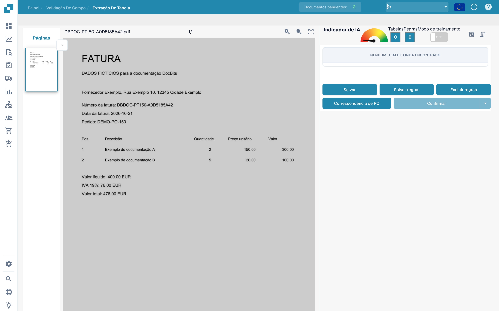
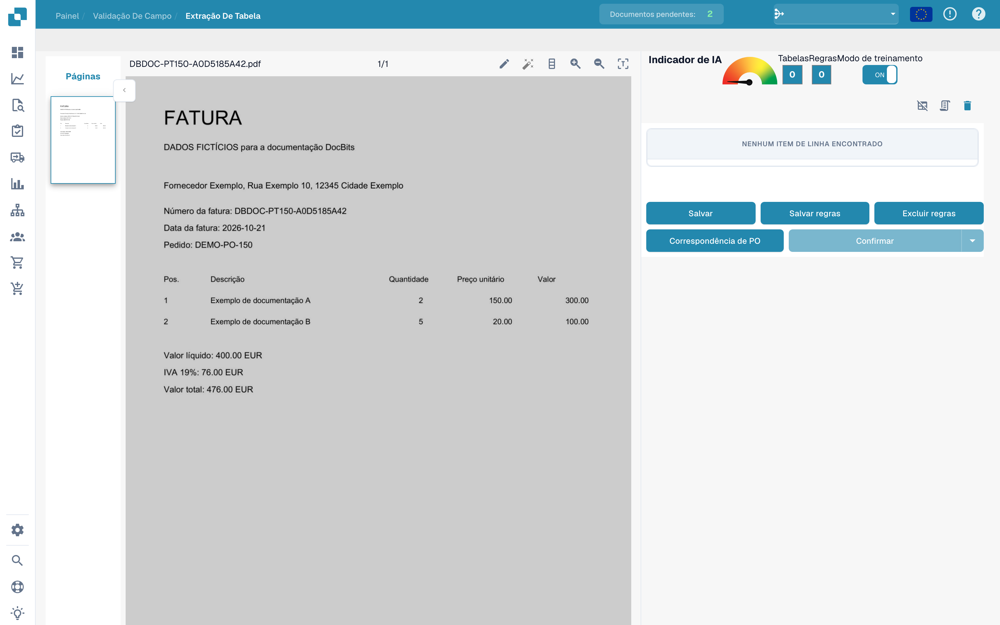
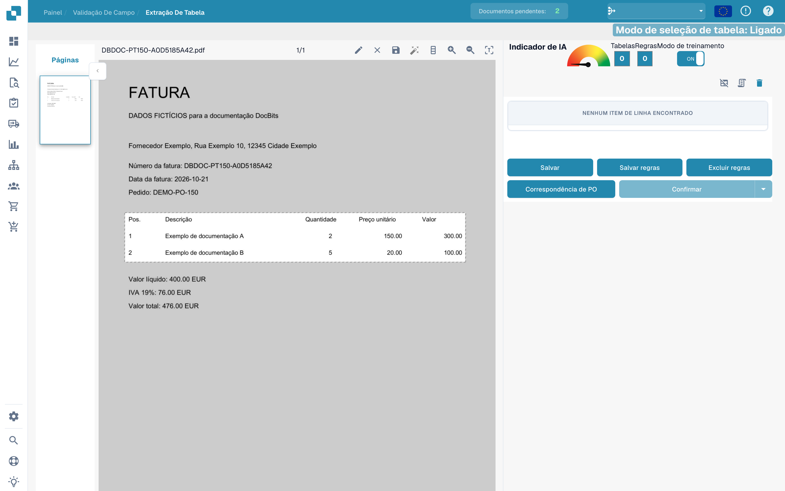
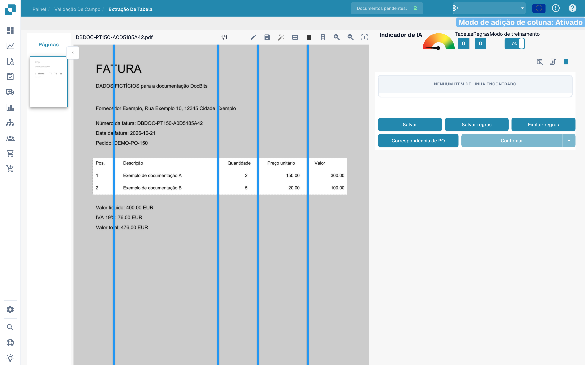
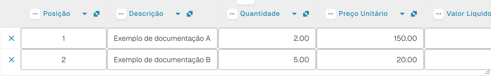

# Definir tabelas e colunas

Se uma tabela não for totalmente reconhecida, o treino de tabelas permite indicar a área e as colunas. Os exemplos utilizam uma fatura fictícia e um rascunho sem guardar.

## Abrir o treino

Abra o documento na validação de campos e aceda à extração de tabelas.

<figure><figcaption>
Interface para definir tabelas e colunas.
</figcaption></figure>

Ative o modo de treino para mostrar as ferramentas de seleção e colunas.

<figure><figcaption>
Treino de tabela com o modo de treino ativo.
</figcaption></figure>

A barra de ferramentas também disponibiliza deteção automática. Compare o resultado com o documento: a imagem mostra as ferramentas disponíveis e não comprova uma deteção concluída.

<figure><figcaption>
Ferramentas de treino de tabela, incluindo deteção automática.
</figcaption></figure>

## Indicar a área e as colunas

Desenhe com o lápis um retângulo que inclua os cabeçalhos e as linhas da fatura. Deixe os totais abaixo fora da área.

<figure><figcaption>
Área de tabela sobre as linhas da fatura fictícia, sem guardar.
</figcaption></figure>

Escolha a ferramenta de colunas e coloque separadores verticais entre as colunas reais.

<figure><figcaption>
Área de tabela com separadores verticais das colunas.
</figcaption></figure>

Verifique posição, descrição, quantidade, preço unitário e montante.

<figure><figcaption>
Separadores entre as colunas da fatura fictícia.
</figcaption></figure>

Verifique toda a área e todos os separadores antes de guardar o documento ou as regras.

<figure><figcaption>
Área e separadores num rascunho de treino sem guardar.
</figcaption></figure>

## Verificar a extração

Compare as linhas lidas com a fatura. A imagem seguinte mostra linhas já extraídas automaticamente na validação. Não são o resultado do rascunho de treino apresentado acima.

<figure><figcaption>
Linhas da fatura fictícia lidas automaticamente na validação.
</figcaption></figure>

Após guardar o treino pretendido, teste outros documentos do mesmo fornecedor. Uma fatura não comprova uma extração fiável para todos os layouts.
