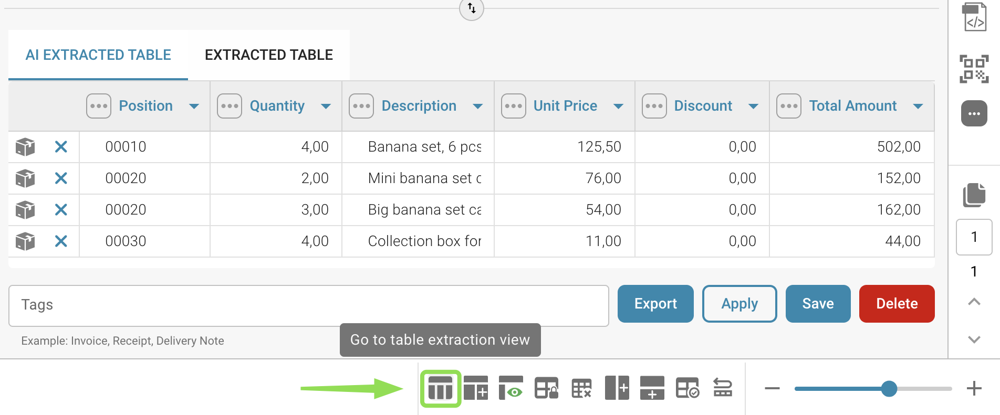
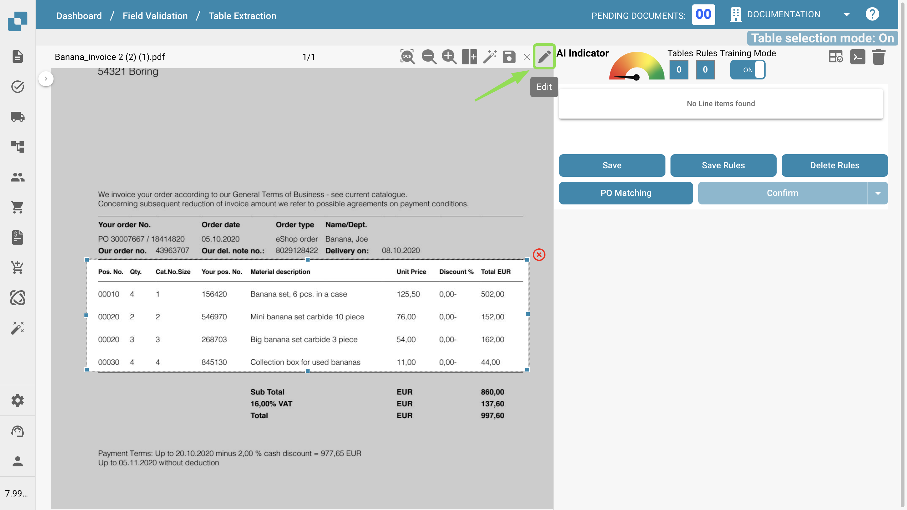

# Definindo Tabelas e Colunas

Use este guia para definir manualmente tabelas e colunas para a extração de itens de linha no DocBits. Isso é especialmente útil quando a detecção automática não captura totalmente a estrutura da tabela ou quando você precisa adicionar campos personalizados.

### 1. Acesse a Visualização de Extração de Tabelas

Abra o seu documento no DocBits e clique no botão **“Table Training”** para entrar na visualização de extração de tabelas.

<figure><figcaption></figcaption></figure>

### 2. Ative o Modo de Treinamento

Para definir ou modificar tabelas e colunas manualmente, clique em **“TRAINING MODE”.**

<figure><figcaption></figcaption></figure>

### 3. Defina a Área da Tabela

Depois de entrar no Modo de Treinamento, você pode definir onde a tabela está no documento. Você tem duas opções:

#### Opção 1: Usar a Detecção Automática

Clique no botão **“Auto-Detect Tables”** para que o DocBits tente identificar a área da tabela por conta própria.

<figure><figcaption></figcaption></figure>

Se a detecção for bem-sucedida, o contorno da tabela será exibido automaticamente. Em seguida, você pode prosseguir para a definição das colunas.

#### Opção 2: Definir a Tabela Manualmente

Se a detecção automática falhar ou for imprecisa, você pode definir a tabela manualmente:

1. Clique no botão **“Edit”** para ativar o modo de seleção de tabela.
2. Desenhe um retângulo ao redor da área da tabela na visualização do documento à esquerda.

<figure><figcaption></figcaption></figure>

### 4. Adicione e Defina as Colunas

Depois que as tabelas estiverem definidas, você pode definir as colunas manualmente por meio do seguinte botão:\

<figure><figcaption></figcaption></figure>

Defina e ordene as colunas arrastando e soltando no documento. Repita isso para as tabelas nas outras páginas também. Como alternativa, se as tabelas forem iguais em cada página, você pode usar o seguinte botão para usar a mesma coluna em todas as tabelas definidas no documento. Essa funcionalidade copia as colunas que você definiu para todas as outras páginas também:

<figure><figcaption></figcaption></figure>

Use o recurso de **zoom** para definir melhor as colunas em documentos confusos ou complexos, por exemplo, quando muitas informações estão próximas umas das outras e isso dificulta a definição das colunas:

<figure><figcaption></figcaption></figure>

Se você definiu uma coluna por engano, ela pode ser selecionada clicando nela e excluída por meio do seguinte botão:

<figure><figcaption></figcaption></figure>

<mark style="color:red;">**Nota**</mark>: O botão só fica visível se a coluna estiver selecionada.

Se você terminou de definir todas as tabelas e todas as colunas no seu documento, use o botão “Save” para ativar suas alterações e extrair os dados do documento:

<figure><figcaption></figcaption></figure>

Os dados de todas as áreas definidas serão extraídos e exibidos no lado direito:

<figure><figcaption></figcaption></figure>

### 6. Salve e Extraia

Clique em **“Save Rules”** quando todas as tabelas e colunas tiverem sido definidas.

* Isso informa ao DocBits onde encontrar os dados de tabela para este fornecedor específico.
* Na próxima vez que um documento do mesmo fornecedor for enviado, o DocBits extrairá a tabela automaticamente usando as regras salvas.

<mark style="color:red;">**Nota**</mark>: Este treinamento é específico para cada fornecedor. Ele não será aplicado a documentos de outros fornecedores.

