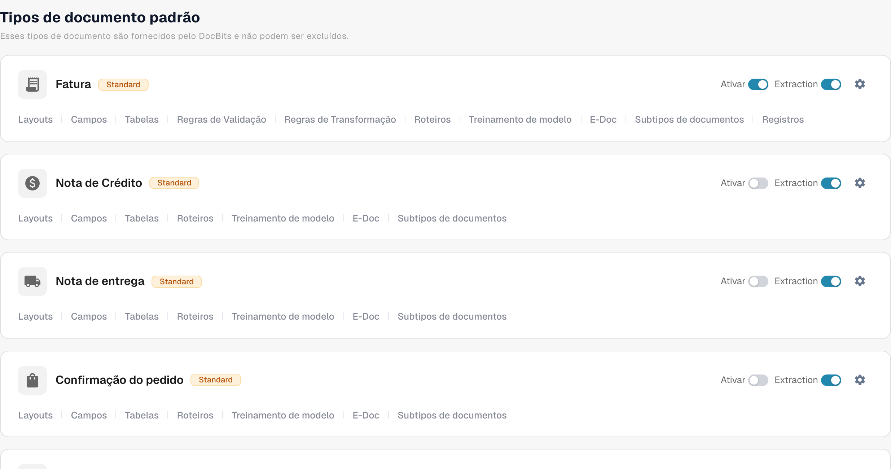
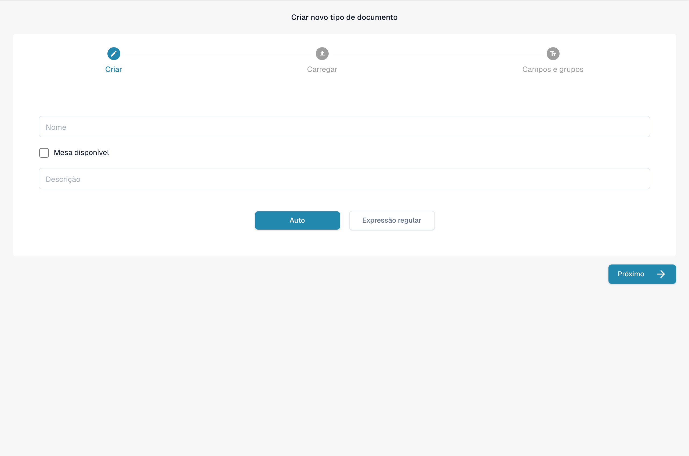

# Tipos de Documento

Os tipos de documento informam ao DocBits com quais tipos de documentos a sua organização trabalha. Um administrador os encontra em **Settings → Document Types**, na seção **Processamento de documentos** do menu de configurações.

A página mostra os **Tipos de documento padrão**, que o DocBits fornece e que você não pode excluir, seguidos dos **Tipos de documentos personalizados** criados para a sua organização. Cada tipo tem o seu próprio cartão.

<figure><figcaption>
Tipos de documentos predefinidos e acesso às suas definições.
</figcaption></figure>

## O que você pode fazer em um cartão

| Controle | O que faz |
| --- | --- |
| **Ativar** | Torna este tipo de documento disponível ou indisponível na sua organização. Um interruptor azul está ligado; um interruptor cinza está desligado. |
| **Extração** | Escolhe o modo de extração: **Flex** quando ligado ou **Fix** quando desligado. Ele não simplesmente liga ou desliga a extração. Passe o mouse sobre o interruptor para ver o modo atual. |
| **Configurações** (engrenagem) | Abre **More Settings** para este tipo. Expanda uma categoria ali para ver suas opções. As categorias dependem do tipo de documento. |
| **Layouts** | Abre a configuração de layouts. Consulte [Layout Builder](layout-builder.md) para os próximos passos. |
| **Campos** | Abre as configurações de campos e de reconhecimento deste tipo. Consulte [Fields](../../settings/global-settings/document-types/fields/README.md) para saber como configurá-los. |
| **Tabelas** | Abre a configuração das colunas de tabela deste tipo. |
| **Roteiros** | Abre os scripts de processamento quando este recurso está disponível. |
| **Treinamento de modelo** | Abre o treinamento de modelo para este tipo. |
| **E-Doc** | Abre as configurações de documentos eletrônicos quando o tipo as suporta. |
| **Subtipos de documentos** | Abre os subtipos deste tipo de documento. |

Você pode ver mais links, como regras de validação ou de transformação, dependendo dos recursos da sua organização. Escolha o link no cartão do tipo que você deseja alterar.

## Edite os campos e as configurações de reconhecimento

Clique em **Campos** em um cartão para ver seus grupos de campos. Na parte superior dessa página, **OCR** e **Limite de correspondência** definem os limites de reconhecimento, **Restore Defaults** redefine esses limites e **Pesquisar por nome** encontra um campo. Use **Criar novo grupo** para organizar os campos e **Criar campo** dentro de um grupo para adicionar um. **Configurações de dados mestre** abre a configuração de dados mestres relacionada.

Cada linha de campo tem controles como **Obrigatório**, **Somente leitura**, **Escondido**, **Force Validation**, **Usar IA**, OCR, Match Score e Formula. Revise o [guia de Fields](../../settings/global-settings/document-types/fields/README.md) antes de alterar valores individuais. Clique em **Salvar configurações** na página Fields para manter suas alterações.

<figure><figcaption>
Configuração dos campos do tipo de documento Fatura. PLACAR DA PARTIDA significa aqui limite de correspondência (Match Score), não um resultado desportivo.
</figcaption></figure>

## Crie um tipo de documento personalizado

Role até **Tipos de documentos personalizados** e clique em **+ New**. Siga [Adicionando/Editando Tipos de Documento](../../settings/global-settings/document-types/adding-editing-document-types.md) para configurar o novo tipo.

<figure><figcaption>
Formulário de um novo tipo de documento sem guardar. Mesa disponível significa que o tipo de documento tem uma tabela de dados.
</figcaption></figure>
