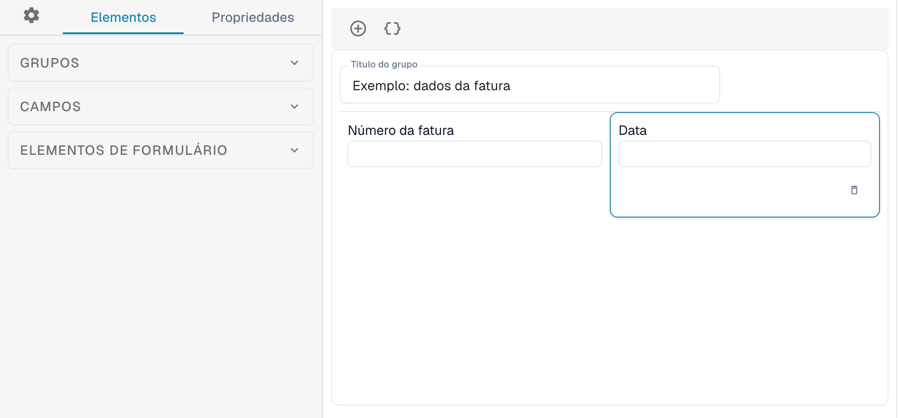
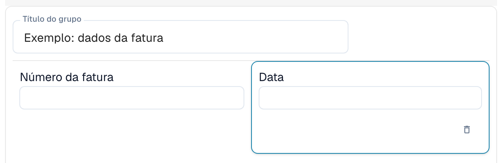
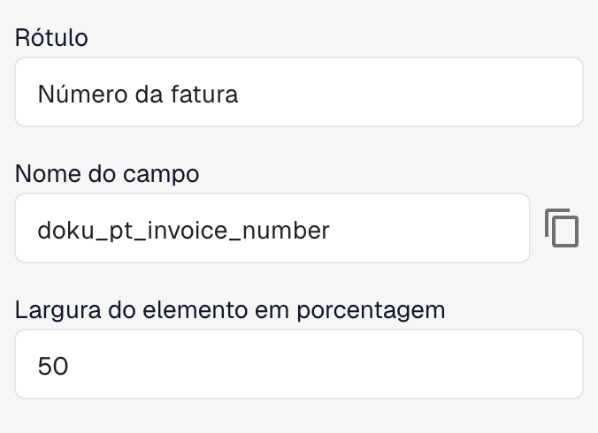

# Construtor de Layouts

Utilize o Construtor de Layouts para organizar os campos e os controlos apresentados durante a validação ou aprovação de um documento. Cada layout está associado a um tipo de documento, uma origem e um tipo de layout. Antes de guardar alterações, confirme qual é o layout aberto.

## Abrir o layout

1. Abra **Configurações → Tipos de documentos**.
2. Abra o Construtor de Layouts do tipo ou subtipo de documento pretendido. Se não estiver disponível, poderá ser necessário que um administrador ative o módulo para a sua organização.
3. Confirme a origem selecionada na barra de ações e o tipo de editor indicado ao lado.

<figure><figcaption>
Vista parcial do editor: as secções Grupos, Campos e Elementos de formulário à esquerda e um exemplo simplificado de layout de fatura ao centro.
</figcaption></figure>

Ao mudar **Origem**, o DocBits pode criar um layout independente para essa origem. Confirme a origem antes de editar.

## Conhecer as áreas do editor

À esquerda pode alternar entre **Elementos**, **Propriedades** e a configuração geral, representada por uma roda dentada.

* O separador **Elementos** contém as secções **Grupos**, **Campos** e **Elementos de formulário**. Abra cada secção para consultar os grupos, campos e controlos disponíveis.
* A área central mostra os grupos e campos do layout. Os grupos permitem organizar campos relacionados.
* À direita encontra-se a vista do documento de exemplo, onde pode consultar o documento e ajustar o zoom.

Arraste um elemento da secção correspondente à esquerda para a área do layout para adicionar um grupo, um campo ou um controlo de formulário.

<figure><figcaption>
Os campos Número da fatura e Data do grupo de exemplo. Neste layout, cada campo ocupa 50 % da largura do grupo.
</figcaption></figure>

Configure os campos reutilizáveis em [Tipos de documentos](README.md). Os campos disponíveis dependem do tipo de documento selecionado e da respetiva configuração.

## Alterar as propriedades de um elemento

Selecione um grupo ou campo na área do layout e abra **Propriedades** à esquerda. As opções dependem do elemento selecionado e incluem, por exemplo, o rótulo, o nome técnico, a largura e o comportamento.

<figure><figcaption>
Propriedades do campo selecionado: o rótulo, o nome técnico e a largura do elemento em percentagem.
</figcaption></figure>

Nos campos predefinidos, o rótulo e o nome técnico podem não ser editáveis. Dependendo do tipo de elemento, também pode configurar o modo de apenas leitura, a visibilidade, a ordem de tabulação, listas de valores e a execução de um fluxo de trabalho ou script quando o valor mudar. As opções de grupos e campos são diferentes.

Confirme o resultado na área do layout depois de alterar as propriedades. A largura é introduzida como percentagem através de um controlo numérico; os grupos e os respetivos campos podem ter larguras diferentes. Consulte [Configurar propriedades dos campos](../../settings/global-settings/document-types/layout-manager/configuring-field-properties.md).

## Modelos e JSON

Além de guardar o layout, a barra de ações oferece funções para gerar um modelo, aplicar o layout predefinido aos layouts por origem, usar o modelo predefinido e editar JSON. A disponibilidade depende do editor aberto.

Gerar ou aplicar um modelo pode substituir o layout personalizado. Confirme primeiro o tipo de documento, a origem e o layout atual. **Editar JSON** destina-se à configuração avançada e exige conhecer o formato do modelo. A cópia da configuração está disponível dentro do diálogo JSON.

## Rever e guardar

Organize os grupos e os campos e confirme o resultado na área do layout. Quando estiver correto, utilize **Salvar** na barra de ações. Para layouts específicos de uma origem, consulte [Layouts de origem](origin-layouts.md).


As ilustrações utilizam um exemplo simplificado de layout de fatura. Os nomes dos campos e as opções disponíveis dependem da sua configuração.

