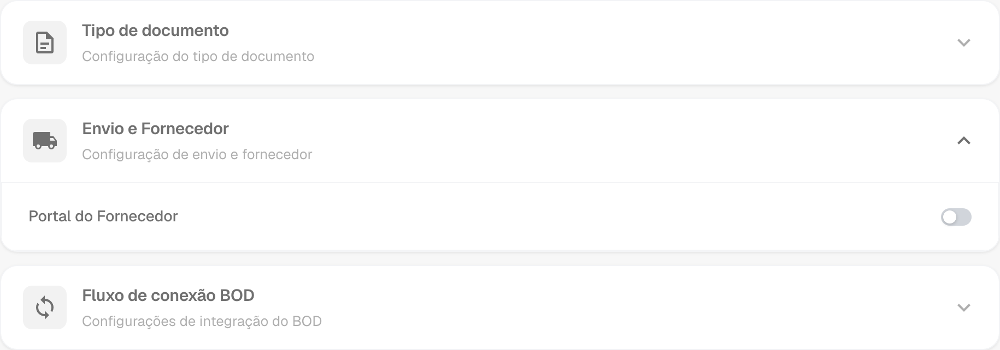
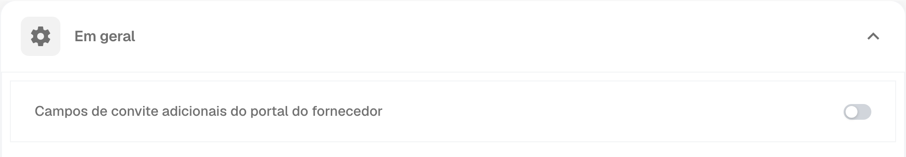
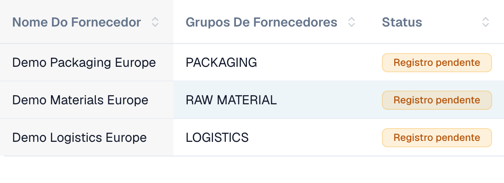
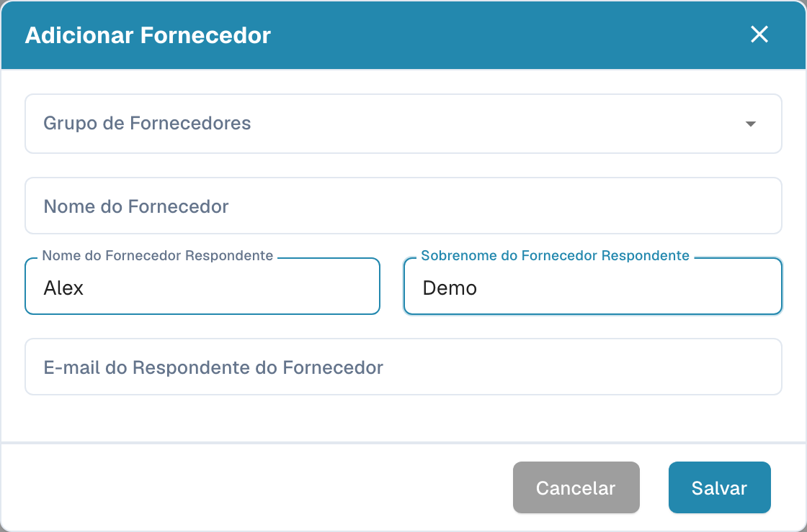

# Portal do Fornecedor

O **portal do fornecedor** permite que um administrador dê aos fornecedores da sua empresa acesso ao **DocBits**. O administrador ativa o portal e configura quais fornecedores podem utilizá-lo e quais informações podem consultar.

Um fornecedor convidado regista-se e inicia sessão com a sua própria conta. Pode então consultar as informações disponibilizadas, por exemplo o estado das suas encomendas de compra e faturas. As funcionalidades disponíveis dependem da configuração da organização.

## Vídeo: preparar o portal de fornecedores e o acesso

Um administrador fictício explica a opção do portal, a seleção do plano, a preparação de um convite e a página de registo. A ativação, o envio, o registo e a aprovação são explicados como passos separados.



[Abrir o vídeo com legendas em português e seleção de capítulos](https://docbits-videos.fra1.cdn.digitaloceanspaces.com/settings-assistant/supplier-portal-access-admin/v1/pt.html)

*A personagem e a voz são sintéticas. A interface pertence a uma organização de demonstração do DocBits.*

## Admin: ativar o portal

1. Nas configurações, abra os módulos e selecione **Integração de Documentos**.
2. Expanda **Envio e Fornecedor** e ative **Portal do Fornecedor**.
3. Se aparecer uma janela de ativação, verifique o plano apresentado e confirme a ativação pretendida.

<figure><figcaption>
Opção do portal no módulo de envios e fornecedores. Este interruptor ativa a função para a organização.
</figcaption></figure>

## Admin: configurar o portal

Configure o portal da sua organização antes de enviar os primeiros convites:

- [Configurações gerais de fornecedores](../../settings/supplier-setting/supplier-general-settings.md): Campos adicionais de convite, estados, logotipo e informações de privacidade.
- [Modelos de e-mail](../../settings/supplier-setting/editing-email-templates.md): Conteúdo e apresentação das mensagens de convite.
- [Layout de fornecedor](../../settings/supplier-setting/supplier-layout.md): Campos para o registro de fornecedores e a gestão interna. Selecione o tipo de layout adequado.
- [Permissões de fornecedores](../../settings/supplier-setting/supplier-permissions.md): Atribuição de funcionários internos a grupos de fornecedores. Estas responsabilidades internas são distintas do acesso próprio de cada fornecedor ao portal.

<figure><figcaption>
Configurações gerais de fornecedores com a opção de campos adicionais de convite.
</figcaption></figure>

## Admin: convidar fornecedores

Abra a gestão de fornecedores. Antes de enviar um convite, verifique a empresa, o grupo de fornecedores, a pessoa de contato e o e-mail. Ao criar um fornecedor, salvar solicita o envio do convite de registro; não apenas guarda um rascunho. Para um fornecedor existente, utilize a ação de convite correspondente. Uma confirmação de envio não comprova a entrega do e-mail nem a conclusão do registro.

<figure><figcaption>
Gestão interna de três empresas fictícias. Os três estados indicam aqui um registro pendente.
</figcaption></figure>

<figure><figcaption>
Formulário para criar e convidar um fornecedor. Verifique a empresa, o contato e o e-mail antes de salvar.
</figcaption></figure>

## Fornecedor: registrar-se e acessar o DocBits

O fornecedor abre o convite, cria ou utiliza a conta própria prevista e segue as etapas de registro configuradas. Em seguida, pode consultar as informações disponibilizadas no DocBits. O processo exato e as funções disponíveis dependem da organização.

[Guia de registro de fornecedores](supplier-registration.md).

## Compreender acesso e estados

Portal ativado, convite enviado, registro concluído e aprovação concedida são estados distintos. Uma ficha de fornecedor ou dados cadastrais salvos não comprovam que o acesso ao portal está pronto. A visão do fornecedor depende das permissões atribuídas e difere da visão interna do administrador.
