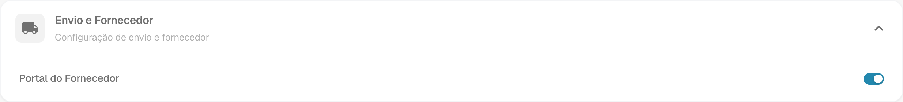
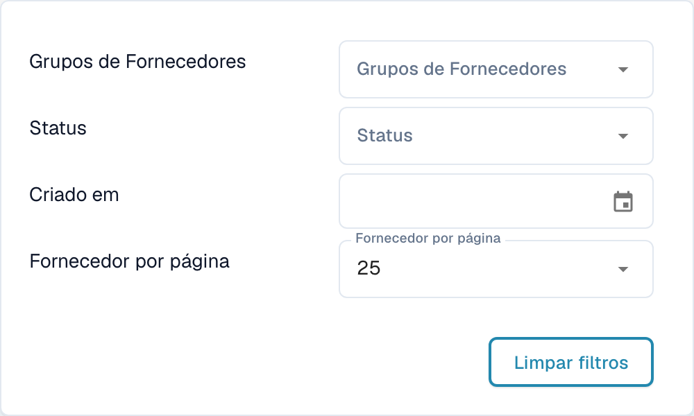
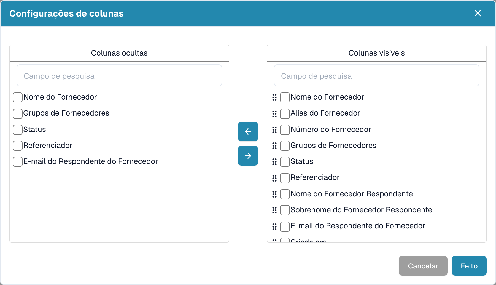
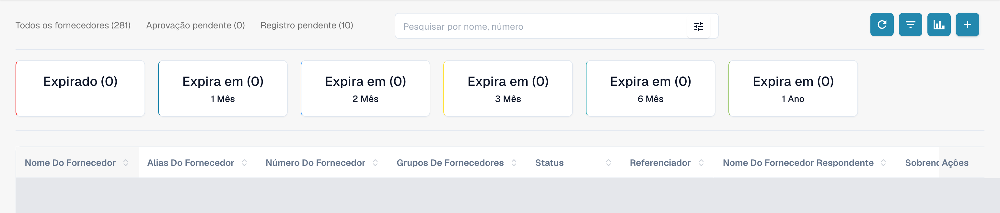
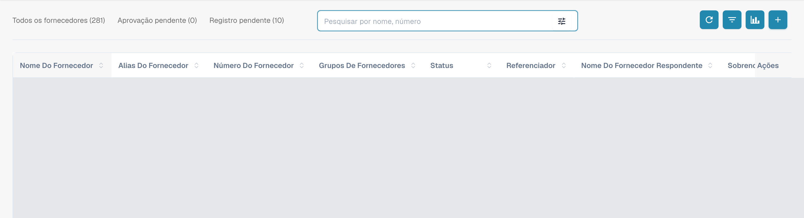
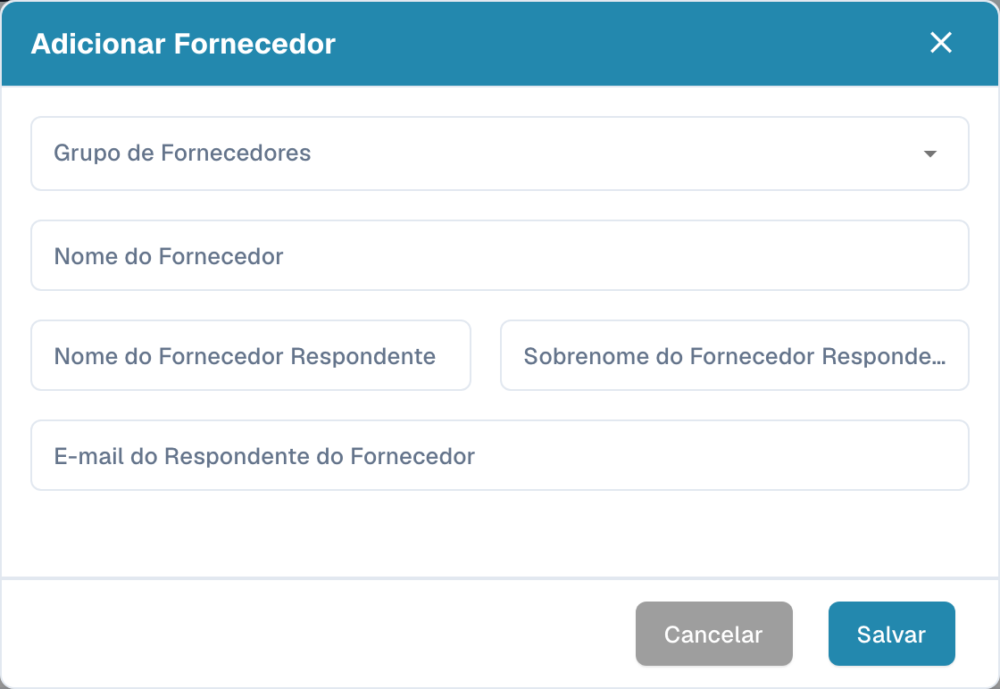

# Portal do Fornecedor

O **portal do fornecedor** permite que um administrador dê aos fornecedores da sua empresa acesso ao **DocBits**. O administrador ativa o portal e configura quais fornecedores podem utilizá-lo e quais informações podem consultar.

Um fornecedor convidado regista-se e inicia sessão com a sua própria conta. Pode então consultar as informações disponibilizadas, por exemplo o estado das suas encomendas de compra e faturas. As funcionalidades disponíveis dependem da configuração da organização.

## Vídeo: preparar o portal de fornecedores e o acesso

Um administrador explica a opção do portal, a seleção do plano, a preparação de um convite e a página de registo. A ativação, o envio, o registo e a aprovação são explicados como passos separados.



[Abrir o vídeo com legendas em português e seleção de capítulos](https://docbits-videos.fra1.cdn.digitaloceanspaces.com/settings-assistant/supplier-portal-access-admin/v1/pt.html)

## Admin: ativar o portal

1. Nas configurações, abra os módulos e selecione **Integração de Documentos**.
2. Expanda **Envio e Fornecedor** e ative **Portal do Fornecedor**.
3. Se aparecer uma janela de ativação, verifique o plano apresentado e confirme a ativação pretendida.

<figure><figcaption>
Vista real do Dev em português, Envio e Fornecedor: Portal do Fornecedor já está ativado nesta organização de teste. O interruptor não foi alterado para a captura.
</figcaption></figure>

## Admin: configurar o portal

Configure o portal da sua organização antes de enviar os primeiros convites:

- [Configurações gerais de fornecedores](../../settings/supplier-setting/supplier-general-settings.md): Campos adicionais de convite, estados, logotipo e informações de privacidade.
- [Modelos de e-mail](../../settings/supplier-setting/editing-email-templates.md): Conteúdo e apresentação das mensagens de convite.
- [Layout de fornecedor](../../settings/supplier-setting/supplier-layout.md): Campos para o registro de fornecedores e a gestão interna. Selecione o tipo de layout adequado.
- [Permissões de fornecedores](../../settings/supplier-setting/supplier-permissions.md): Atribuição de funcionários internos a grupos de fornecedores. Estas responsabilidades internas são distintas do acesso próprio de cada fornecedor ao portal.

<figure><figcaption>
Vista real de Campos de convite adicionais do portal do fornecedor: a opção já está ativada e Campos conserva o valor configurado Assigned User. Nenhuma alteração foi salva.
</figcaption></figure>

## Admin: pesquisar e filtrar fornecedores

Abra o **painel de fornecedores** para a gestão interna. Os contadores **Todos os fornecedores**, **Aprovação pendente** e **Registro pendente** permitem limitar a lista apresentada. O campo **Pesquisar por nome, número** serve para procurar um fornecedor pelo nome ou número.

Abra o botão de filtros no campo de pesquisa para usar **Grupos de Fornecedores**, **Status** e **Criado em**. **Fornecedor por página** define o tamanho da página; **Limpar filtros** remove os filtros de pesquisa ativos. Estes controlos dizem respeito à lista de fornecedores.

<figure><figcaption>
Menu de filtros com Grupos de Fornecedores, Status, Criado em, Fornecedor por página e Limpar filtros. A captura mostra os controlos disponíveis e não comprova um teste funcional dos resultados da filtragem.
</figcaption></figure>

## Admin: escolher as colunas visíveis

Junto ao botão de atualização, abra as configurações de colunas. A dica é **Definir colunas da tabela para organização**. Selecione campos em **Colunas ocultas** ou **Colunas visíveis** e mova-os entre as listas com as setas. As pegas de arrastar permitem mudar a ordem das colunas visíveis. **Feito** aplica a seleção à organização; **Cancelar** fecha a janela sem a aplicar. A deslocação horizontal permite aceder às colunas de uma tabela mais larga do que o ecrã.

<figure><figcaption>
Configurações de colunas com Colunas ocultas, Colunas visíveis, setas, Cancelar e Feito. A janela foi fechada com Cancelar sem alterar a seleção.
</figcaption></figure>

## Admin: analisar prazos de validade

Use **Análise**, o ícone de gráfico junto às configurações de colunas, para mostrar ou ocultar a visão dos prazos de validade. Os cartões mostram **Expirado** e **Expira em**, com os períodos **1 Mês**, **2 Mês**, **3 Mês**, **6 Mês** e **1 Ano**, conforme os rótulos da aplicação. Selecionar um cartão limita a lista ao período correspondente. Os contadores dizem respeito a prazos de validade associados aos fornecedores.

<figure><figcaption>
Análise mostra Expirado e Expira em para um, dois, três ou seis meses e um ano. As linhas estão cobertas e nenhum cartão foi selecionado.
</figcaption></figure>

## Admin: convidar fornecedores

Abra a gestão de fornecedores. Antes de enviar um convite, verifique a empresa, o grupo de fornecedores, a pessoa de contato e o e-mail. Ao criar um fornecedor, salvar solicita o envio do convite de registro; não apenas guarda um rascunho. Para um fornecedor existente, utilize a ação de convite correspondente. Uma confirmação de envio não comprova a entrega do e-mail nem a conclusão do registro.

<figure><figcaption>
Painel interno com Todos os fornecedores, Aprovação pendente, Registro pendente, pesquisa e barra de ferramentas. As linhas dos fornecedores existentes estão cobertas.
</figcaption></figure>

<figure><figcaption>
Formulário vazio Adicionar Fornecedor com Grupo de Fornecedores, Nome do Fornecedor, nome e sobrenome da pessoa de contato, e-mail, Cancelar e Salvar. O campo esquerdo é o nome e o direito o sobrenome; a aplicação abrevia aqui o rótulo longo do sobrenome. Salvar solicita o envio do convite de registro; para a captura foi usado apenas Cancelar.
</figcaption></figure>

## Admin: abrir os detalhes no painel de fornecedores

Os funcionários internos podem abrir os detalhes a partir da linha de um fornecedor no painel. A vista contém as mesmas seis secções preenchidas pelo fornecedor e o respetivo estado. Permite consultar e atualizar as informações enviadas e efetuar a aprovação correspondente. Nenhuma linha de fornecedor existente foi aberta para estas capturas.

## Fornecedor: registrar-se e acessar o DocBits

O fornecedor abre o convite, cria ou utiliza a conta própria prevista e segue as etapas de registro configuradas. Em seguida, pode consultar as informações disponibilizadas no DocBits. O processo exato e as funções disponíveis dependem da organização.

[Guia de registro de fornecedores](supplier-registration.md).

## Compreender acesso e estados

Portal ativado, convite enviado, registro concluído e aprovação concedida são estados distintos. Uma ficha de fornecedor ou dados cadastrais salvos não comprovam que o acesso ao portal está pronto. A visão do fornecedor depende das permissões atribuídas e difere da visão interna do administrador.

As capturas foram feitas com a conta de teste Dev autorizada e a interface em português. Foram verificadas as consultas de leitura da interface e das listas, os controlos visíveis e os formulários cancelados sem alterações. Não foram salvas configurações do portal nem seleções de colunas, não foram criados ou alterados fornecedores e não foram executados convites, registros ou aprovações. Os resultados de pesquisa e filtragem e a entrega de e-mail não estão confirmados como testados funcionalmente. O vídeo existente foi preservado; não foi feita uma nova avaliação do áudio, idioma ou sincronização.
