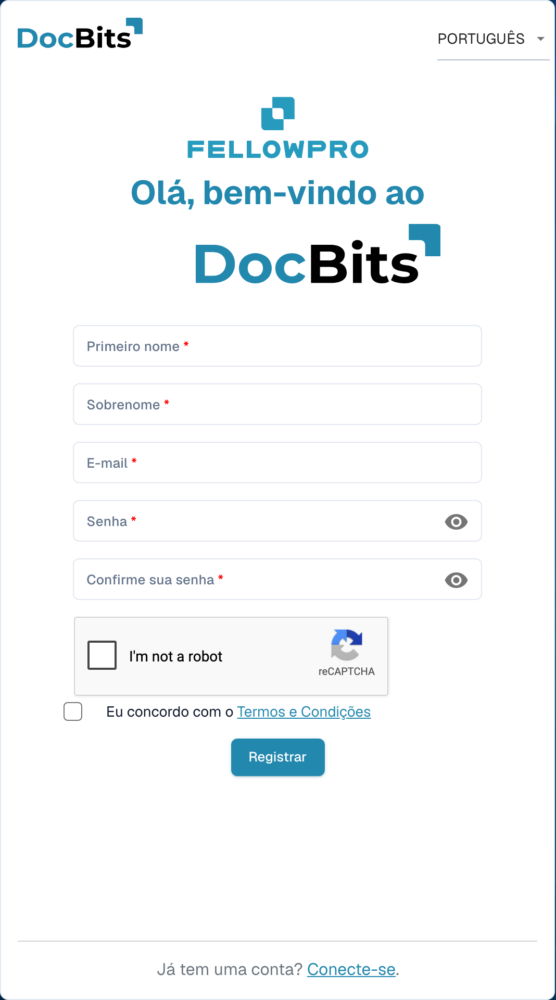

# Registro de fornecedores

Este guia destina-se a fornecedores convidados para o portal DocBits de uma organização. Utilize o link do seu convite. Você tem a sua própria conta de fornecedor; a organização que convida define as informações disponíveis e as etapas de registro necessárias.

## 1. Abrir o convite

Verifique qual organização enviou o convite e a que endereço de e-mail se destina. Abra o link de registro desse convite. Se tiver expirado ou for destinado a outra pessoa, solicite um novo convite à organização.

## 2. Configurar a sua conta

Confira o nome e o e-mail preenchidos previamente. Insira os dados solicitados e siga as regras de senha apresentadas. Leia os termos e as informações de privacidade. Conclua a criação da conta com a função de registro. Uma conta existente e um novo registro são situações diferentes; siga o processo previsto para o seu convite.

<figure><figcaption>
Formulário de registro da conta de fornecedor. O exemplo está vazio; um convite pode preencher previamente alguns dados.
</figcaption></figure>

## 3. Completar os dados do fornecedor

Complete os dados e eventuais documentos solicitados pela organização. Os campos e as seções dependem do layout de fornecedor configurado. As marcações e mensagens de validação indicam os dados obrigatórios. Salve o progresso se a tela oferecer essa opção; salvar não equivale automaticamente ao envio final.

## 4. Verificar o registro e a aprovação

Envie os dados por meio da ação de conclusão correspondente. Se houver uma revisão ou aprovação configurada, aguarde o resultado. Depois, entre com a sua própria conta. A organização define quais pedidos, faturas e outras informações você pode consultar.

## Se não conseguir acessar o portal

Entre em contato com a organização que enviou o convite se o link for inválido, faltarem permissões ou os dados obrigatórios não estiverem claros. Uma ficha interna de fornecedor não substitui o seu registro nem a aprovação de acesso necessária.

[Configuração do portal de fornecedores](README.md).
